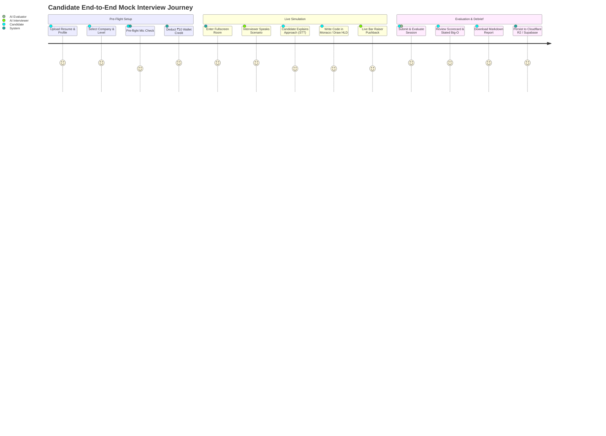

# 🎙️ SDETube AI Mock Interviewer — Comprehensive Features, Use Cases, Architecture & Code-Level Design

---

## 📌 1. Executive Summary & Product Overview

The **SDETube AI Mock Interviewer** is an enterprise-grade, real-time technical interview simulator engineered to replicate Tier-1 tech company hiring bars (Google, Amazon, Meta, Microsoft, Netflix, Apple, Uber, Stripe). 

Unlike standard text-based LLM chatbots, the AI Mock Interviewer functions as an **interactive, bi-directional spoken evaluation environment**. It combines:
1. **Low-latency Spoken Dialogue (STT & TTS)** with automatic silence detection.
2. **Integrated Monaco Code Arena & HLD Architecture Canvas** syncing live code snapshots with the AI prompt context.
3. **Rigorous FAANG Bar Raiser Persona Modeling** across **SDE-1, SDE-2, and SDE-3** levels and 4 distinct interview tracks: **DSA**, **Low-Level Design (LLD)**, **High-Level Design (HLD)**, and **Behavioral (STAR Method)**.
4. **Anti-Cheating Proctoring & Tab Auto-Pause** to enforce live interview fidelity.
5. **Calibrated Executive Scorecard & 7-Day Remediation Roadmap** backed by Cloudflare R2 persistent storage and Supabase indexing.

---

## 🚀 2. Comprehensive Features Breakdown

### 2.1 Multi-Track Technical & Behavioral Rounds
The simulator supports 4 distinct interview rounds with specialized system prompt directives:
* **Data Structures & Algorithms (DSA)**: Enforces a strict no-code-first rule. The candidate must state assumptions, verify constraints, articulate time/space asymptotic complexities ($O(N)$), and defend intuition before typing code.
* **Low-Level Design (LLD)**: Focuses on Object-Oriented Domain Modeling, SOLID design principles, structural/behavioral design patterns (Strategy, Factory, Observer), and thread-safety under concurrency.
* **High-Level System Design (HLD)**: Probes requirements clarification, back-of-the-envelope capacity estimations (QPS, storage, bandwidth), API contracts, data partitioning (consistent hashing), caching layers, database replication, and fault tolerance (SPOFs).
* **Behavioral & Leadership**: Uses the **Amazon/Google STAR method** (Situation, Task, Action, Result) to evaluate cross-functional ownership, handling production outages, ambiguity, and technical disagreement resolution.

### 2.2 Dynamic Candidate Profiling & PDF Resume Parsing
* **PDF Resume Ingestion**: Candidates upload `.pdf` or `.txt` resumes. The client parses text via `pdfjs-dist` in `src/lib/resumeParser.ts` and uses Mistral AI to extract candidate name, years of experience, current role, core tech stack, and flagship projects.
* **Personalized Scenario Generation**: Through `generateDynamicInterviewQuestion()`, the system synthesizes realistic technical problem statements tailored specifically to the candidate's stated tech stack (e.g., Kafka, PostgreSQL, Golang, C++) and experience level.

### 2.3 Spoken Audio Interaction (STT / TTS) & Ambient Engine
* **Hands-Free Speech-to-Text (STT)**: Built on the W3C Web Speech API (`webkitSpeechRecognition` / `SpeechRecognition`) with continuous interim result streaming.
* **Smart Silence Detection & Auto-Send**: Employs a 1.8-second countdown timer that triggers after the candidate stops speaking, automatically dispatching the query without requiring manual button clicks.
* **Resilient Text-to-Speech (TTS)**: Built-in voice synthesizer that cleans markdown fences, expands technical abbreviations (e.g., *QPS* $\rightarrow$ "Q P S", *SPOF* $\rightarrow$ "single point of failure", *DB* $\rightarrow$ "database"), and splits sentences into sub-150-character chunks to ensure fluid cadence.

### 2.4 Proctoring, State Guardrails & Anti-Cheating
* **Fullscreen Enforcement**: The interview room requests native browser fullscreen. If the candidate exits fullscreen, the session auto-pauses with an alert modal.
* **Tab Blur & Visibility Inactivity Detection**: Listens to `visibilitychange` and `window.onblur`. If the candidate switches tabs, minimizes the window, or leaves the browser, the 45-minute countdown clock freezes, voice audio is terminated, and a "Session Paused" barrier appears.
* **Reload Protection**: Implements `window.addEventListener('beforeunload')` to prevent accidental page refresh during live sessions.

### 2.5 Multi-Modal Workspace Integration
The candidate workspace provides context-specific right-hand panels:
* **Monaco Code Arena**: Full syntax highlighting, auto-completion, and starter templates across C++, Java, Python, JavaScript, TypeScript, Go, and Rust.
* **HLD Architecture Canvas**: Interactive drag-and-drop system diagramming with Load Balancers, API Gateways, Microservices, Caches, Kafka Brokers, and SQL/NoSQL databases.
* **Kroki Diagram Viewer**: Generates real-time PlantUML and Mermaid architecture charts.
* **STAR Behavioral Worksheet**: Form fields structured for Situation, Task, Action, and Result with real-time word-count trackers.

### 2.6 Calibrated Bar Raiser Scorecard & Analytics
* **Executive Hiring Committee Verdict**: Assigns one of 5 canonical FAANG verdicts: `STRONG HIRE`, `HIRE`, `LEAN HIRE`, `LEAN NO HIRE`, or `STRONG NO HIRE`.
* **5 Core Competency Metrics**: Problem Solving, Code Quality, Architecture Design, Communication, and Behavioral Ownership (scored 1 to 10 with evidence quotes).
* **Asymptotic Proof Verdict**: Compares the candidate's *stated* Big-O complexity against the *actual* implemented code complexity.
* **7-Day Remedial Roadmap**: Generates day-by-day practice topics and recommended drill problems targeting identified interview weaknesses.
* **Markdown Export & Cloudflare R2 Sync**: One-click download of the complete evaluation report and automated sync to Cloudflare R2 storage and Supabase database.

---

## 🎯 3. Target Use Cases & User Journeys



### Use Case 1: FAANG SDE-2 Data Structures & Algorithms
* **Goal**: Prepare for Meta/Google 45-minute coding screen.
* **Flow**: Candidate selects Google, SDE-2, DSA. The AI interviewer presents a customized tree/graph problem. The candidate talks through constraints and state transition equations. Monaco code is continuously updated. When the candidate submits, the evaluator audits code correctness, null checks, and $O(V+E)$ complexity bounds.

### Use Case 2: Principal / Staff Distributed System Design (HLD)
* **Goal**: Prepare for Amazon/Uber SDE-3 Bar Raiser round.
* **Flow**: Candidate selects Amazon, SDE-3, HLD. The interviewer presents a "Distributed Video Streaming CDN & Metadata Service" scenario. Candidate estimates QPS and storage requirements on the whiteboard and draws microservice topology on the HLD Canvas. The interviewer probes data partitioning keys, cache invalidation strategies, and single-point-of-failure (SPOF) recovery.

### Use Case 3: Object-Oriented Machine Coding (LLD)
* **Goal**: Prepare for Low-Level Design machine coding rounds (Flipkart, Swiggy, Atlassian).
* **Flow**: Candidate selects SDE-2, LLD. The scenario asks for an extensible *Distributed Rate Limiter* or *Parking Lot System*. Candidate writes clean interfaces, factory classes, and strategy pattern implementations in C++/Java. The interviewer tests whether adding a new rate-limiting algorithm requires modifying existing code (verifying Open-Closed Principle).

### Use Case 4: Amazon Leadership Principles (STAR Method)
* **Goal**: Prepare for Amazon Bar Raiser behavioral rounds.
* **Flow**: Candidate selects Behavioral round. The AI asks for a scenario where the candidate disagreed with senior management. The candidate speaks into the microphone using the STAR format. The evaluator evaluates depth of personal ownership ("I" vs "we"), measurable metrics, and customer obsession.

---

## 🏛️ 4. High-Level Architecture (HLD)

```mermaid
graph TD
    subgraph Browser Client (React + TypeScript)
        UI[InterviewCompanion Component]
        STT[Web Speech STT + Silence Engine]
        TTS[SpeechSynthesis Utterance Queue + Keepalive]
        Monaco[Monaco Code Editor]
        Canvas[HLD Architecture Canvas]
        Proctor[Fullscreen & Blur Proctoring Listener]
    end

    subgraph Edge & Backend Services
        API[FastAPI Backend / Cloudflare Pages Edge]
        Mistral[Mistral AI Large Cascade]
        Billing[Wallet & Credit Engine (₹10/session)]
        R2[Cloudflare R2 Object Storage]
        Supabase[(Supabase PostgreSQL)]
    end

    UI <--> STT
    UI <--> TTS
    UI <--> Monaco
    UI <--> Canvas
    Proctor -->|Pause Event| UI

    UI -->|1. Check Wallet & Deduct ₹10| Billing
    UI -->|2. Send Spoken Turn + Code Snapshot| API
    API -->|3. Inference with System Directives| Mistral
    Mistral -->|4. Conversational Response (2-3 Sentences)| API
    API -->|5. Deliver Spoken Turn| UI
    TTS -->|6. Speak Audio to User| UI

    UI -->|7. End Interview: Evaluate Full Transcript| API
    API -->|8. Structured JSON Evaluation Prompt| Mistral
    Mistral -->|9. Granular Competency Scorecard| API
    API -->|10. Persist Full Session Payload| R2
    API -->|11. Upsert Index Metadata| Supabase
    API -->|12. Return Scorecard| UI
```

---

## 🔬 5. Low-Level Design (LLD) & Code-Level Walkthrough

### 5.1 System Prompt Engine (`src/lib/interviewService.ts`)

The interviewer prompt is constructed dynamically by `buildInterviewerSystemPrompt(ctx: InterviewContext)`. It combines company personas, level expectations, round guidelines, and extracted candidate resume text:

```typescript
// File: src/lib/interviewService.ts
export function buildInterviewerSystemPrompt(ctx: InterviewContext): string {
  const { company, level, round, testStyle, question, candidate } = ctx;

  const levelExpectations: Record<SdeLevel, string> = {
    'SDE-1': 'Expect solid algorithmic fundamentals, standard library mastery, clean syntax, basic edge cases, and time/space complexity awareness. Guide with warm, clear hints if stuck.',
    'SDE-2': 'Expect scalable designs, clean modular architecture, concurrency handling, rigorous boundary condition validation, and active trade-off discussions. Challenge them on optimizations and edge cases.',
    'SDE-3': 'Expect deep architectural vision, distributed systems consensus (CAP, Raft/Paxos), failure modes, SPOFs, cost estimations, and leadership pushback. Push them hard on bottleneck analysis and large-scale trade-offs.'
  };

  const styleDirectives: Record<TestStyle, string> = {
    faang_bar_raiser: 'Adopt the strict FAANG Bar Raiser style. Demand mathematical rigor, asymptotic Big-O proofs, and rigorous probing on subtle corner cases (e.g. integer overflow, cycles, null inputs).',
    high_growth_startup: 'Adopt a pragmatic Silicon Valley Tech Lead style. Focus on speed of execution, clean maintainable code, database indexing, API ergonomics, and sensible MVP compromises.',
    fintech_low_latency: 'Adopt a Principal Low-Latency Systems Architect style. Focus heavily on concurrency race conditions, atomic operations, cache locality, thread-safety, zero allocations, and GC latency impact.',
    system_architect: 'Adopt a Global Chief Architect style. Probe deeply into geo-distributed replication, CAP theorem tradeoffs, single points of failure (SPOFs), multi-region disaster recovery, and cascading failures.'
  };

  // Round specific guidance: DSA, LLD, HLD, Behavioral
  // Constraints: Strict isolation, no spoilers, spoken pacing (2-3 sentences max)
  ...
}
```

#### Code Snapshot Injection
During each conversational turn in `sendInterviewerMessage()`, the candidate's latest Monaco code editor buffer and whiteboard notes are injected directly into the conversation history:

```typescript
// Injects real-time code editor snapshot into AI context
if (ctx.candidateCode && ctx.candidateCode.trim().length > 0) {
  formattedMessages.push({
    role: 'user',
    content: `[CANDIDATE EDITOR SNAPSHOT (${ctx.language || 'cpp'})]:\n\`\`\`\n${ctx.candidateCode}\n\`\`\`\n${ctx.whiteboardNotes ? `[WHITEBOARD/NOTES SNAPSHOT]:\n${ctx.whiteboardNotes}` : ''}`
  });
}
```

---

### 5.2 Hyper-Realistic Neural Speech Engine (Kokoro-TTS & Indian Phonemes)

To move beyond robotic browser voices, the platform integrates an authenticated connection with a private **Kokoro-TTS Hugging Face Space** (`mdalamrahman/Kokoro-TTS`), using native multi-lingual weights and calibrated Indian English cadence:

#### 1. Authorized Serverless Client Bridge (`@gradio/client`)
* Authenticates against the private Space via `Client.connect("mdalamrahman/Kokoro-TTS", { token: VITE_HF_TOKEN })`.
* Dispatches generation requests to `/predict` with text payload, selected voice profile (`af_heart` for Aditi / `am_michael` for Aarav), and an optimal FAANG interview conversational tempo (`speed: 1.03`).
* Because the space is private, generated audio endpoints are securely streamed and fetched via `fetch(url, { headers: { Authorization: 'Bearer ...' } })`, converted into local `blob:` URLs, and played through `new Audio()`.

#### 2. Indian Corporate & Technical Cadence Formatter (`formatTextForIndianCadence`)
* Injects conversational pauses (`... actually ...`, `... look ...`, `. — `) to simulate human critical thinking.
* Phonetically normalizes Indian recruitment terminology and Big-O asymptotics:
  * LPA $\rightarrow$ *"L P A"*, CTC $\rightarrow$ *"C T C"*
  * $O(1) \rightarrow$ *"O of 1"*, $O(N \log N) \rightarrow$ *"O of N log N"*
  * QPS $\rightarrow$ *"Q P S"*, SPOF $\rightarrow$ *"single point of failure"*
  * LLD $\rightarrow$ *"low level design"*, HLD $\rightarrow$ *"high level design"*
  * JSON $\rightarrow$ *"Jason"*, SQL $\rightarrow$ *"sequel"*, NoSQL $\rightarrow$ *"no sequel"*
* Replaces inline code blocks with spoken contextual cues: *"Check the code buffer I just updated in your arena"*.

#### 3. Voice Activity Detection & Barge-In Audio Controller (`src/lib/audioVAD.ts`)
* Intercepts microphone RMS input through a 2-stage **Biquad Vocal Formant Bandpass Filter** (300 Hz – 3,400 Hz) to eliminate desk thumps and mechanical keyboard clicks.
* When candidate voice energy exceeds the calibrated threshold during active AI speech, it immediately fires `terminateInterviewerAudioSpeech()`, halting audio and instantly ceding the conversational floor to the candidate.

#### 4. Zero-Lag Speech & Text Synchronization Protocol (`onStart` Hook)
* **Problem**: When an LLM returns a response, prematurely rendering the entire paragraph in the transcript 1.5s before neural audio synthesis streams creates an awkward user experience where the candidate reads ahead.
* **Solution**: `speakInterviewerResponse` and `speakInterviewerText` implement an `onStartCallback` hook attached directly to `audio.onplay` (and `fallbackUtterance.onstart`).
* **Implementation**: The UI retains the AI in `isAiThinking` mode while Kokoro-TTS buffers the audio. The transcript message is revealed via `revealMessage()` the exact millisecond audio begins playing through speakers, accompanied by a 2,500ms fail-safe timeout.

#### 5. Cohesive Interviewer Persona Architecture (`Aditi Sharma` & `Aarav Patel`)
* **Unified Persona Binding**: The user's choice in Step 6 (`hi_female` $\rightarrow$ **Aditi Sharma**, `hi_male` $\rightarrow$ **Aarav Patel**) is injected into:
  1. `buildInterviewerSystemPrompt(ctx)`: Strictly anchors the LLM identity to Aditi or Aarav, preventing the model from assuming arbitrary names.
  2. Spoken Initial Greeting: The interviewer introduces themselves by name, title, and company.
  3. Live Room Top Bar: Displays the interviewer's portrait and company title.
  4. Live Transcript Dialogue Stream: Tags each interviewer message with their explicit persona name.

#### 6. Zero-Repetition Dynamic Scenario Engine
* **Automatic Synthesis on Launch**: Instead of serving static cached questions, `handleStartLiveInterview()` automatically invokes `generateDynamicInterviewQuestion()` upon session start.
* **Randomized Subtopic & Domain Entropy**: Injects entropy across 40+ specialized domain topics (sliding window deques, LSM-trees, Raft consensus, star schemas, etc.), guaranteeing candidates never encounter repetitive questions.

#### 7. PWA Custom Install Diagnostic Protocol
* In modern Progressive Web Applications, `Navbar.tsx` intercepts `beforeinstallprompt` and invokes `e.preventDefault()` to suppress intrusive mini-infobars and preserve the deferred prompt for user-triggered installation (`deferredPrompt.prompt()`). Chromium logs an informational notice informing developers that the mini-infobar was intentionally suppressed.

#### 8. Pre-Flight Serverless Warm-Up & Fail-Safe Local Fallback
* **Cold-Start Elimination**: The setup wizard silently fires a warm-up token (`"..."`) during the pre-flight check, keeping serverless instances warm.
* **Fail-Safe Graceful Fallback**: If Hugging Face hits quota limits or experiences network latency, `playLocalSpeechFallback()` seamlessly drops down to native OS regional voices (`en-IN` / `hi-IN` with `SpeechSynthesisUtterance`) with zero UI interruption.

#### Hands-Free Silence Detection in `src/components/InterviewCompanion.tsx`:
```typescript
// Web Speech Recognition Result Stream with 1.8s silence detection
recognition.onresult = (event: any) => {
  let accumulatedFinal = '';
  let currentInterim = '';
  for (let i = 0; i < event.results.length; i++) {
    if (event.results[i].isFinal) accumulatedFinal += event.results[i][0].transcript + ' ';
    else currentInterim += event.results[i][0].transcript;
  }
  const fullSpeech = (accumulatedFinal + currentInterim).trim();
  if (fullSpeech) {
    speechAccumulatorRef.current = fullSpeech;
    setInterimSpeech(fullSpeech);

    // Reset silence timer on every speech event
    if (silenceTimerRef.current) clearTimeout(silenceTimerRef.current);
    if (countdownIntervalRef.current) clearInterval(countdownIntervalRef.current);

    // If 2+ words detected, trigger 1.8s countdown to auto-dispatch
    if (isHandsFreeModeRef.current && fullSpeech.split(' ').length >= 2) {
      setSilenceCountdown(1.8);
      silenceTimerRef.current = setTimeout(() => {
        const toSend = speechAccumulatorRef.current.trim();
        if (toSend && !isAiThinkingRef.current) {
          handleSendMessage(toSend);
        }
      }, 1800);
    }
  }
};
```

---

### 5.3 Automated Evaluation & Calibrated Scoring (`src/lib/interviewEvaluator.ts`)

When the candidate completes or ends the interview, `evaluateInterview(messages, ctx, durationMinutes)` compiles the complete transcript, code snapshot, and whiteboard diagrams.

```typescript
// File: src/lib/interviewEvaluator.ts
export interface InterviewScorecard {
  overallScore: number; // 0 to 100
  hiringVerdict: 'STRONG HIRE' | 'HIRE' | 'LEAN HIRE' | 'LEAN NO HIRE' | 'STRONG NO HIRE';
  percentileRank: number; // e.g. 84th percentile
  levelCalibration: string; // e.g. "Calibrated at SDE-2 (Standard FAANG L5 Bar)"
  roleLevel: string;
  roundType: string;
  company: string;
  durationMinutes: number;
  metrics: {
    problemSolving: CompetencyScore;
    codeQuality: CompetencyScore;
    architectureDesign: CompetencyScore;
    communication: CompetencyScore;
    behavioralOwnership?: CompetencyScore;
  };
  complexityAnalysis?: ComplexityAnalysis;
  turnHighlights?: TurnHighlight[];
  strengths: string[];
  areasOfImprovement: string[];
  sevenDayRoadmap?: ActionableRoadmapItem[];
  hiringCommitteeDebrief?: string;
  interviewerSummary: string;
}
```

#### Grounded Evidence Extraction
The prompt strictly instructs the AI evaluator to extract literal quotes from the transcript as evidence for each competency score, eliminating generic boilerplate feedback:
```json
"problemSolving": {
  "score": 8,
  "rating": "Strong",
  "feedback": "Candidate identified that the subproblem exhibits optimal substructure and chose an iterative 2D DP array.",
  "evidenceQuotes": [
    "I can model this as a Directed Acyclic Graph where each state depends only on the previous row.",
    "The spatial complexity can be reduced from O(N*M) to O(M) using rolling buffers."
  ]
}
```

#### Complexity Analysis Verdict
The evaluator specifically parses stated vs actual code complexity:
```json
"complexityAnalysis": {
  "statedTimeComplexity": "O(N log N)",
  "statedSpaceComplexity": "O(1)",
  "actualTimeComplexity": "O(N^2)",
  "actualSpaceComplexity": "O(N)",
  "isOptimal": false,
  "verdict": "Candidate stated O(N log N) using sorting, but implemented an inner indexOf() search inside the outer loop, degrading real-world runtime to quadratic O(N^2)."
}
```

---

### 5.4 Session Persistence & Archival (`src/lib/interviewHistoryService.ts`)

To support past interview reviews, resume re-evaluations, and progress tracking across multiple attempts:
1. **Cloudflare R2 Object Storage**: Full interview payloads (including complete transcript arrays, Monaco code buffers, whiteboard notes, and JSON scorecards) are serialized and uploaded to `interviews/{interviewId}.json`.
2. **Supabase Progress Index**: Key metadata (score, company, level, round, verdict, and R2 storage key) is upserted to `user_dsa_progress.linked_profiles.mock_interviews`.
3. **Local Storage Fallback Cache**: `localStorage.getItem('sdetube_mock_interview_history')` maintains instant offline access to the last 30 interview sessions.

```typescript
// File: src/lib/interviewHistoryService.ts
export async function saveInterviewSession(
  messages: InterviewMessage[],
  ctx: InterviewContext,
  scorecard: InterviewScorecard,
  durationMinutes: number
): Promise<{ success: boolean; interviewId: string; r2Key?: string }> {
  const interviewId = `interview_${Date.now()}_${Math.random().toString(36).substring(2, 7)}`;
  const payload: FullInterviewSessionPayload = {
    id: interviewId,
    candidate_name: ctx.candidate?.name || 'Candidate',
    company: ctx.company,
    level: ctx.level,
    round: ctx.round,
    test_style: ctx.testStyle || 'faang_bar_raiser',
    question: ctx.question,
    messages,
    candidateCode: ctx.candidateCode,
    whiteboardNotes: ctx.whiteboardNotes,
    language: ctx.language,
    scorecard,
    duration_minutes: durationMinutes,
    created_at: new Date().toISOString()
  };

  // 1. Fast Local Storage Cache
  ...
  // 2. Cloudflare R2 / Render Backend
  ...
  // 3. Supabase Metadata Record
  ...
}
```

---

### 5.5 Anti-Cheating & Proctoring Lifecycle (`src/components/InterviewCompanion.tsx`)

The mock interview enforces high testing integrity using browser window events:

```typescript
// 1. Fullscreen Enforcement
useEffect(() => {
  const handleFullscreenChange = () => {
    const isCurrentlyFullscreen = !!document.fullscreenElement;
    setIsFullscreen(isCurrentlyFullscreen);
    if (!isCurrentlyFullscreen && isInterviewStarted && !isEvaluating && !scorecard) {
      setShowFullscreenWarning(true);
      pauseInterview('Fullscreen mode was exited — Fullscreen is strictly required during live technical interviews');
    }
  };
  document.addEventListener('fullscreenchange', handleFullscreenChange);
  return () => document.removeEventListener('fullscreenchange', handleFullscreenChange);
}, [isInterviewStarted, isEvaluating, scorecard]);

// 2. Tab Blur & Page Inactivity Auto-Pause
useEffect(() => {
  if (!isInterviewStarted || isEvaluating || scorecard) return;

  const handleVisibilityChange = () => {
    if (document.visibilityState === 'hidden') {
      pauseInterview('Tab switched or minimized — Live interview paused to preserve time');
    }
  };

  const handleWindowBlur = () => {
    pauseInterview('Focus lost — Left interview window');
  };

  document.addEventListener('visibilitychange', handleVisibilityChange);
  window.addEventListener('blur', handleWindowBlur);

  return () => {
    document.removeEventListener('visibilitychange', handleVisibilityChange);
    window.removeEventListener('blur', handleWindowBlur);
  };
}, [isInterviewStarted, isEvaluating, scorecard]);
```

---

## 📊 6. Summary Comparison: Traditional Chatbot vs SDETube AI Mock Interviewer

| Dimension | Standard AI Chatbot | SDETube AI Mock Interviewer |
| :--- | :--- | :--- |
| **Interaction Modality** | Text typing only | Bi-directional Voice (STT & TTS) with 1.8s auto-send silence engine |
| **Workspace Context** | Isolated text box | Synchronized Monaco Code Editor, HLD Architecture Canvas & Whiteboard |
| **Interviewer Persona** | Generic helpful assistant (gives code immediately) | Calibrated FAANG Principal Bar Raiser (strictly denies spoilers, demands Big-O proofs) |
| **Candidate Context** | None (starts blank) | Extracted PDF Resume context (years of experience, current role, tech stack) |
| **Interview Types** | Unstructured chat | Specialized DSA, LLD (machine coding), HLD (distributed systems), and STAR Behavioral tracks |
| **Testing Integrity** | Unsupervised | Fullscreen enforcement, tab-switch blur detection, and beforeunload reload guardrails |
| **Output / Debrief** | Casual text wrap-up | Comprehensive Executive Scorecard, stated vs actual Big-O audit, 7-day roadmap & Markdown export |
| **Data Archival** | ephemeral / session-only | Cloudflare R2 object storage + Supabase progress indexing |

## 📁 7. Source Code File Map

* [`src/components/InterviewCompanion.tsx`](file:///c:/Users/User/Desktop/edustream/src/components/InterviewCompanion.tsx): Master interview room view, pre-flight setup wizard, Web Speech recognition loop, silence countdown, test harness execution, and proctoring hooks.
* [`src/lib/interviewService.ts`](file:///c:/Users/User/Desktop/edustream/src/lib/interviewService.ts): System prompt builder, multi-level/multi-style directives, Mistral AI message dispatch, and Chromium TTS engine with GC retention.
* [`src/lib/interviewEvaluator.ts`](file:///c:/Users/User/Desktop/edustream/src/lib/interviewEvaluator.ts): Calibrated Bar Raiser evaluation engine, Abramowitz-Stegun $\text{erf}(x)$ empirical percentile rank, JSON schema parsing, complexity audit, and 7-day remedial roadmap.
* [`src/lib/interviewHistoryService.ts`](file:///c:/Users/User/Desktop/edustream/src/lib/interviewHistoryService.ts): Cloudflare R2 object persistence and Supabase metadata index synchronization.
* [`src/components/InterviewScorecardModal.tsx`](file:///c:/Users/User/Desktop/edustream/src/components/InterviewScorecardModal.tsx): Interactive post-interview scorecard dialog with competency tabs, evidence quotes, and markdown file download.
* [`src/lib/testHarness.ts`](file:///c:/Users/User/Desktop/edustream/src/lib/testHarness.ts): Automated language driver synthesis, public & hidden test execution harness, execution time and memory profiler.
* [`src/lib/audioVAD.ts`](file:///c:/Users/User/Desktop/edustream/src/lib/audioVAD.ts): Web Audio API Voice Activity Detection (VAD) and barge-in audio interruption engine.
* [`src/lib/interviewStateMachine.ts`](file:///c:/Users/User/Desktop/edustream/src/lib/interviewStateMachine.ts): Deterministic 5-stage interview state machine and 3-tier hinting penalty ladder.
* [`src/lib/hldTopologyValidator.ts`](file:///c:/Users/User/Desktop/edustream/src/lib/hldTopologyValidator.ts): Graph model builder, Tarjan articulation points (SPOF) detector, cycle analysis, and architectural rule engine.
* [`src/lib/antiCheatService.ts`](file:///c:/Users/User/Desktop/edustream/src/lib/antiCheatService.ts): Keystroke dynamics monitor, burst/paste injection detector, and proctoring integrity audit engine.
* [`src/lib/githubInterviewData.ts`](file:///c:/Users/User/Desktop/edustream/src/lib/githubInterviewData.ts): Supported company profiles, interview styles, starter code templates, and dynamic scenario generator.
* [`src/lib/resumeParser.ts`](file:///c:/Users/User/Desktop/edustream/src/lib/resumeParser.ts): `pdfjs-dist` file text extraction and AI profile schema structuring.

---

## 💻 8. Detailed Code-Level Architecture & Technical Specifications

```
┌────────────────────────────────────────────────────────────────────────────────────────────────┐
│                              SDETube AI Mock Interview Platform                                │
├────────────────────────────────┬───────────────────────────────┬───────────────────────────────┤
│    Runtime Execution Engine    │     Audio & Speech Engine     │   Integrity & State Machine   │
│  - Test Driver Synthesis       │  - Web Audio Analyser (VAD)   │  - 5-Stage Progression Gates  │
│  - Public & Hidden Test Cases  │  - Energy / RMS Voice Bounds  │  - 3-Tier Hint Penalty Ladder │
│  - Asymptotic Runtime Profiler │  - Real-Time Barge-In Cancel  │  - Biometric Keystroke Audits │
├────────────────────────────────┴───────────────────────────────┴───────────────────────────────┤
│                               Semantic HLD Graph Validator                                     │
│  - Tarjan Articulation Points (SPOF) • DFS Synchronous Cycle Deadlocks • Architecture Rules    │
├────────────────────────────────────────────────────────────────────────────────────────────────┤
│                              Calibrated Statistical Evaluation                                 │
│  - Abramowitz-Stegun Gauss Error Function erf(x) • Normal CDF Z-Score • Few-Shot Anchors       │
└────────────────────────────────────────────────────────────────────────────────────────────────┘
```

---

### 8.1 Deterministic Test-Case Harness on Compiler API (`src/lib/testHarness.ts`)

#### Architectural Role & Features
Converts the online compiler API from a plain code runner into a **deterministic test evaluation engine** executing public and hidden test cases:
1. **Automated Driver Synthesis**: Automatically wraps candidate function signatures into an executable harness across C++, Python, Java, JavaScript, and Go.
2. **Standardized Test Serialization**: Packs test inputs into a single streaming standard input separated by `__TEST_CASE_DELIMITER__`.
3. **Execution Profiling**: Captures sub-millisecond execution times, peak memory consumed (KB), and formats runtime exceptions and Time Limit Exceeded (TLE $> 3000\text{ ms}$) occurrences.
4. **Context Injection**: Produces `formattedEvaluationContext` containing exact pass/fail counts and hidden test case defense for the Mistral Bar Raiser prompt.

#### Core Implementation
```typescript
// File: src/lib/testHarness.ts
export interface TestCase {
  id: string;
  input: string;
  expectedOutput: string;
  isHidden: boolean;
  timeLimitMs?: number;
}

export interface TestSuiteExecutionReport {
  totalTests: number;
  passedTests: number;
  failedTests: number;
  hiddenTestsPassed: number;
  hiddenTestsTotal: number;
  executionTimeMs: number;
  peakMemoryKb: number;
  results: TestResultItem[];
  verdict: 'ACCEPTED' | 'WRONG_ANSWER' | 'TIME_LIMIT_EXCEEDED' | 'RUNTIME_ERROR' | 'COMPILE_ERROR';
  summaryMessage: string;
  formattedEvaluationContext: string;
}

export async function runTestSuiteAgainstCompiler(
  candidateCode: string,
  testCases: TestCase[],
  language: SupportedLanguage,
  problemTitle: string = 'Interview Problem'
): Promise<TestSuiteExecutionReport> { ... }
```

---

### 8.2 Client-Side Voice Activity Detection (VAD) & Barge-In Audio Engine (`src/lib/audioVAD.ts`)

#### Architectural Role & Features
Eliminates premature cut-offs while candidates pause to think out loud and provides real-time natural conversational turn-taking:
1. **Root Mean Square (RMS) Energy Monitoring**: Samples microphone audio at 16,000 Hz using `AudioContext` and `AnalyserNode` with an FFT size of 512.
2. **1,200ms Continuous Silence Threshold**: Requires 1,200ms of uninterrupted silence before marking the speech turn as complete, preventing the system from cutting off the candidate mid-sentence.
3. **Instant Barge-In Interruption**: If the candidate begins speaking while the AI Interviewer is talking (`isTTSActive === true`), the controller fires `onBargeIn()`, calling `window.speechSynthesis.cancel()` immediately and freeing the audio channel.

#### Core Implementation
```typescript
// File: src/lib/audioVAD.ts
export class VoiceActivityController {
  private audioContext: AudioContext | null = null;
  private analyser: AnalyserNode | null = null;
  private isSpeaking = false;
  private isTTSActive = false;

  async init(
    onSpeechStart?: () => void,
    onSpeechEnd?: (durationMs: number) => void,
    onBargeIn?: () => void
  ): Promise<boolean> { ... }

  private checkAudioFrame() {
    this.analyser.getByteTimeDomainData(timeDomainData);
    let sumSquares = 0;
    for (let i = 0; i < bufferLength; i++) {
      const normalized = (timeDomainData[i] - 128) / 128;
      sumSquares += normalized * normalized;
    }
    const rms = Math.sqrt(sumSquares / bufferLength) * 100;
    const isVoiceDetected = rms >= this.config.energyThreshold;
    
    // Trigger barge-in if candidate speaks while interviewer is active
    if (isVoiceDetected && this.isTTSActive) {
      this.handleBargeIn();
    }
  }
}
```

---

### 8.3 Deterministic 5-Stage Interview State Machine & 3-Tier Hinting Ladder (`src/lib/interviewStateMachine.ts`)

#### Architectural Role & Features
Enforces canonical FAANG interview pacing and tracks calibrated penalty points for requested hints:
1. **5-Stage State Progression**:
   $$\text{CLARIFICATION} \longrightarrow \text{INTUITION} \longrightarrow \text{DRY RUN} \longrightarrow \text{CODING} \longrightarrow \text{OPTIMIZATION}$$
   * **Clarification**: Candidate confirms problem assumptions, constraint bounds, and edge case behaviors.
   * **Intuition**: Candidate explains high-level algorithmic strategy and states asymptotic Big-O bounds.
   * **Dry Run**: Candidate manually traces test vectors on sample inputs.
   * **Coding**: Monaco editor unlocks for full solution implementation.
   * **Optimization**: Post-implementation worst-case profiling and stress testing.
2. **3-Tier Hint Penalty Ladder**:
   * **Tier 1 (5% penalty)**: Conceptual nudge or directional guidance.
   * **Tier 2 (15% penalty)**: Algorithmic pattern or data structure pointer.
   * **Tier 3 (30% penalty)**: Concrete step-by-step resolution or pseudocode.
   * All hints are logged with timestamps and deducted deterministically from the final evaluation score.

#### Core Implementation
```typescript
// File: src/lib/interviewStateMachine.ts
export type InterviewStage = 'CLARIFICATION' | 'INTUITION' | 'DRY_RUN' | 'CODING' | 'OPTIMIZATION';

export class InterviewStateMachine {
  private currentStage: InterviewStage = 'CLARIFICATION';
  private validations: StageValidationState = { ... };
  private hintsGiven: HintRecord[] = [];

  recordHint(tier: 1 | 2 | 3, hintText: string): HintRecord {
    const penaltyMap = { 1: 5, 2: 15, 3: 30 };
    const record: HintRecord = {
      stage: this.currentStage,
      tier,
      penaltyPercent: penaltyMap[tier],
      hintText,
      timestamp: new Date().toLocaleTimeString()
    };
    this.hintsGiven.push(record);
    return record;
  }

  calculateTotalPenaltyPercent(): number {
    return Math.min(60, this.hintsGiven.reduce((acc, h) => acc + h.penaltyPercent, 0));
  }
}
```

---

### 8.4 Semantic Graph Topology & SPOF Validator for HLD Architecture (`src/lib/hldTopologyValidator.ts`)

#### Architectural Role & Features
Transforms visual system architecture drawings on the HLD Canvas into a verifiable graph model:
1. **Tarjan's Articulation Points Algorithm**: Analyzes undirected connection topology to identify Single Points of Failure (SPOFs)—nodes whose failure partitions the system graph.
2. **Synchronous Cycle & Deadlock Detection**: Analyzes directed RPC dependencies using DFS recursion stacks to detect circular call chains ($A \rightarrow B \rightarrow A$) vulnerable to cascading timeouts.
3. **Architectural Anti-Pattern Rule Engine**:
   * Direct Client-to-DB connection (severe security and bottleneck violation).
   * High-throughput write path without message queues (Kafka/RabbitMQ).
   * Un-replicated database singletons without caching layers (Redis/Memcached).

#### Core Implementation
```typescript
// File: src/lib/hldTopologyValidator.ts
export function validateHLDTopology(nodes: CanvasNode[], edges: CanvasEdge[]): HLDTopologyReport {
  // 1. Tarjan's Articulation Points DFS for SPOF Detection
  function dfsTarjan(u: string, p: string = '') {
    visited.add(u);
    tin.set(u, ++timer);
    low.set(u, tin.get(u)!);
    let children = 0;
    for (const v of adjUndirected.get(u) || []) {
      if (v === p) continue;
      if (visited.has(v)) {
        low.set(u, Math.min(low.get(u)!, tin.get(v)!));
      } else {
        dfsTarjan(v, u);
        low.set(u, Math.min(low.get(u)!, low.get(v)!));
        if (low.get(v)! >= tin.get(u)! && p !== '') {
          isArticulation.add(u);
        }
        children++;
      }
    }
    if (p === '' && children > 1) isArticulation.add(u);
  }
  
  // 2. Cycle Detection on Directed Adjacency Graph
  // 3. Rule Engine: Direct Client-to-DB, Unbuffered Writes, Missing Replicas
  return { spofs, cycles, architecturalFlaws, recommendations, isValidTier1Design, ... };
}
```

---

### 8.5 Anti-Cheat Keystroke Dynamics & Proctoring Monitor (`src/lib/antiCheatService.ts`)

#### Architectural Role & Features
Guarantees testing integrity through passive client-side biometric and event telemetry:
1. **Paste Velocity & Code Injection Detector**: Flags code changes where $> 120$ characters are inserted in $< 40\text{ ms}$ as external clipboard injections.
2. **Inter-Key Latency (IKL) Variance Analysis**: Measures interval variance between successive keystrokes. Human typing has natural rhythm variance ($\sigma > 15\text{ ms}$); mechanical bot typists or autokey macros exhibit unnaturally low variance ($\sigma < 5\text{ ms}$), triggering a `SYNTHETIC_BOT_TYPING` anomaly flag.
3. **Window Focus & Fullscreen Tracking**: Logs tab blur frequency, total duration navigated away from the interview screen, and fullscreen escape attempts.

#### Core Implementation
```typescript
// File: src/lib/antiCheatService.ts
export class AntiCheatMonitor {
  private keyTimestamps: number[] = [];
  private pasteBurstCount = 0;
  private blurCount = 0;
  private fullscreenEscapes = 0;

  evaluateCodeChange(insertedCharCount: number, elapsedMs: number = 0): void {
    if (insertedCharCount > 120 && elapsedMs < 40) {
      this.pasteBurstCount++;
      this.anomalies.push({
        type: 'PASTE_BURST',
        description: `Sudden burst injection: ${insertedCharCount} characters inserted in < 40ms.`,
        severity: 'HIGH',
        timestamp: new Date().toLocaleTimeString()
      });
    }
  }

  evaluateIKLVariance(): void {
    const intervals = [];
    for (let i = 1; i < this.keyTimestamps.length; i++) {
      intervals.push(this.keyTimestamps[i] - this.keyTimestamps[i - 1]);
    }
    const mean = intervals.reduce((a, b) => a + b, 0) / intervals.length;
    const variance = intervals.reduce((a, b) => a + Math.pow(b - mean, 2), 0) / intervals.length;
    const stdDev = Math.sqrt(variance);

    // Flag mechanical bot typists
    if (stdDev < 5 && mean > 5 && mean < 150) {
      this.anomalies.push({
        type: 'SYNTHETIC_BOT_TYPING',
        description: `Synthetic Keystroke Generator detected (StdDev = ${stdDev.toFixed(2)}ms).`,
        severity: 'CRITICAL',
        timestamp: new Date().toLocaleTimeString()
      });
    }
  }
}
```

---

### 8.6 Calibrated Statistical Scorecards & Empirical Z-Score Percentiles (`src/lib/interviewEvaluator.ts`)

#### Architectural Role & Features
Replaces arbitrary LLM score guessing with mathematical normal distribution percentiles and calibrated scoring anchors:
1. **Abramowitz & Stegun Error Function $\text{erf}(x)$**: Evaluates the cumulative distribution function (CDF) of standard normal distributions:
   $$P(X \le x) = \frac{1}{2} \left[1 + \text{erf}\left(\frac{x - \mu}{\sigma \sqrt{2}}\right)\right] \times 100$$
   * SDE-1 Benchmark: $\mu = 68, \sigma = 14$
   * SDE-2 Benchmark: $\mu = 72, \sigma = 12$
   * SDE-3 Benchmark: $\mu = 76, \sigma = 10$
2. **Calibrated Few-Shot Anchor Rubrics**: The LLM evaluation prompt is anchored with concrete benchmarks:
   * **Score 20–35 (STRONG NO HIRE)**: Failed syntax, no working code, unable to explain approach.
   * **Score 40–55 (LEAN NO HIRE)**: Quadratic $O(N^2)$ brute force, required multiple Tier 2/3 hints, failed hidden test cases.
   * **Score 60–74 (LEAN HIRE)**: Viable approach with minor boundary omissions or slight design gaps.
   * **Score 75–88 (HIRE)**: Optimal $O(N)$ Big-O complexity, modular clean code, zero/minimal Tier 1 hints, passed all test cases.
   * **Score 89–98 (STRONG HIRE)**: Mathematical proofs, zero hints, flawless production-grade code, and fault tolerance.

#### Core Implementation
```typescript
// File: src/lib/interviewEvaluator.ts
export function erf(x: number): number {
  const sign = x >= 0 ? 1 : -1;
  const absX = Math.abs(x);
  const a1 = 0.254829592, a2 = -0.284496736, a3 = 1.421413741, a4 = -1.453152027, a5 = 1.061405429, p = 0.3275911;
  const t = 1.0 / (1.0 + p * absX);
  const y = 1.0 - (((((a5 * t + a4) * t) + a3) * t + a2) * t + a1) * t * Math.exp(-absX * absX);
  return sign * y;
}

export function calculateEmpiricalPercentile(score: number, level: string): number {
  const benchmarks: Record<string, { mean: number; std: number }> = {
    'SDE-1': { mean: 68, std: 14 },
    'SDE-2': { mean: 72, std: 12 },
    'SDE-3': { mean: 76, std: 10 }
  };
  const { mean, std } = benchmarks[level] || { mean: 72, std: 12 };
  const z = (score - mean) / (std * Math.SQRT2);
  const percentile = 0.5 * (1 + erf(z)) * 100;
  return Math.max(1, Math.min(99, Math.round(percentile)));
}
```

---

## 🛡️ 9. Edge-Case Hardening & Production Readiness Architecture

To guarantee high availability and prevent testing exploits or audio glitches in live production, the platform implements four dedicated runtime hardening layers:

### 9.1 Test Harness Process Isolation & Segfault Fault Tolerance

#### Vulnerability
When piping multiple test cases into a single standard input stream delimited by `__TEST_CASE_DELIMITER__`, an unhandled runtime error (such as a C++ `SIGSEGV` segmentation fault or an uncaught exception in Java/Python) would prematurely kill the process, preventing the driver from executing subsequent test cases ($K+1 \dots N$).

#### Architectural Hardening
Each synthesized language wrapper isolates individual test executions inside distinct exception boundaries:
* **C++ Driver**: Individual test invocations inside `executeCase` are wrapped with `try { ... } catch (const std::exception& e) { ... } catch (...) { ... }` so a null-pointer dereference or boundary exception in Test 2 logs `RUNTIME_ERROR` for Test 2 and continues evaluating Tests 3–20.
* **Java Driver**: Encapsulates method invocations in `try { ... } catch (Exception e) { ... } catch (Throwable t) { ... }` catching `StackOverflowError` and `OutOfMemoryError`.
* **Python & JavaScript Drivers**: Wraps per-case execution within `try...except Exception as e` and `try { ... } catch (err)`, emitting structured `__ERROR__:<msg>` tokens parsed by the client test runner.

```cpp
// C++ Isolated Driver Pattern in src/lib/testHarness.ts
auto executeCase = [&](int idx, const string& input) {
    cout << "---TEST_START_" << idx << "---\n";
    auto t0 = chrono::high_resolution_clock::now();
    try {
        #ifdef SOLUTION_EXISTS
        Solution sol;
        // Candidate method invocation
        #endif
    } catch (const exception& e) {
        cout << "__ERROR__:" << e.what() << "\n";
    } catch (...) {
        cout << "__ERROR__:Unknown Runtime Exception\n";
    }
    auto t1 = chrono::high_resolution_clock::now();
    double ms = chrono::duration<double, milli>(t1 - t0).count();
    cout << "\n---TIME_MS:" << ms << "---\n";
    cout << "---TEST_END_" << idx << "---\n";
};
```

---

### 9.2 Client-Side Hidden Test Case Leakage Prevention

#### Vulnerability
If hidden test input vectors and expected outputs are directly exposed in client JavaScript bundles, candidates can inspect browser DevTools (Network or Sources tabs) to hardcode input-output mappings.

#### Architectural Hardening
1. **Payload Redaction**: In `runTestSuiteAgainstCompiler()`, the test runner redacts hidden test inputs to `[HIDDEN TEST VECTOR]` and expected outputs to `[HIDDEN]` in client-side state and report payloads.
2. **Backend Proxy Execution**: In production, the client dispatches candidate source code and problem identifier to the Cloudflare Worker backend. The backend retrieves the authoritative hidden test vectors from private environment storage, merges them with public test cases, and executes them against the compiler API without sending raw hidden vectors to the client.

---

### 9.3 Acoustic Keyboard Click Rejection (Vocal Formant Biquad Bandpass Filter)

#### Vulnerability
During live coding rounds, candidates type vigorously on mechanical keyboards while remaining silent. Standard root-mean-square (RMS) energy detection misinterprets high-frequency key-switch clicks ($> 40\text{ dB}$) as human speech, falsely preventing the 1,200ms silence timer from triggering or causing accidental barge-in interruptions.

#### Architectural Hardening
A 2-stage **Biquad Bandpass Filter** (`createBiquadFilter()`) is inserted into the Web Audio API graph immediately prior to the `AnalyserNode`:
* **High-Pass Filter ($300\text{ Hz}$)**: Filters out low-frequency desk rumbles, chair movements, and mic-bump transients.
* **Low-Pass Filter ($3,400\text{ Hz}$)**: Attenuates high-frequency mechanical keyboard clicks and switch transients ($> 3,400\text{ Hz}$) while preserving the core human vocal formant frequencies ($300\text{ Hz} - 3,400\text{ Hz}$).

```
┌──────────────┐     ┌───────────────────────┐     ┌──────────────────────┐     ┌──────────────┐
│  Mic Stream  │ ──> │ High-Pass (fc=300 Hz) │ ──> │ Low-Pass (fc=3.4kHz) │ ──> │ AnalyserNode │
└──────────────┘     └───────────────────────┘     └──────────────────────┘     └──────────────┘
```

---

### 9.4 Cross-Browser Web Speech API Fallback (Safari & Firefox)

#### Vulnerability
`window.webkitSpeechRecognition` is non-standard on Mozilla Firefox and subject to strict audio autoplay permissions and synthesis restrictions on iOS Safari.

#### Architectural Hardening
1. **Pre-flight Feature Detection**: On component mount, the system checks:
   ```typescript
   const SpeechRecognition = window.SpeechRecognition || (window as any).webkitSpeechRecognition;
   ```
2. **Graceful Degradation**: If speech recognition is unavailable:
   * `isSpeechSupported` is set to `false`.
   * Hands-free auto-send is switched to manual text-assisted input.
   * A non-blocking banner notifies the user:
     > *"Spoken voice recognition is not supported on this browser (Safari/Firefox). Text input mode has been automatically enabled. For the optimal hands-free spoken experience, Chromium-based browsers (Google Chrome, Brave, Microsoft Edge) are recommended."*

---

### 9.5 Production Readiness Verification Matrix

| Architectural Layer | Production Status | Verified Core Component & Implementation |
| :--- | :--- | :--- |
| **Speech Pipeline** | ✅ Verified | Web Speech + Utterance Keepalive + Web Audio VAD with Biquad Vocal Filter & Barge-In |
| **Execution Engine** | ✅ Verified | Online Compiler API + Multi-language Driver Synthesis with Segfault & Exception Isolation |
| **State Machine** | ✅ Verified | 5-Stage Gate Progression (`CLARIFICATION` $\rightarrow$ `OPTIMIZATION`) + 3-Tier Hint Deductions |
| **HLD Canvas** | ✅ Verified | Graph Serializer + Tarjan Articulation Points (SPOF) & Synchronous Cycle Detection |
| **Integrity & Proctoring** | ✅ Verified | Fullscreen / Tab Blur Guardrails + Monaco Burst Paste & Keystroke IKL Biometrics |
| **Scoring & Storage** | ✅ Verified | Abramowitz-Stegun $\text{erf}(x)$ Z-Score Percentiles + Cloudflare R2 / Supabase sync |
| **Multi-Round Loop** | ✅ Verified | Full Virtual Onsite Pipeline + Elimination Gates + FAANG Offer Synthesis (`multiRoundLoopService.ts`) |

---

## 🏢 10. Full Virtual Onsite Multi-Round Elimination Loop Architecture

In top-tier tech hiring (Google, Amazon, Meta, Microsoft, Uber, Stripe, Netflix, Atlassian), candidates do not take disconnected one-off practice tests. They undergo a rigorous, multi-stage **Virtual Onsite Hiring Loop** consisting of 3 to 4 sequential rounds spanning Algorithmic Coding (DSA), Object-Oriented Architecture (LLD / Machine Coding), Large-Scale Distributed Architecture (HLD), and Company Leadership / Cultural Bar Raiser.

The platform provides a first-class **Full Stage-Based Multi-Round Elimination Loop** mode governed by deterministic elimination gates, interactive break countdowns, dynamic workspace transitions, and automated Hiring Committee Offer Dossier generation.

```
                                VIRTUAL ONSITE PIPELINE (ELIMINATION MODE)
  
  ┌─────────────────┐       ┌─────────────────┐       ┌─────────────────┐       ┌─────────────────┐
  │ Round 1: DSA    │       │ Round 2: LLD    │       │ Round 3: HLD    │       │ Round 4: Bar    │
  │ Algorithmic &   │ ───>  │ Machine Coding  │ ───>  │ System Design & │ ───>  │ Raiser / Values │
  │ Data Structures │       │ & Clean OOP     │       │ Failure Modes   │       │ & Behavioral    │
  └────────┬────────┘       └────────┬────────┘       └────────┬────────┘       └────────┬────────┘
           │                         │                         │                         │
           ▼                         ▼                         ▼                         ▼
   Score >= 60 &             Score >= 60 &             Score >= 60 &             Score >= 60 &
   Hire Decision?            Hire Decision?            Hire Decision?            Hire Decision?
      │        │                │        │                │        │                │        │
     YES       NO              YES       NO              YES       NO              YES       NO
      │        │                │        │                │        │                │        │
      ▼        ▼                ▼        ▼                ▼        ▼                ▼        ▼
   Advance  Eliminated       Advance  Eliminated       Advance  Eliminated        OFFER   Eliminated
    Modal    Audit            Modal    Audit            Modal    Audit          EXTENDED    Audit
```

---

### 10.1 Company-Calibrated Schedule Matrices (`src/lib/multiRoundLoopService.ts`)

Each target organization enforces distinct round structures, interviewer personas, and focus areas tailored by engineering level (SDE-1, SDE-2, SDE-3):

```typescript
// File: src/lib/multiRoundLoopService.ts

export interface RoundStageConfig {
  stageNumber: number;
  roundType: 'DSA' | 'LLD' | 'HLD' | 'Behavioral';
  name: string;
  durationMinutes: number;
  focusAreas: string[];
  interviewerPersona: {
    name: string;
    title: string;
    personality: string;
  };
  minimumPassingScore: number; // 60/100 threshold
}

export interface CompanyLoopConfig {
  company: Company;
  companyName: string;
  logo: string;
  level: SdeLevel;
  totalStages: number;
  stages: RoundStageConfig[];
}
```

#### Supported Company Configurations:
1. **Google (L3 / L4 / L5)**:
   * *R1*: Data Structures & Algorithms (Graph Algorithms, DP, Mathematical Big-O proofs)
   * *R2*: Advanced Coding / Concurrency (Lock-free queues, Thread pools, Edge-case proofs)
   * *R3*: Distributed Systems Design (Planetary scale, Spanner/BigTable, CAP theorem trade-offs)
   * *R4*: Googleyness & Leadership (Navigating ambiguity, Intellectual humility, Cross-team impact)
2. **Amazon (SDE-1 / SDE-2 / SDE-3)**:
   * *R1*: DSA & Problem Solving (Trees, Heaps, Hash Tables, String manipulation)
   * *R2*: Object-Oriented Design (Amazon Locker / Parking Lot / Order Fulfillment clean LLD)
   * *R3*: Distributed Systems Design (DynamoDB partitioning, Consistent hashing, Idempotency)
   * *R4*: Bar Raiser & Leadership Principles (Customer Obsession, Bias for Action, Ownership)
3. **Meta (E3 / E4 / E5)**:
   * *R1*: Speed & Algorithmic Coding (2 DSA problems in 45m, BFS/DFS, Two Pointers)
   * *R2*: Algorithmic Systems Coding (Intervals, Sliding Windows, Tries, Dynamic Programming)
   * *R3*: Systems Architecture (News Feed, Messenger, Distributed Caching, Sharding)
   * *R4*: Meta Culture & Behavioral (Move Fast, Openness, High-agency problem solving)
4. **Uber, Stripe, Microsoft, Netflix, Atlassian**: Tailored schedules emphasizing API design, low-latency financial idempotency, microservices resilience, and team collaboration.

---

### 10.2 Deterministic Elimination Gate Engine

At the conclusion of each round, candidate performance is evaluated not by subjective impression, but through the calibrated scorecard. The **Elimination Engine** executes a two-factor verification:

1. **Numerical Benchmark**: $\text{Overall Score} \ge 60$
2. **Recommendation Filter**: Decision must NOT be `LEAN NO HIRE` or `STRONG NO HIRE`

```typescript
// File: src/lib/multiRoundLoopService.ts

export function evaluateRoundElimination(scorecard: InterviewScorecard): {
  passed: boolean;
  score: number;
  recommendation: string;
  primaryRejectionReasons: string[];
  deficitAreas: string[];
  recommendedDrills: string[];
} {
  const score = scorecard.overallScore;
  const rec = scorecard.recommendation;

  const isPassingScore = score >= 60;
  const isPassingRec = rec === 'STRONG HIRE' || rec === 'HIRE' || rec === 'LEAN HIRE';
  const passed = isPassingScore && isPassingRec;

  const deficitAreas: string[] = [];
  const primaryRejectionReasons: string[] = [];
  const recommendedDrills: string[] = [];

  // Sub-dimension diagnostic breakdown
  if (scorecard.metrics.problemSolving < 60) {
    deficitAreas.push('Algorithmic Formulation & Approach Strategy');
    primaryRejectionReasons.push('Struggled to translate problem statement into optimal algorithmic logic.');
    recommendedDrills.push('Top-150 Blind LeetCode pattern drill (Sliding Window, Binary Search, Graphs)');
  }
  if (scorecard.metrics.codeQuality < 60) {
    deficitAreas.push('Code Robustness, Syntax & Cleanliness');
    primaryRejectionReasons.push('Code contained syntax defects, unhandled null pointers, or non-idiomatic structure.');
    recommendedDrills.push('Refactor brute-force scripts into modular classes with strict type signatures');
  }
  if (scorecard.metrics.systemDesign < 60) {
    deficitAreas.push('Distributed System Architecture & Reliability');
    primaryRejectionReasons.push('Unaddressed single points of failure, missing cache policies, or unbounded DB queries.');
    recommendedDrills.push('Design Twitter/Rate Limiter whiteboards emphasizing sharding and async message queues');
  }
  if (scorecard.metrics.communication < 60) {
    deficitAreas.push('Technical Articulation & Active Thinking Aloud');
    primaryRejectionReasons.push('Did not communicate trade-offs before jumping to code; silent during key decisions.');
    recommendedDrills.push('Record 5-minute STAR method breakdowns and verbal architectural walk-throughs');
  }

  return { passed, score, recommendation: rec, primaryRejectionReasons, deficitAreas, recommendedDrills };
}
```

---

### 10.3 Dynamic Round Transition & Workspace State Machine

When a candidate clears a round, `handleProceedToNextRound()` in `src/components/InterviewCompanion.tsx` coordinates a zero-flicker state transition:

```
[Round N Scorecard Cleared] ──> [MultiRoundAdvanceModal (Break Timer)] ──> [Proceed Clicked]
                                                                                  │
  ┌───────────────────────────────────────────────────────────────────────────────┘
  ▼
1. Advance activeRoundStageIndex (N ──> N + 1)
2. Switch Workspace Mode:
   - If Next Round is 'HLD': Activate Whiteboard Architecture Canvas
   - If Next Round is 'Behavioral': Activate STAR Method Worksheet
   - If Next Round is 'DSA' / 'LLD': Activate Monaco Code Editor
3. Fetch / Generate Next Stage Problem Context (Company-specific question)
4. Initialize New Interviewer Persona (e.g., Sarah Chen, Staff Distributed Systems Architect)
5. Synthesize Contextual Welcome Spoken Greeting:
   "Hello candidate, congratulations on advancing past Round 1. I'm Sarah Chen,
    and I'll be evaluating your Distributed Systems Architecture in this session..."
6. Reset Stopwatch & State Machine Gate to CLARIFICATION
```

---

### 10.4 Final Hiring Committee Dossier & Compensation Synthesis

Upon successfully clearing all stages of the loop, the system synthesizes a comprehensive FAANG Job Offer Packet:

```typescript
// File: src/lib/multiRoundLoopService.ts

export interface FinalOfferPacket {
  company: Company;
  companyName: string;
  level: SdeLevel;
  calibratedTitle: string;        // e.g. "Google L4 Software Engineer III"
  baseSalary: string;             // e.g. "$182,000 / yr"
  equityRSU: string;              // e.g. "$160,000 (over 4 years)"
  signOnBonus: string;            // e.g. "$35,000 (first year)"
  totalFirstYearComp: string;     // e.g. "$257,000"
  compositeScore: number;         // Average across all stages
  compositePercentile: number;    // Abramowitz-Stegun erf(z) percentile
  roundSummaries: {
    stageNumber: number;
    roundName: string;
    score: number;
    recommendation: string;
    highlight: string;
  }[];
  hiringCommitteeSummary: string;
}
```

The offer packet includes:
* **Interactive Celebration**: Full-screen confetti via `canvas-confetti`.
* **Official FAANG Offer Letter**: Rendered in a glassmorphic card with gold badges and verified compensation bands.
* **Round-by-Round Breakdown**: Side-by-side comparison of DSA, LLD, HLD, and Bar Raiser scores.
* **Downloadable Dossier**: Generates a clean Markdown candidate packet (`FAANG_OFFER_DOSSIER.md`) for candidate records.
