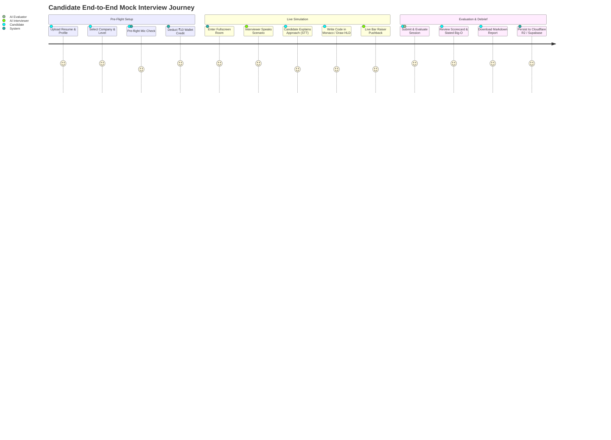

# 🎙️ SDETube AI Mock Interviewer — Comprehensive Features, Use Cases, Architecture & Code-Level Design

---

## 📌 1. Executive Summary & Product Overview

The **SDETube AI Mock Interviewer** is an enterprise-grade, real-time technical interview simulator engineered to replicate Tier-1 tech company hiring bars (Google, Amazon, Meta, Microsoft, Netflix, Apple, Uber, Stripe). 

Unlike standard text-based LLM chatbots, the AI Mock Interviewer functions as an **interactive, bi-directional spoken evaluation environment**. It combines:
1. **Low-latency Spoken Dialogue (STT & TTS)** with automatic silence detection.
2. **Integrated Monaco Code Arena & HLD Architecture Canvas** syncing live code snapshots with the AI prompt context.
3. **Rigorous FAANG Bar Raiser Persona Modeling** across **SDE-1, SDE-2, and SDE-3** levels and 4 distinct interview tracks: **DSA**, **Low-Level Design (LLD)**, **High-Level Design (HLD)**, and **Behavioral (STAR Method)**.
4. **Anti-Cheating Proctoring & Tab Auto-Pause** to enforce live interview fidelity.
5. **Calibrated Executive Scorecard & 7-Day Remediation Roadmap** backed by Cloudflare R2 persistent storage and Supabase indexing.

---

## 🚀 2. Comprehensive Features Breakdown

### 2.1 Multi-Track Technical & Behavioral Rounds
The simulator supports 4 distinct interview rounds with specialized system prompt directives:
* **Data Structures & Algorithms (DSA)**: Enforces a strict no-code-first rule. The candidate must state assumptions, verify constraints, articulate time/space asymptotic complexities ($O(N)$), and defend intuition before typing code.
* **Low-Level Design (LLD)**: Focuses on Object-Oriented Domain Modeling, SOLID design principles, structural/behavioral design patterns (Strategy, Factory, Observer), and thread-safety under concurrency.
* **High-Level System Design (HLD)**: Probes requirements clarification, back-of-the-envelope capacity estimations (QPS, storage, bandwidth), API contracts, data partitioning (consistent hashing), caching layers, database replication, and fault tolerance (SPOFs).
* **Behavioral & Leadership**: Uses the **Amazon/Google STAR method** (Situation, Task, Action, Result) to evaluate cross-functional ownership, handling production outages, ambiguity, and technical disagreement resolution.

### 2.2 Dynamic Candidate Profiling & PDF Resume Parsing
* **PDF Resume Ingestion**: Candidates upload `.pdf` or `.txt` resumes. The client parses text via `pdfjs-dist` in `src/lib/resumeParser.ts` and uses Mistral AI to extract candidate name, years of experience, current role, core tech stack, and flagship projects.
* **Personalized Scenario Generation**: Through `generateDynamicInterviewQuestion()`, the system synthesizes realistic technical problem statements tailored specifically to the candidate's stated tech stack (e.g., Kafka, PostgreSQL, Golang, C++) and experience level.

### 2.3 Spoken Audio Interaction (STT / TTS) & Ambient Engine
* **Hands-Free Speech-to-Text (STT)**: Built on the W3C Web Speech API (`webkitSpeechRecognition` / `SpeechRecognition`) with continuous interim result streaming.
* **Smart Silence Detection & Auto-Send**: Employs a 1.8-second countdown timer that triggers after the candidate stops speaking, automatically dispatching the query without requiring manual button clicks.
* **Resilient Text-to-Speech (TTS)**: Built-in voice synthesizer that cleans markdown fences, expands technical abbreviations (e.g., *QPS* $\rightarrow$ "Q P S", *SPOF* $\rightarrow$ "single point of failure", *DB* $\rightarrow$ "database"), and splits sentences into sub-150-character chunks to ensure fluid cadence.

### 2.4 Proctoring, State Guardrails & Anti-Cheating
* **Fullscreen Enforcement**: The interview room requests native browser fullscreen. If the candidate exits fullscreen, the session auto-pauses with an alert modal.
* **Tab Blur & Visibility Inactivity Detection**: Listens to `visibilitychange` and `window.onblur`. If the candidate switches tabs, minimizes the window, or leaves the browser, the 45-minute countdown clock freezes, voice audio is terminated, and a "Session Paused" barrier appears.
* **Reload Protection**: Implements `window.addEventListener('beforeunload')` to prevent accidental page refresh during live sessions.

### 2.5 Multi-Modal Workspace Integration
The candidate workspace provides context-specific right-hand panels:
* **Monaco Code Arena**: Full syntax highlighting, auto-completion, and starter templates across C++, Java, Python, JavaScript, TypeScript, Go, and Rust.
* **HLD Architecture Canvas**: Interactive drag-and-drop system diagramming with Load Balancers, API Gateways, Microservices, Caches, Kafka Brokers, and SQL/NoSQL databases.
* **Kroki Diagram Viewer**: Generates real-time PlantUML and Mermaid architecture charts.
* **STAR Behavioral Worksheet**: Form fields structured for Situation, Task, Action, and Result with real-time word-count trackers.

### 2.6 Calibrated Bar Raiser Scorecard & Analytics
* **Executive Hiring Committee Verdict**: Assigns one of 5 canonical FAANG verdicts: `STRONG HIRE`, `HIRE`, `LEAN HIRE`, `LEAN NO HIRE`, or `STRONG NO HIRE`.
* **5 Core Competency Metrics**: Problem Solving, Code Quality, Architecture Design, Communication, and Behavioral Ownership (scored 1 to 10 with evidence quotes).
* **Asymptotic Proof Verdict**: Compares the candidate's *stated* Big-O complexity against the *actual* implemented code complexity.
* **7-Day Remedial Roadmap**: Generates day-by-day practice topics and recommended drill problems targeting identified interview weaknesses.
* **Markdown Export & Cloudflare R2 Sync**: One-click download of the complete evaluation report and automated sync to Cloudflare R2 storage and Supabase database.

---

## 🎯 3. Target Use Cases & User Journeys



### Use Case 1: FAANG SDE-2 Data Structures & Algorithms
* **Goal**: Prepare for Meta/Google 45-minute coding screen.
* **Flow**: Candidate selects Google, SDE-2, DSA. The AI interviewer presents a customized tree/graph problem. The candidate talks through constraints and state transition equations. Monaco code is continuously updated. When the candidate submits, the evaluator audits code correctness, null checks, and $O(V+E)$ complexity bounds.

### Use Case 2: Principal / Staff Distributed System Design (HLD)
* **Goal**: Prepare for Amazon/Uber SDE-3 Bar Raiser round.
* **Flow**: Candidate selects Amazon, SDE-3, HLD. The interviewer presents a "Distributed Video Streaming CDN & Metadata Service" scenario. Candidate estimates QPS and storage requirements on the whiteboard and draws microservice topology on the HLD Canvas. The interviewer probes data partitioning keys, cache invalidation strategies, and single-point-of-failure (SPOF) recovery.

### Use Case 3: Object-Oriented Machine Coding (LLD)
* **Goal**: Prepare for Low-Level Design machine coding rounds (Flipkart, Swiggy, Atlassian).
* **Flow**: Candidate selects SDE-2, LLD. The scenario asks for an extensible *Distributed Rate Limiter* or *Parking Lot System*. Candidate writes clean interfaces, factory classes, and strategy pattern implementations in C++/Java. The interviewer tests whether adding a new rate-limiting algorithm requires modifying existing code (verifying Open-Closed Principle).

### Use Case 4: Amazon Leadership Principles (STAR Method)
* **Goal**: Prepare for Amazon Bar Raiser behavioral rounds.
* **Flow**: Candidate selects Behavioral round. The AI asks for a scenario where the candidate disagreed with senior management. The candidate speaks into the microphone using the STAR format. The evaluator evaluates depth of personal ownership ("I" vs "we"), measurable metrics, and customer obsession.

---

## 🏛️ 4. High-Level Architecture (HLD)

```mermaid
graph TD
    subgraph Browser Client (React + TypeScript)
        UI[InterviewCompanion Component]
        STT[Web Speech STT + Silence Engine]
        TTS[SpeechSynthesis Utterance Queue + Keepalive]
        Monaco[Monaco Code Editor]
        Canvas[HLD Architecture Canvas]
        Proctor[Fullscreen & Blur Proctoring Listener]
    end

    subgraph Edge & Backend Services
        API[FastAPI Backend / Cloudflare Pages Edge]
        Mistral[Mistral AI Large Cascade]
        Billing[Wallet & Credit Engine (₹10/session)]
        R2[Cloudflare R2 Object Storage]
        Supabase[(Supabase PostgreSQL)]
    end

    UI <--> STT
    UI <--> TTS
    UI <--> Monaco
    UI <--> Canvas
    Proctor -->|Pause Event| UI

    UI -->|1. Check Wallet & Deduct ₹10| Billing
    UI -->|2. Send Spoken Turn + Code Snapshot| API
    API -->|3. Inference with System Directives| Mistral
    Mistral -->|4. Conversational Response (2-3 Sentences)| API
    API -->|5. Deliver Spoken Turn| UI
    TTS -->|6. Speak Audio to User| UI

    UI -->|7. End Interview: Evaluate Full Transcript| API
    API -->|8. Structured JSON Evaluation Prompt| Mistral
    Mistral -->|9. Granular Competency Scorecard| API
    API -->|10. Persist Full Session Payload| R2
    API -->|11. Upsert Index Metadata| Supabase
    API -->|12. Return Scorecard| UI
```

---

## 🔬 5. Low-Level Design (LLD) & Code-Level Walkthrough

### 5.1 System Prompt Engine (`src/lib/interviewService.ts`)

The interviewer prompt is constructed dynamically by `buildInterviewerSystemPrompt(ctx: InterviewContext)`. It combines company personas, level expectations, round guidelines, and extracted candidate resume text:

```typescript
// File: src/lib/interviewService.ts
export function buildInterviewerSystemPrompt(ctx: InterviewContext): string {
  const { company, level, round, testStyle, question, candidate } = ctx;

  const levelExpectations: Record<SdeLevel, string> = {
    'SDE-1': 'Expect solid algorithmic fundamentals, standard library mastery, clean syntax, basic edge cases, and time/space complexity awareness. Guide with warm, clear hints if stuck.',
    'SDE-2': 'Expect scalable designs, clean modular architecture, concurrency handling, rigorous boundary condition validation, and active trade-off discussions. Challenge them on optimizations and edge cases.',
    'SDE-3': 'Expect deep architectural vision, distributed systems consensus (CAP, Raft/Paxos), failure modes, SPOFs, cost estimations, and leadership pushback. Push them hard on bottleneck analysis and large-scale trade-offs.'
  };

  const styleDirectives: Record<TestStyle, string> = {
    faang_bar_raiser: 'Adopt the strict FAANG Bar Raiser style. Demand mathematical rigor, asymptotic Big-O proofs, and rigorous probing on subtle corner cases (e.g. integer overflow, cycles, null inputs).',
    high_growth_startup: 'Adopt a pragmatic Silicon Valley Tech Lead style. Focus on speed of execution, clean maintainable code, database indexing, API ergonomics, and sensible MVP compromises.',
    fintech_low_latency: 'Adopt a Principal Low-Latency Systems Architect style. Focus heavily on concurrency race conditions, atomic operations, cache locality, thread-safety, zero allocations, and GC latency impact.',
    system_architect: 'Adopt a Global Chief Architect style. Probe deeply into geo-distributed replication, CAP theorem tradeoffs, single points of failure (SPOFs), multi-region disaster recovery, and cascading failures.'
  };

  // Round specific guidance: DSA, LLD, HLD, Behavioral
  // Constraints: Strict isolation, no spoilers, spoken pacing (2-3 sentences max)
  ...
}
```

#### Code Snapshot Injection
During each conversational turn in `sendInterviewerMessage()`, the candidate's latest Monaco code editor buffer and whiteboard notes are injected directly into the conversation history:

```typescript
// Injects real-time code editor snapshot into AI context
if (ctx.candidateCode && ctx.candidateCode.trim().length > 0) {
  formattedMessages.push({
    role: 'user',
    content: `[CANDIDATE EDITOR SNAPSHOT (${ctx.language || 'cpp'})]:\n\`\`\`\n${ctx.candidateCode}\n\`\`\`\n${ctx.whiteboardNotes ? `[WHITEBOARD/NOTES SNAPSHOT]:\n${ctx.whiteboardNotes}` : ''}`
  });
}
```

---

### 5.2 Resilient Web Speech Engine (TTS & STT)

Standard browser `SpeechSynthesis` and `SpeechRecognition` implementations suffer from known Chromium bugs:
1. **Chromium GC Bug**: Long utterances get garbage collected mid-speech, cutting audio short.
2. **Chrome 15-Second Freeze**: Chrome silently kills audio playback after ~15 seconds without firing `onend`.
3. **AudioContext Unlock**: Modern browsers block audio until an explicit user interaction.

#### The Solutions Implemented in `src/lib/interviewService.ts`:
* **Global Voice Locking & Utterance Retention**: `activeUtteranceQueue` keeps active utterance references alive in JavaScript memory so the V8 garbage collector never unloads them.
* **Keepalive Heartbeat**: An interval fires every 5,000ms calling `window.speechSynthesis.pause()` followed immediately by `window.speechSynthesis.resume()` to reset Chrome's internal 15s watchdog timer.
* **Technical Abbreviation Expansion**: Regular expressions rewrite acronyms so synthesis reads naturally:
  ```typescript
  let cleanText = text
    .replace(/```[\s\S]*?```/g, 'Code block provided in editor.')
    .replace(/\bQPS\b/g, 'Q P S')
    .replace(/\bSPOF\b/g, 'single point of failure')
    .replace(/\bLLD\b/g, 'low level design')
    .replace(/\bHLD\b/g, 'high level design')
    .replace(/\bDSA\b/g, 'D S A');
  ```
* **Sentence Chunking**: Sentences are segmented into $\le 150$-character chunks using punctuation boundaries (`.`, `!`, `?`, `,`, `;`), feeding the utterance queue sequentially via recursive `playChunk(index + 1)`.

#### Hands-Free Silence Detection in `src/components/InterviewCompanion.tsx`:
```typescript
// Web Speech Recognition Result Stream with 1.8s silence detection
recognition.onresult = (event: any) => {
  let accumulatedFinal = '';
  let currentInterim = '';
  for (let i = 0; i < event.results.length; i++) {
    if (event.results[i].isFinal) accumulatedFinal += event.results[i][0].transcript + ' ';
    else currentInterim += event.results[i][0].transcript;
  }
  const fullSpeech = (accumulatedFinal + currentInterim).trim();
  if (fullSpeech) {
    speechAccumulatorRef.current = fullSpeech;
    setInterimSpeech(fullSpeech);

    // Reset silence timer on every speech event
    if (silenceTimerRef.current) clearTimeout(silenceTimerRef.current);
    if (countdownIntervalRef.current) clearInterval(countdownIntervalRef.current);

    // If 2+ words detected, trigger 1.8s countdown to auto-dispatch
    if (isHandsFreeModeRef.current && fullSpeech.split(' ').length >= 2) {
      setSilenceCountdown(1.8);
      silenceTimerRef.current = setTimeout(() => {
        const toSend = speechAccumulatorRef.current.trim();
        if (toSend && !isAiThinkingRef.current) {
          handleSendMessage(toSend);
        }
      }, 1800);
    }
  }
};
```

---

### 5.3 Automated Evaluation & Calibrated Scoring (`src/lib/interviewEvaluator.ts`)

When the candidate completes or ends the interview, `evaluateInterview(messages, ctx, durationMinutes)` compiles the complete transcript, code snapshot, and whiteboard diagrams.

```typescript
// File: src/lib/interviewEvaluator.ts
export interface InterviewScorecard {
  overallScore: number; // 0 to 100
  hiringVerdict: 'STRONG HIRE' | 'HIRE' | 'LEAN HIRE' | 'LEAN NO HIRE' | 'STRONG NO HIRE';
  percentileRank: number; // e.g. 84th percentile
  levelCalibration: string; // e.g. "Calibrated at SDE-2 (Standard FAANG L5 Bar)"
  roleLevel: string;
  roundType: string;
  company: string;
  durationMinutes: number;
  metrics: {
    problemSolving: CompetencyScore;
    codeQuality: CompetencyScore;
    architectureDesign: CompetencyScore;
    communication: CompetencyScore;
    behavioralOwnership?: CompetencyScore;
  };
  complexityAnalysis?: ComplexityAnalysis;
  turnHighlights?: TurnHighlight[];
  strengths: string[];
  areasOfImprovement: string[];
  sevenDayRoadmap?: ActionableRoadmapItem[];
  hiringCommitteeDebrief?: string;
  interviewerSummary: string;
}
```

#### Grounded Evidence Extraction
The prompt strictly instructs the AI evaluator to extract literal quotes from the transcript as evidence for each competency score, eliminating generic boilerplate feedback:
```json
"problemSolving": {
  "score": 8,
  "rating": "Strong",
  "feedback": "Candidate identified that the subproblem exhibits optimal substructure and chose an iterative 2D DP array.",
  "evidenceQuotes": [
    "I can model this as a Directed Acyclic Graph where each state depends only on the previous row.",
    "The spatial complexity can be reduced from O(N*M) to O(M) using rolling buffers."
  ]
}
```

#### Complexity Analysis Verdict
The evaluator specifically parses stated vs actual code complexity:
```json
"complexityAnalysis": {
  "statedTimeComplexity": "O(N log N)",
  "statedSpaceComplexity": "O(1)",
  "actualTimeComplexity": "O(N^2)",
  "actualSpaceComplexity": "O(N)",
  "isOptimal": false,
  "verdict": "Candidate stated O(N log N) using sorting, but implemented an inner indexOf() search inside the outer loop, degrading real-world runtime to quadratic O(N^2)."
}
```

---

### 5.4 Session Persistence & Archival (`src/lib/interviewHistoryService.ts`)

To support past interview reviews, resume re-evaluations, and progress tracking across multiple attempts:
1. **Cloudflare R2 Object Storage**: Full interview payloads (including complete transcript arrays, Monaco code buffers, whiteboard notes, and JSON scorecards) are serialized and uploaded to `interviews/{interviewId}.json`.
2. **Supabase Progress Index**: Key metadata (score, company, level, round, verdict, and R2 storage key) is upserted to `user_dsa_progress.linked_profiles.mock_interviews`.
3. **Local Storage Fallback Cache**: `localStorage.getItem('sdetube_mock_interview_history')` maintains instant offline access to the last 30 interview sessions.

```typescript
// File: src/lib/interviewHistoryService.ts
export async function saveInterviewSession(
  messages: InterviewMessage[],
  ctx: InterviewContext,
  scorecard: InterviewScorecard,
  durationMinutes: number
): Promise<{ success: boolean; interviewId: string; r2Key?: string }> {
  const interviewId = `interview_${Date.now()}_${Math.random().toString(36).substring(2, 7)}`;
  const payload: FullInterviewSessionPayload = {
    id: interviewId,
    candidate_name: ctx.candidate?.name || 'Candidate',
    company: ctx.company,
    level: ctx.level,
    round: ctx.round,
    test_style: ctx.testStyle || 'faang_bar_raiser',
    question: ctx.question,
    messages,
    candidateCode: ctx.candidateCode,
    whiteboardNotes: ctx.whiteboardNotes,
    language: ctx.language,
    scorecard,
    duration_minutes: durationMinutes,
    created_at: new Date().toISOString()
  };

  // 1. Fast Local Storage Cache
  ...
  // 2. Cloudflare R2 / Render Backend
  ...
  // 3. Supabase Metadata Record
  ...
}
```

---

### 5.5 Anti-Cheating & Proctoring Lifecycle (`src/components/InterviewCompanion.tsx`)

The mock interview enforces high testing integrity using browser window events:

```typescript
// 1. Fullscreen Enforcement
useEffect(() => {
  const handleFullscreenChange = () => {
    const isCurrentlyFullscreen = !!document.fullscreenElement;
    setIsFullscreen(isCurrentlyFullscreen);
    if (!isCurrentlyFullscreen && isInterviewStarted && !isEvaluating && !scorecard) {
      setShowFullscreenWarning(true);
      pauseInterview('Fullscreen mode was exited — Fullscreen is strictly required during live technical interviews');
    }
  };
  document.addEventListener('fullscreenchange', handleFullscreenChange);
  return () => document.removeEventListener('fullscreenchange', handleFullscreenChange);
}, [isInterviewStarted, isEvaluating, scorecard]);

// 2. Tab Blur & Page Inactivity Auto-Pause
useEffect(() => {
  if (!isInterviewStarted || isEvaluating || scorecard) return;

  const handleVisibilityChange = () => {
    if (document.visibilityState === 'hidden') {
      pauseInterview('Tab switched or minimized — Live interview paused to preserve time');
    }
  };

  const handleWindowBlur = () => {
    pauseInterview('Focus lost — Left interview window');
  };

  document.addEventListener('visibilitychange', handleVisibilityChange);
  window.addEventListener('blur', handleWindowBlur);

  return () => {
    document.removeEventListener('visibilitychange', handleVisibilityChange);
    window.removeEventListener('blur', handleWindowBlur);
  };
}, [isInterviewStarted, isEvaluating, scorecard]);
```

---

## 📊 6. Summary Comparison: Traditional Chatbot vs SDETube AI Mock Interviewer

| Dimension | Standard AI Chatbot | SDETube AI Mock Interviewer |
| :--- | :--- | :--- |
| **Interaction Modality** | Text typing only | Bi-directional Voice (STT & TTS) with 1.8s auto-send silence engine |
| **Workspace Context** | Isolated text box | Synchronized Monaco Code Editor, HLD Architecture Canvas & Whiteboard |
| **Interviewer Persona** | Generic helpful assistant (gives code immediately) | Calibrated FAANG Principal Bar Raiser (strictly denies spoilers, demands Big-O proofs) |
| **Candidate Context** | None (starts blank) | Extracted PDF Resume context (years of experience, current role, tech stack) |
| **Interview Types** | Unstructured chat | Specialized DSA, LLD (machine coding), HLD (distributed systems), and STAR Behavioral tracks |
| **Testing Integrity** | Unsupervised | Fullscreen enforcement, tab-switch blur detection, and beforeunload reload guardrails |
| **Output / Debrief** | Casual text wrap-up | Comprehensive Executive Scorecard, stated vs actual Big-O audit, 7-day roadmap & Markdown export |
| **Data Archival** | ephemeral / session-only | Cloudflare R2 object storage + Supabase progress indexing |

---

* [`src/lib/testHarness.ts`](file:///c:/Users/User/Desktop/edustream/src/lib/testHarness.ts): Automated language driver synthesis, public & hidden test execution harness, execution time and memory profiler.
* [`src/lib/audioVAD.ts`](file:///c:/Users/User/Desktop/edustream/src/lib/audioVAD.ts): Web Audio API Voice Activity Detection (VAD) and barge-in audio interruption engine.
* [`src/lib/interviewStateMachine.ts`](file:///c:/Users/User/Desktop/edustream/src/lib/interviewStateMachine.ts): Deterministic 5-stage interview state machine and 3-tier hinting penalty ladder.
* [`src/lib/hldTopologyValidator.ts`](file:///c:/Users/User/Desktop/edustream/src/lib/hldTopologyValidator.ts): Graph model builder, Tarjan articulation points (SPOF) detector, cycle analysis, and architectural rule engine.
* [`src/lib/antiCheatService.ts`](file:///c:/Users/User/Desktop/edustream/src/lib/antiCheatService.ts): Keystroke dynamics monitor, burst/paste injection detector, and proctoring integrity audit engine.

---

## ⚡ 8. Tier-1 Engineering Upgrade Implementation Plan (Phases 1–6)

### Phase 1: Test-Case Harness on the Existing Compiler API
Converts the compiler API from a plain "Run Code" window into a **deterministic test evaluation engine** executing public and hidden test cases:
* **Automated Language Test Driver Synthesis (`src/lib/testHarness.ts`)**: Injects candidate code into custom language runners (`cpp`, `java`, `python`, `javascript`, `go`), feeds input delimited by `__TEST_CASE_DELIMITER__`, and measures sub-millisecond execution times and memory limits.
* **Test Assertion Normalizer**: Captures stdout, parses runtime exceptions and TLEs (> 3000ms), and formats a rich markdown block injected directly into the Mistral AI evaluation context.

### Phase 2: Audio Engine & Client-Side Voice Activity Detection (VAD)
Eliminates premature cut-offs while candidates pause to think:
* **AudioWorklet & Analyser (`src/lib/audioVAD.ts`)**: Monitors RMS audio energy and zero-crossing rates in real-time. Finalizes candidate turns only after 1,200ms of continuous silence.
* **Barge-In Interruption**: Cancels active SpeechSynthesis TTS immediately when the candidate begins speaking, freeing audio resources and aborting in-flight LLM requests.

### Phase 3: Deterministic State Machine & 3-Tier Hinting Ladder
Prevents candidate rushing and enforces authentic interview progression:
* **5-Stage State Progression (`src/lib/interviewStateMachine.ts`)**:
  $$\text{CLARIFICATION} \longrightarrow \text{INTUITION} \longrightarrow \text{DRY RUN} \longrightarrow \text{CODING} \longrightarrow \text{OPTIMIZATION}$$
* **3-Tier Hint Penalty Ladder**:
  * **Tier 1 (5% deduction)**: Subtle conceptual nudge.
  * **Tier 2 (15% deduction)**: Algorithmic pattern or data structure pointer.
  * **Tier 3 (30% deduction)**: Step-by-step resolution / concrete pseudocode.

### Phase 4: Semantic Topology Validation for HLD Canvas
Transforms raw drag-and-drop canvas drawings into structured graph models:
* **Tarjan's Articulation Points Algorithm (`src/lib/hldTopologyValidator.ts`)**: Identifies Single Points of Failure (SPOFs) that would disconnect the architecture if dropped.
* **Synchronous Cycle Detection**: Flags cyclic service calls ($A \rightarrow B \rightarrow A$) vulnerable to distributed deadlocks.
* **Architectural Rule Engine**: Flags direct Client-to-DB connections, unbuffered high-throughput writes, and un-replicated database singletons.

### Phase 5: Anti-Cheat & Keystroke Biometric Hardening
Protects interview fidelity through client-side anomaly detection:
* **Paste Burst / Macro Detection (`src/lib/antiCheatService.ts`)**: Flags insertions $> 120$ characters in $< 40\text{ ms}$ as External Code Injection.
* **Inter-Key Latency (IKL) Variance**: Analyzes standard deviation of typing rhythm ($\sigma < 5\text{ ms}$ over 25+ strokes indicates a synthetic bot typist).
* **Proctored Window Monitoring**: Tracks tab blur duration, focus shifts, and fullscreen escape frequency.

### Phase 6: Calibrated Statistical Scorecards & Empirical Percentiles
Replaces prompt estimation with empirical statistical calibration:
* **Abramowitz & Stegun Error Function $\text{erf}(x)$**: Calculates exact empirical Z-score percentiles:
  $$P = \frac{1}{2} \left[1 + \text{erf}\left(\frac{x - \mu}{\sigma \sqrt{2}}\right)\right] \times 100$$
* **Few-Shot Anchor Rubrics**: Injects calibrated grading anchors (Scores 2, 4, 6, 8, 10) into `src/lib/interviewEvaluator.ts` to prevent grading drift and eliminate score inflation.

---

### 📅 6-Week Execution Roadmap

```
Week 1: Test Driver & Compiler Harness
└── Wrap candidate code with automated test drivers (public/hidden test runner).
└── Parse compiler API execution time and memory limits.

Week 2: Voice Pipeline & Silero VAD
└── Deploy ONNX WebAssembly VAD for instant silence detection.
└── Implement barge-in interruption to abort TTS when candidate speaks.

Week 3: State Machine & Hint Deductions
└── Add interview stage progression (Clarification -> Intuition -> Coding).
└── Implement the 3-Tier hint deduction system.

Week 4: HLD Topological Validator
└── Serialize Canvas to Graph (nodes/edges).
└── Run Tarjan's algorithm for automatic SPOF and deadlock detection.

Week 5: Biometrics & Integrity
└── Add Monaco burst/paste velocity listener.
└── Integrate MediaPipe local gaze/head-pose detection worker.

Week 6: Empirical Percentiles & Polish
└── Deploy Supabase Z-score percentile calculator.
└── End-to-end load testing and UI polish.
```

