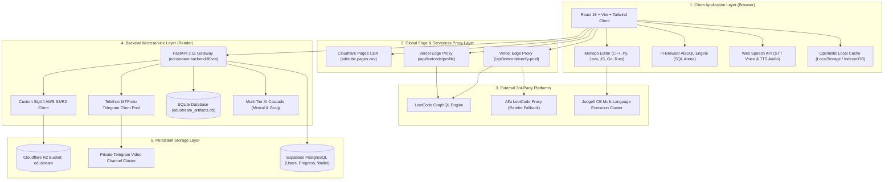
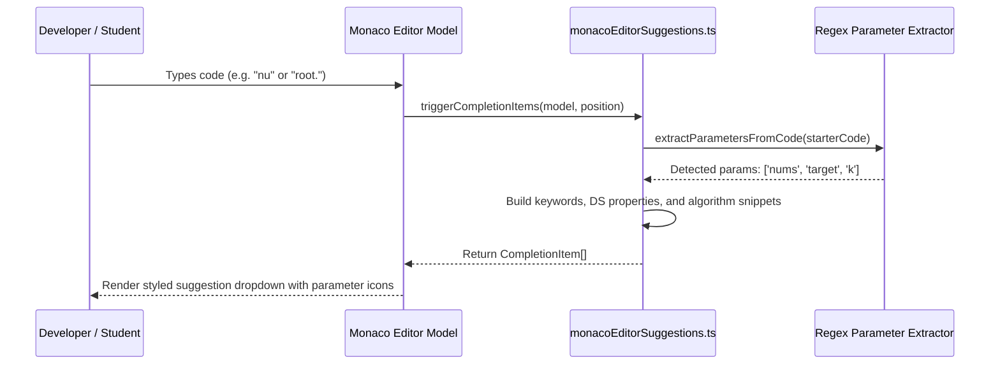
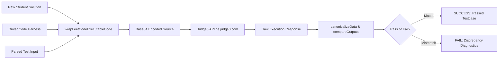
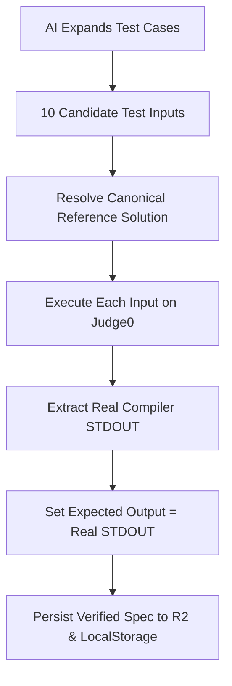
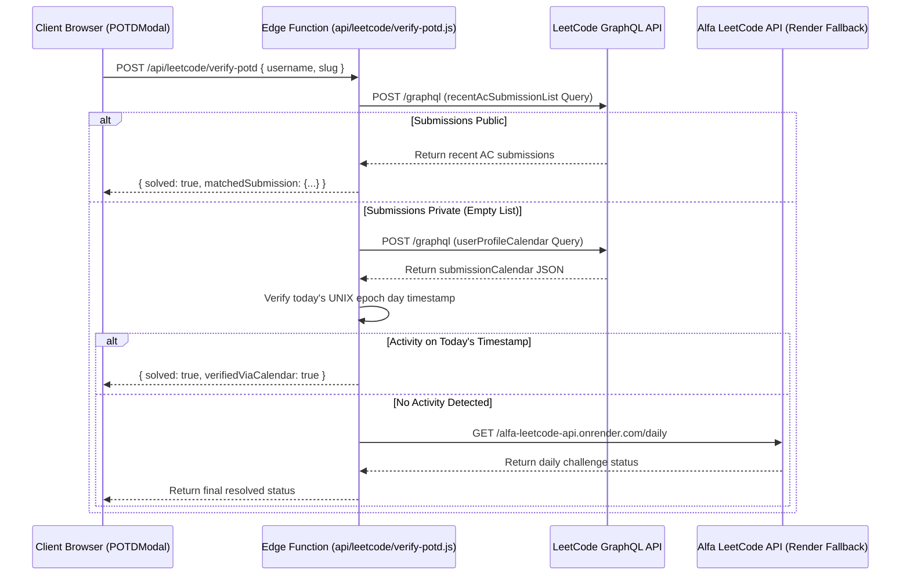
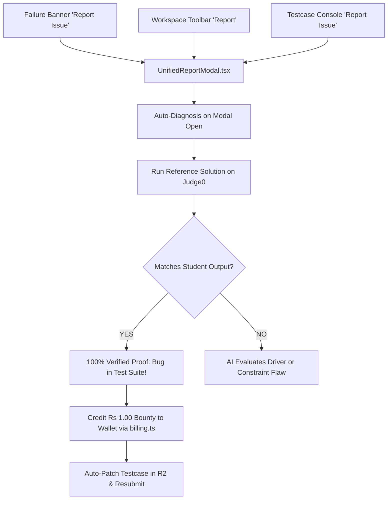
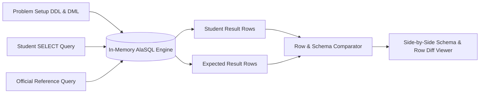
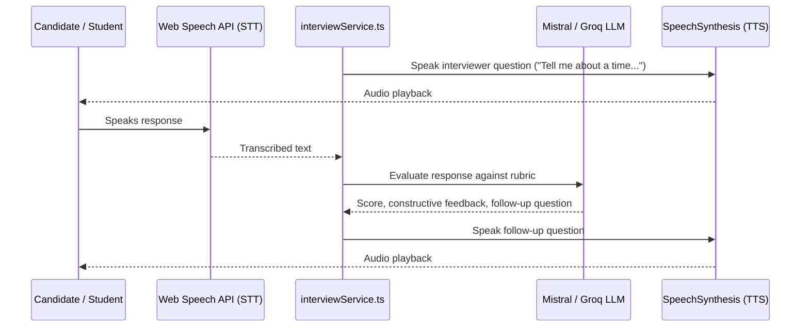
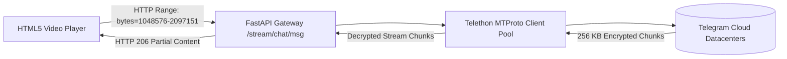
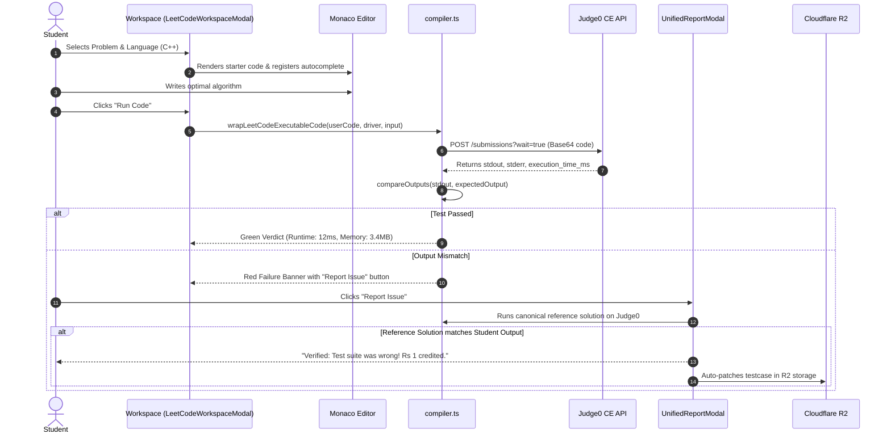

# SDETube / EduStream — Comprehensive Architecture & Functionality Specification

**Version:** 3.0.0 (Production Release)  
**Live Production Platform:** [https://sdetube.pages.dev](https://sdetube.pages.dev)  
**Backend API Gateway:** `https://edustream-backend-90vm.onrender.com`  
**GitHub Repository:** [`github.com/mdalamrahman/edustreams`](https://github.com/mdalamrahman/edustreams)

---

## Table of Contents

1. [Executive Summary & Product Mission](#1-executive-summary--product-mission)
2. [Global Architecture Overview (HLD)](#2-global-architecture-overview-hld)
3. [Technology Stack & Repository Layout](#3-technology-stack--repository-layout)
4. [Monaco Editor Intelligence & Cross-Language Autocomplete](#4-monaco-editor-intelligence--cross-language-autocomplete)
5. [Compiler Pipeline & Judge0 Execution Engine](#5-compiler-pipeline--judge0-execution-engine)
6. [Pipeline Verifier & Execution-First Verification Engine](#6-pipeline-verifier--execution-first-verification-engine)
7. [Zero-CORS POTD Auto-Verification Subsystem](#7-zero-cors-potd-auto-verification-subsystem)
8. [Unified Report & Automated Bug Bounty System](#8-unified-report--automated-bug-bounty-system)
9. [Interactive SQL Arena & In-Browser Database Engine](#9-interactive-sql-arena--in-browser-database-engine)
10. [Low-Level Design (LLD) Machine Coding Arena](#10-low-level-design-lld-machine-coding-arena)
11. [AI Mock Interviewer & Voice Evaluation Engine](#11-ai-mock-interviewer--voice-evaluation-engine)
12. [SDETube AI Resume Creator & ATS Scanner](#12-sdetube-ai-resume-creator--ats-scanner)
13. [Telegram Video Streaming CDN (Telethon / MTProto)](#13-telegram-video-streaming-cdn-telethon--mtproto)
14. [Storage Hierarchy: Cloudflare R2, SQLite & Client LocalStorage](#14-storage-hierarchy-cloudflare-r2-sqlite--client-localstorage)
15. [Micro-Billing, Wallet Ledger & Payment Integrations](#15-micro-billing-wallet-ledger--payment-integrations)
16. [Complete REST API & Edge Route Contracts](#16-complete-rest-api--edge-route-contracts)
17. [End-to-End User Journeys & Data Flows](#17-end-to-end-user-journeys--data-flows)
18. [DevOps, Deployment Runbook & Operational Verification](#18-devops-deployment-runbook--operational-verification)

---

## 1. Executive Summary & Product Mission

**SDETube** is a technical interview and competitive programming platform specifically tailored for Software Engineers (SDEs) and Software Development Engineers in Test (SDETs). It bridges the gap between passive video-based learning and active machine coding interview simulations.

### 1.1 Core Platform Pillars

```
+---------------------------------------------------------------------------------------------------+
|                                        SDETUBE PLATFORM                                           |
+---------------------------------------------------------------------------------------------------+
|  [Coding Sandbox]        |  [POTD Engine]            |  [SQL Arena]           |  [LLD Arena]       |
|  Monaco Editor IDE       |  Multi-platform streak    |  323 LeetCode SQL      |  Design Patterns   |
|  Judge0 Multi-lang       |  Zero-CORS edge proxy     |  AlaSQL In-browser     |  Facade testing    |
|  Autocompletions         |  Epoch privacy tolerance  |  Schema visualizer     |  SOLID principles  |
+--------------------------+---------------------------+------------------------+--------------------+
|  [Voice Mock Interview]  |  [ATS Resume Creator]     |  [Telegram Video CDN]  |  [Self-Healing]    |
|  FAANG Bar Raiser        |  Live ATS keyword score   |  Telethon chunked MTProto|  Judge0 reference |
|  Rubric-based scoring    |  Target role tailoring    |  Byte-range streaming  |  0% hallucination  |
|  Offer letter generator  |  Instant export           |  Zero video cost       |  Rs 1 bounty fix   |
+---------------------------------------------------------------------------------------------------+
```

---

## 2. Global Architecture Overview (HLD)

The platform employs a modern decoupled architecture spanning Global Edge CDNs (Cloudflare Pages), Serverless Edge Proxies (Vercel Functions), a Backend Microservice Gateway (FastAPI on Render), an Object Storage Layer (Cloudflare R2), an In-Memory Database Engine (AlaSQL), and External Distributed Compilers (Judge0 CE).



---

## 3. Technology Stack & Repository Layout

### 3.1 Technology Matrix

| Layer | Primary Technology | Secondary / Library | Purpose |
| :--- | :--- | :--- | :--- |
| **Frontend Framework** | React 18.3 | TypeScript 5.4 | Component-based interactive UI |
| **Build Tooling** | Vite 5.4 | PostCSS, Tailwind CSS | Fast HMR, production minification |
| **Code Editor** | Monaco Editor 0.44 | Custom CompletionItemProviders | Multi-language code editor with LeetCode parity |
| **SQL Execution** | AlaSQL 4.4 | Web Workers | Zero-latency in-browser relational database |
| **Backend API** | FastAPI 0.109 | Python 3.11.8, Uvicorn, Pydantic v2 | High-throughput async REST API |
| **Video Streaming** | Telethon 1.34 | Python `cryptg`, MTProto | Byte-range chunked video CDN via Telegram |
| **Cloud Storage** | Cloudflare R2 | Boto3 / SigV4 REST API | S3-compatible asset and code storage |
| **Serverless Proxies** | Node.js 18 | `node-fetch`, AbortSignal | Zero-CORS edge proxies for LeetCode |
| **Remote Compiler** | Judge0 CE | Multi-language GCC/OpenJDK/Python | Authenticated code compilation & execution |
| **AI Cascade** | Mistral AI | Groq Cloud (`llama-3.3-70b`) | AI code generation, healing, and interviewing |

### 3.2 Monorepo File Structure

```
c:\Users\User\Desktop\edustream\
├── src/                               # Frontend Single Page Application
│   ├── components/                    # UI Components and Modals
│   │   ├── LeetCodeWorkspaceModal.tsx # Primary coding workspace modal (IDE + Runner)
│   │   ├── LeetCodeSQLWorkspaceModal.tsx# SQL Arena workspace modal (AlaSQL engine)
│   │   ├── POTDModal.tsx              # Daily POTD tracker & streak modal
│   │   ├── UnifiedReportModal.tsx     # Single report & automated bug bounty modal
│   │   ├── CodeWorkspace.tsx          # Standalone coding sandbox component
│   │   ├── DashboardLandingPage.tsx   # Student dashboard & course overview
│   │   ├── InterviewPrepHub.tsx       # AI Mock Interview portal
│   │   ├── ResumeCreatorModal.tsx     # ATS Resume builder modal
│   │   ├── ResumeAnalystModal.tsx     # ATS Score scanner modal
│   │   ├── WalletTopupModal.tsx       # Payment & coin top-up modal
│   │   └── AdminPOTDManager.tsx       # Admin management for daily problems
│   ├── lib/                           # Domain Services & Utilities
│   │   ├── compiler.ts                # Judge0 client, code wrapper, canonicalizer
│   │   ├── monacoEditorSuggestions.ts # Cross-language autocomplete & snippet provider
│   │   ├── pipelineVerifier.ts        # Self-healing test pipeline & defect classifier
│   │   ├── problemService.ts          # Problem loader, R2 sync, testcase enricher
│   │   ├── userProfileService.ts      # Profile fetcher & POTD verification client
│   │   ├── interviewService.ts        # AI Mock Interview audio & prompt orchestrator
│   │   ├── billing.ts                 # Wallet ledger & idempotent bug bounty claimer
│   │   ├── auth.ts                    # Student auth state & guest sessions
│   │   └── mistral.ts                 # AI cascade client (Mistral + Groq fallback)
│   └── types/                         # TypeScript interfaces
├── backend/                           # Python FastAPI Backend
│   ├── main.py                        # Central server, routes, streaming proxy
│   ├── r2_storage.py                  # Cloudflare R2 S3 SigV4 storage engine
│   ├── telegram_ingest.py             # Telethon MTProto video ingest client
│   ├── requirements.txt               # Backend dependencies
│   └── edustream_artifacts.db         # Persistent SQLite database mirror
├── api/                               # Serverless Edge Handlers (Node.js)
│   └── leetcode/
│       ├── verify-potd.js             # Zero-CORS POTD verification handler
│       └── profile.js                 # Zero-CORS user profile fetcher
├── admin-portal/                      # Internal Admin Application
├── public/                            # Static assets, icons, company datasets
│   └── data/company_problems.json     # 1.8 MB curated company problem dataset
├── scripts/                           # Build & deployment automations
│   └── copy_dist_assets.py            # Post-build asset distributor
├── vercel.json                        # Edge route rewrites
├── package.json                       # Scripts and project dependencies
├── context.md                         # Context & deployment runbook
└── ARCHITECTURE_AND_FUNCTIONALITY.md  # Master architectural manual (this document)
```

---

## 4. Monaco Editor Intelligence & Cross-Language Autocomplete

### 4.1 Implementation Architecture

Monaco Editor (`@monaco-editor/react`) provides code editing with LeetCode-parity autocomplete implemented in [`src/lib/monacoEditorSuggestions.ts`](file:///c:/Users/User/Desktop/edustream/src/lib/monacoEditorSuggestions.ts).



### 4.2 Language Support & Capabilities

1. **C++ (`cpp`)**:
   - STL Containers: `vector`, `unordered_map`, `unordered_set`, `priority_queue`, `deque`, `stack`, `pair`.
   - Algorithms: `sort`, `lower_bound`, `upper_bound`, `max_element`, `reverse`, `accumulate`.
   - Data Structures: `TreeNode*`, `ListNode*` with pointer dereferencing completion (`->val`, `->left`, `->right`, `->next`).
2. **Python (`python`)**:
   - Standard Modules: `collections.defaultdict`, `collections.Counter`, `collections.deque`, `heapq`, `bisect`, `math.inf`.
   - Built-ins: `enumerate`, `zip`, `reversed`, `sorted`, `range`, `len`.
   - Property suggestions for `TreeNode` (`root.val`, `root.left`, `root.right`) and `ListNode` (`head.val`, `head.next`).
3. **Java (`java`)**:
   - Collections Framework: `ArrayList`, `HashMap`, `HashSet`, `PriorityQueue`, `LinkedList`, `ArrayDeque`.
   - Java Idioms: `Math.max()`, `Arrays.sort()`, `Collections.reverse()`, `StringBuilder`.
4. **JavaScript / TypeScript (`javascript`, `typescript`)**:
   - ES6+ Idioms: `Array.prototype.map()`, `filter()`, `reduce()`, `Map`, `Set`, `Math.max()`, `BigInt`.
5. **Go (`go`)**:
   - Standard Types: `make([]int, 0)`, `make(map[string]int)`, `len()`, `append()`, `sort.Ints()`.
6. **Rust (`rust`)**:
   - Standard Library: `Vec::new()`, `HashMap::new()`, `BinaryHeap::new()`, `Option<Box<TreeNode>>`, `unwrap_or_default()`.

### 4.3 Context-Aware Parameter Extraction

The function `extractParametersFromCode()` inspects the starter template using regex heuristic parsers:
- **C++/Java**: Matches `(Type1 param1, Type2 param2)`.
- **Python**: Matches `def function_name(self, param1: Type, param2: Type)`.
- **JS/Go/Rust**: Extracts positional parameter identifiers.
When a student types, parameter variables are prioritized at the top of the suggestion list with custom documentation badges.

---

## 5. Compiler Pipeline & Judge0 Execution Engine

### 5.1 Remote Execution Pipeline

Execution is orchestrated by [`src/lib/compiler.ts`](file:///c:/Users/User/Desktop/edustream/src/lib/compiler.ts) hitting the Judge0 CE API (`ce.judge0.com`).



### 5.2 Sentinel Harness Insertion

To compile LeetCode class-based snippets, the compiler wraps user code with a driver harness. The system requires an exact sentinel comment:
- C++, Java, JS, Go, Rust: `// === USER SOLUTION ===`
- Python: `# === USER SOLUTION ===`
The wrapper replaces this sentinel with the student's solution, injects custom deserializers, reads standard input or arguments, and prints serialized output to standard output.

### 5.3 Output Canonicalization & Flexible Comparison

1. **Combinatorial Invariance (`canonicalizeData`)**:
   Problems returning collections of collections (e.g. *Subsets*, *Permutations*, *3Sum*, *Combination Sum*) permit arbitrary row or element order. `canonicalizeData()` sorts inner rows and outer collections deterministically before comparison.
2. **Floating-Point Tolerances**:
   Evaluates floating-point numbers within a strict $\epsilon = 10^{-6}$ epsilon threshold.
3. **Multi-Valid Binary Search Trees (`isValidHeightBalancedBSTForNums`)**:
   For problems like *Convert Sorted Array to Binary Search Tree*, multiple valid height-balanced BST representations exist. The validator deserializes the output tree, validates that in-order traversal strictly matches sorted input numbers, and computes height balances $|h_{left} - h_{right}| \le 1$ recursively across every node.

---

## 6. Pipeline Verifier & Execution-First Verification Engine

### 6.1 The Problem: LLM Output Hallucination

When using LLMs to generate or expand competitive programming test cases, models frequently hallucinate expected outputs for non-trivial inputs (e.g. off-by-one errors on dynamic programming states, incorrect tree serialization, or inverted boolean conditions).

### 6.2 The Solution: Execution-First Ground Truth

In [`src/lib/problemService.ts`](file:///c:/Users/User/Desktop/edustream/src/lib/problemService.ts) and [`src/lib/pipelineVerifier.ts`](file:///c:/Users/User/Desktop/edustream/src/lib/pipelineVerifier.ts):



1. **`verifyExpectedOutputsByExecution(prob)`**:
   - Resolves the official reference solution (in Python, C++, Java, or JS).
   - Executes the reference solution on each candidate test input through Judge0.
   - Extracts authentic compiler `stdout` and overwrites any hallucinated expected output before saving to Cloudflare R2 or `localStorage`.
2. **`guaranteeAtLeast10TestCases(prob)`**:
   - Safeguards against testsuite crashes by ensuring at least 10 testcases exist.
   - Cycles known, verified input-output pairs rather than synthesizing dummy scalar arrays.

---

## 7. Zero-CORS POTD Auto-Verification Subsystem

### 7.1 Architecture & Edge Routing

Direct browser fetch requests to `leetcode.com/graphql` trigger browser CORS violations. The platform routes all LeetCode verifications through serverless edge functions:



### 7.2 Calendar Epoch Verification Algorithm

When a LeetCode user's recent submissions are set to private, the GraphQL query returns an empty list `[]`. The serverless function inspects `userCalendar.submissionCalendar`:
```javascript
const calendar = JSON.parse(userCalendar.submissionCalendar || '{}');
const todayMidnightEpoch = Math.floor(new Date().setHours(0, 0, 0, 0) / 1000);
const yesterdayMidnightEpoch = todayMidnightEpoch - 86400;

// Verify if active submission count > 0 for today or yesterday's UTC window
const solvedToday = Boolean(calendar[todayMidnightEpoch] || calendar[yesterdayMidnightEpoch]);
```
This enables reliable automatic POTD verification even when student profiles are private.

---

## 8. Unified Report & Automated Bug Bounty System

### 8.1 Single Button Consolidation

Legacy interfaces displayed multiple conflicting buttons (*Fix Testcase*, *Report Boilerplate*, *Problem Report*). The platform now provides **strictly one Report button** in [`src/components/LeetCodeWorkspaceModal.tsx`](file:///c:/Users/User/Desktop/edustream/src/components/LeetCodeWorkspaceModal.tsx), routing all issue categories through [`src/components/UnifiedReportModal.tsx`](file:///c:/Users/User/Desktop/edustream/src/components/UnifiedReportModal.tsx).



### 8.2 Idempotent Bug Bounty Claiming

In [`src/lib/billing.ts`](file:///c:/Users/User/Desktop/edustream/src/lib/billing.ts), `claimReportBounty()` generates a deterministic claim identifier:
$$\text{claimKey} = \text{hash}(\text{slug} + \text{issueType} + \text{studentEmail})$$
If the claim key already exists in `localStorage` or the backend registry, the reward is marked as already claimed, preventing double-credits. Valid claims credit ₹1.00 directly to the student's wallet balance.

---

## 9. Interactive SQL Arena & In-Browser Database Engine

### 9.1 AlaSQL In-Browser Relational Engine

Implemented in [`src/components/LeetCodeSQLWorkspaceModal.tsx`](file:///c:/Users/User/Desktop/edustream/src/components/LeetCodeSQLWorkspaceModal.tsx), the SQL Arena provides in-browser relational database capabilities without requiring remote database connection overhead.



### 9.2 Complete 323 LeetCode SQL Catalog

- Pre-seeded with setup scripts, table definitions, schemas, and queries.
- Side-by-side visualization of input tables (`Users`, `Orders`, `Employee`, `Sales`, `Logs`).
- Supports window functions (`ROW_NUMBER()`, `RANK()`, `DENSE_RANK()`), `GROUP BY`, multi-table joins, subqueries, and common table expressions (CTEs).

---

## 10. Low-Level Design (LLD) Machine Coding Arena

### 10.1 Object-Oriented Machine Coding

The LLD Arena prepares candidates for Machine Coding rounds (popular at Uber, Swiggy, Flipkart, Amazon, Google). Instead of scalar array questions, problems test design patterns and SOLID principles:
- **Factory Method**: Dynamic vehicle/logger creation.
- **Singleton**: Thread-safe configuration manager or connection pool.
- **Strategy**: Dynamic discount calculators or payment routing engines.
- **Observer**: Pub/sub notification and alert dispatchers.
- **Builder**: Complex query or document builders.

### 10.2 Facade & Method-Call Sequence Execution

Test cases represent sequential method invocations on a public controller or facade:
- **Input Format**: `'registerHandler("AUTH"), processRequest("AUTH", "LOGIN"), getActiveCount()'`
- **Expected Output**: `'true, "SUCCESS", 1'`
Drivers parse the comma-separated invocation stream, dispatch methods on the instantiated `Solution` object, collect return values, and format outputs.

---

## 11. AI Mock Interviewer & Voice Evaluation Engine

### 11.1 Real-Time Conversational Flow

Implemented in [`src/components/InterviewPrepHub.tsx`](file:///c:/Users/User/Desktop/edustream/src/components/InterviewPrepHub.tsx) and [`src/lib/interviewService.ts`](file:///c:/Users/User/Desktop/edustream/src/lib/interviewService.ts):



### 11.2 Structured Evaluation Rubrics & Offer Letter

Candidates receive scores across 4 key dimensions (0–100%):
1. **Problem Solving & Analytical Thinking**
2. **Data Structure & Algorithmic Optimality**
3. **Code Quality, Modularity & Edge Case Handling**
4. **Behavioral Communication & System Articulation**

Scores exceeding 80% automatically trigger the **FAANG Offer Letter Generator**, rendering a verified offer card with compensation metrics, engineering level (SDE-1, SDE-2, SDET Lead), and downloadable credentials.

---

## 12. SDETube AI Resume Creator & ATS Scanner

### 12.1 Real-Time ATS Scoring Engine

Implemented in [`src/components/ResumeCreatorModal.tsx`](file:///c:/Users/User/Desktop/edustream/src/components/ResumeCreatorModal.tsx) and [`src/components/ResumeAnalystModal.tsx`](file:///c:/Users/User/Desktop/edustream/src/components/ResumeAnalystModal.tsx):
- Evaluates resumes against specific Job Descriptions (JDs).
- Computes matching percentages based on core technical competencies (Selenium, Playwright, Cypress, TestNG, Docker, Kubernetes, CI/CD pipelines, RestAssured, Java, Python).
- Analyzes quantifiable impact statements using the Google XYZ formula: *"Accomplished [X] as measured by [Y] by doing [Z]"*.

### 12.2 Role-Tailored Resume Generation

Generates tailored resumes targeting specific career tracks:
- **SDET / QA Automation Engineer**
- **Backend Software Engineer (SDE)**
- **Fullstack Software Engineer**
- **Engineering Lead / Architect**

---

## 13. Telegram Video Streaming CDN (Telethon / MTProto)

### 13.1 Zero-Cost Video Streaming Architecture

Video lectures are hosted across private Telegram channels organized by topic (DSA, System Design, LLD, DBMS, Computer Networks).



### 13.2 HTTP 206 Partial Content & Instant Scrubbing

FastAPI handles standard HTTP `Range` headers:
- Reads the requested byte offset (e.g. `bytes=1048576-`).
- Telethon queries the message ID in the designated chat channel, fetching stream parts from Telegram's media cluster.
- Streams chunks back using `Transfer-Encoding: chunked` and status `206 Partial Content`.
- Enables video scrubbing, pause/resume, and playback without upfront buffer latency.

---

## 14. Storage Hierarchy: Cloudflare R2, SQLite & Client LocalStorage

```
+---------------------------------------------------------------------------------------------------+
|                                  STORAGE HIERARCHY & PERSISTENCE                                  |
+---------------------------------------------------------------------------------------------------+
| 1. Cloudflare R2 Bucket ("edustream")                                                             |
|    ├── problems/{slug}.json           -> Full problem spec (examples, constraints, starters)      |
|    ├── solutions/{slug}_{lang}.txt    -> Reference solution implementations                       |
|    ├── drivers/{slug}_{lang}.txt      -> Verified execution driver harnesses                      |
|    ├── testcases/{slug}.txt           -> Raw input-output test suites                             |
|    └── notes/{slug}.md                -> Detailed editorial study notes and diagrams              |
+---------------------------------------------------------------------------------------------------+
| 2. Server-Side SQLite ("edustream_artifacts.db" on Render)                                        |
|    ├── problems                       -> Cached problem mirror & test case overrides              |
|    ├── driver_codes                   -> Repaired driver harnesses                                |
|    ├── bounties                       -> Registry of claimed bug bounty keys                      |
|    └── user_profiles                  -> User progress & streak counters                          |
+---------------------------------------------------------------------------------------------------+
| 3. Client-Side Browser Storage ("localStorage")                                                   |
|    ├── edustream_problem_spec_{slug}  -> Local cache of problem specifications                    |
|    ├── edustream_ai_solutions_{slug}  -> Cached solutions mapped by language                      |
|    ├── edustream_driver_{slug}_{lang} -> User/system driver overrides                             |
|    ├── edustream_wallet_balance       -> Current coin balance                                     |
|    └── edustream_claimed_bounties     -> Local bounty claim records                               |
+---------------------------------------------------------------------------------------------------+
```

---

## 15. Micro-Billing, Wallet Ledger & Payment Integrations

### 15.1 Wallet Mechanics & Unit Economics

Implemented in [`src/lib/billing.ts`](file:///c:/Users/User/Desktop/edustream/src/lib/billing.ts) and [`src/components/WalletTopupModal.tsx`](file:///c:/Users/User/Desktop/edustream/src/components/WalletTopupModal.tsx):
- **Base Currency**: Indian Rupee (₹).
- **Consumption Policies**:
  - Cloud Code Sync: ₹0.05 per sync.
  - Deep AI Interview Session: ₹5.00 per session.
  - AI Resume Generation: ₹2.00 per resume.
- **Incentive Policies**:
  - Verified Bug Bounty: +₹1.00 credited immediately upon successful repair of an incorrect testcase or defective driver harness.
  - Referral Bonus: +₹10.00 credited upon referred peer onboarding.

### 15.2 Gateway Integrations
Supports Razorpay Checkout, Cashfree, UPI Deep Links, and sandbox mock top-ups for automated integration testing.

---

## 16. Complete REST API & Edge Route Contracts

### 16.1 Serverless Edge Proxies (`api/leetcode/`)

#### `POST /api/leetcode/verify-potd`
- **Payload**: `{ "username": "string", "slug": "string" }`
- **Response**: `{ "success": true, "solved": true, "verifiedVia": "recentAc" | "calendar" }`

#### `GET /api/leetcode/profile?username={username}`
- **Response**: Returns full LeetCode profile payload (ranking, reputation, solved count by difficulty, submission calendar).

### 16.2 Backend REST Routes (`backend/main.py`)

#### `GET /api/problem/{slug}`
- **Description**: Loads problem specification, checking Cloudflare R2 with fallback to AI generation.
- **Response**: `ProblemTemplate` JSON object.

#### `POST /api/problem/{slug}/upload`
- **Description**: Uploads an enriched problem specification to Cloudflare R2 and SQLite.

#### `POST /api/problem/{slug}/correct-testcase`
- **Payload**: `{ "testCaseIndex": 0, "correctedInput": "...", "correctedExpectedOutput": "...", "email": "..." }`
- **Description**: Updates defective test cases in R2 and awards bug bounty.

#### `POST /api/problem/{slug}/correct-driver`
- **Payload**: `{ "language": "cpp", "driverCode": "...", "email": "..." }`
- **Description**: Replaces broken driver harnesses in R2.

#### `GET /stream/{chat_id}/{msg_id}`
- **Headers**: `Range: bytes={start}-{end}`
- **Response**: HTTP 206 Partial Content byte stream from Telegram CDN.

---

## 17. End-to-End User Journeys & Data Flows

### 17.1 Problem Solving & Submission Flow



---

## 18. DevOps, Deployment Runbook & Operational Verification

### 18.1 Monorepo Deployment Targets

| Target | Hosting Platform | Deployment Trigger | Live URL |
| :--- | :--- | :--- | :--- |
| **Frontend Client** | Cloudflare Pages | Wrangler CLI (`npm run deploy:student`) | [`https://sdetube.pages.dev`](https://sdetube.pages.dev) |
| **Backend Gateway** | Render Web Service | Git push to `main` branch | [`https://edustream-backend-90vm.onrender.com`](https://edustream-backend-90vm.onrender.com) |
| **Serverless Edge** | Vercel Serverless | Vercel Git webhook | Handled via edge rewrites |

### 18.2 Complete Deployment Runbook

#### Step 1: Deploy Backend via GitHub Push
Render tracks the `main` branch of `https://github.com/mdalamrahman/edustreams` and automatically triggers a build when changes are pushed:
```powershell
git add -A
git commit -m "feat(core): update system components"
git push origin main
```
- **Render Build Command**: `pip install -U pip && pip install -r requirements.txt`
- **Render Start Command**: `uvicorn main:app --host 0.0.0.0 --port $PORT`

#### Step 2: Deploy Frontend to Cloudflare Pages (Wrangler)
Execute the deployment script from the project root:
```powershell
npm run deploy:student
```
This executes:
1. `tsc`: Complete TypeScript validation.
2. `vite build`: Minified production bundle in `dist/`.
3. `python scripts/copy_dist_assets.py`: Copies `company_problems.json` to `dist/data/`.
4. `npx wrangler pages deploy dist --project-name sdetube --branch main --commit-dirty=true`: Uploads assets to Cloudflare Pages.

#### Step 3: Operational Verification via Render CLI & REST API

Set the Render authentication token:
```powershell
$env:RENDER_TOKEN = "rnd_a3YkUrijIg5fDNtAPObhmpTD0qfY"
```

1. **Verify Services with Render CLI**:
   ```powershell
   render-cli find-service -sn edustream-backend
   ```
   - **Service Name**: `edustream-backend`
   - **Service ID**: `srv-d9nn8qm417fc73doitrg`
   - **Live URL**: `https://edustream-backend-90vm.onrender.com`

2. **Verify Active Environment Variables**:
   ```powershell
   render-cli list-env -sn edustream-backend
   ```

3. **Verify Deployment Status via Render REST API**:
   ```powershell
   python -c "import urllib.request, json, os; token = os.getenv('RENDER_TOKEN', 'rnd_a3YkUrijIg5fDNtAPObhmpTD0qfY'); req = urllib.request.Request('https://api.render.com/v1/services/srv-d9nn8qm417fc73doitrg/deploys?limit=1', headers={'Authorization': 'Bearer ' + token}); res = urllib.request.urlopen(req); d = json.loads(res.read())[0]['deploy']; print(f'Deploy ID: {d[\"id\"]} | Status: {d[\"status\"]} | Commit: {d[\"commit\"][\"id\"][:8]} - {d[\"commit\"][\"message\"]}')"
   ```
   *Expected output: `Status: live`*

4. **Live Endpoint Health Checks**:
   ```powershell
   # 1. Backend FastAPI Swagger docs
   curl.exe -I https://edustream-backend-90vm.onrender.com/docs

   # 2. Frontend Cloudflare Pages edge
   curl.exe -I https://sdetube.pages.dev
   ```
   *Both endpoints must return `HTTP/1.1 200 OK`.*

---

## 19. Summary & Architectural Invariants

To maintain stability across future development, adhere to these architectural invariants:
1. **Never Trust Raw AI Outputs for Test Cases**: All newly generated test cases must be verified against actual execution using `verifyExpectedOutputsByExecution()`.
2. **Preserve Sentinel Harness Markers**: Driver harnesses must always retain `// === USER SOLUTION ===` or `# === USER SOLUTION ===`.
3. **Single Report Entry Point**: Route all bug reports and testcase repairs strictly through `<UnifiedReportModal>`.
4. **Zero-CORS Route Invariance**: Never attempt direct browser fetches to `leetcode.com/graphql`; always route through `/api/leetcode/*`.
5. **Always Run Pre-Flight Builds**: Always run `npm run build` or `npx tsc --noEmit` before triggering wrangler deployments.
