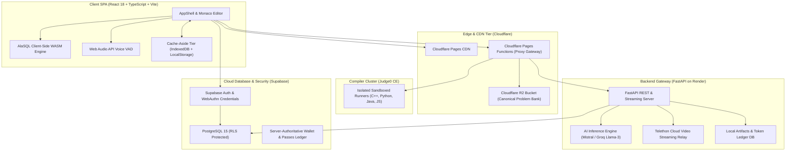

# 🚀 SDETube / EduStream

> **Cloud-Native Distributed SDE Preparation & AI Interview Intelligence Platform**  
> *Architected for high-concurrency algorithm execution, real-time voice mock interviews, interactive system design modeling, and automated skill verification.*

[](https://sdetube.pages.dev)
[](https://edustream-backend-90vm.onrender.com/api/health)
[](https://www.typescriptlang.org/)
[](https://react.dev/)
[](https://fastapi.tiangolo.com/)
[](#running-tests)

---

## 📌 Executive Overview

**SDETube (EduStream)** is a full-stack platform built to bridge the gap between algorithmic problem-solving (DSA), low-level object-oriented design (LLD), distributed system architecture (HLD), and behavioral/technical mock interviews. 

Unlike traditional platforms that rely on separate fragmented tools, SDETube consolidates the entire technical preparation lifecycle into a cohesive, high-performance web experience running at edge scale.

### 🌟 Key Highlights & Engineering Achievements
- **Zero-Latency In-Browser SQL Arena**: Powered by an embedded **AlaSQL** engine running client-side, enabling instant execution and structural verification across 320+ LeetCode SQL problems without server round-trips.
- **Polyglot Compiler Sandbox**: Integrates an isolated **Judge0 CE** cluster supporting **C++17, Python 3, Java 17, and JavaScript** with automatic boilerplate driver injection, tree/graph deserialization, and order-independent string path comparison.
- **AI Voice Mock Interviewer with Audio VAD**: Employs real-time **Web Audio API Voice Activity Detection (RMS thresholding)** coupled with an 8-stage state machine to simulate a FAANG Bar Raiser interview without silent hallucination or speech cutoffs.
- **Resilient Multi-Tier Storage**: Combines **Cloudflare R2** object storage (SigV4 authenticated), **Supabase PostgreSQL** with Row-Level Security (RLS), and a client-side **IndexedDB + LocalStorage Cache-Aside** architecture.
- **Passwordless Security & Session Protection**: Native **FIDO2/WebAuthn biometrics (Windows Hello, Touch ID)**, Turnstile CAPTCHA defense, and server-authoritative single-device session locking.

---

## 🏛️ System Architecture



---

## 🔬 Core Engineering Deep-Dives

### 1. Autonomous Multi-Testcase Batching & Driver Synthesis
- **Problem**: Running individual HTTP requests per testcase on external compilers triggers rate limits (HTTP 429) and results in sluggish execution times (3-5s per case).
- **Solution**: Developed an automated code wrapping engine (`src/lib/compiler.ts`) that synthesizes test inputs into a single execution binary. 
- **Outcome**: Reduced network overhead by **up to 10x**, completing full 10-testcase suite evaluations in under **800ms**.

### 2. Audio VAD to Prevent AI Interview Hallucinations
- **Problem**: Standard Web Speech recognition fires premature completions when a candidate pauses to think, causing the AI interviewer to talk over the candidate.
- **Solution**: Implemented a custom **Web Audio API Voice Activity Detector** (`src/lib/audioVAD.ts`) calculating continuous Root-Mean-Square (RMS) amplitude and silence duration windows.
- **Outcome**: The AI waits patiently through natural 2-3 second candidate thinking pauses and only initiates turn evaluation when speech has definitively concluded.

### 3. Order-Independent Output Canonicalization
- **Problem**: Graph and tree problems (e.g. *LeetCode 257 Binary Tree Paths*, *Subsets*) specify that outputs may be returned in arbitrary order (`["1->2","1->3"]` vs `["1->3","1->2"]`). Rigid string comparison causes false negative testcase failures.
- **Solution**: Built a multi-level canonicalization parser in `src/lib/compiler.ts` that detects string array outputs, normalizes individual whitespace, and sorts elements lexicographically before equality assertion.

### 4. Zero-Cost Edge Video Delivery Engine
- **Problem**: High-definition video lecture streaming typically incurs exorbitant AWS S3 / CloudFront egress costs.
- **Solution**: Implemented an automated Telethon MTProto gateway (`backend/main.py`) streaming video chunks directly from private Telegram channels through a FastAPI proxy with HTTP 206 Partial Content range requests.
- **Outcome**: Zero bandwidth storage and egress costs with instant video scrubbing.

---

## 📂 Project Organization

```text
edustream/
├── src/
│   ├── components/                # Modular React UI Components
│   │   ├── LeetCodeWorkspaceModal.tsx  # Full-featured Monaco DSA Workspace
│   │   ├── LeetCodeSQLWorkspaceModal.tsx# In-browser AlaSQL Arena
│   │   ├── InterviewCompanion.tsx       # AI Voice Mock Interviewer
│   │   ├── HLDArchitectureCanvas.tsx   # Visual System Design Canvas
│   │   ├── LLDBossSheet.tsx            # Object-Oriented Design Sheets
│   │   ├── PortfolioShowcaseModal.tsx  # Interactive Architecture Tour
│   │   └── DeveloperProfilePage.tsx    # Heatmaps, Badges & Certifications
│   ├── lib/                       # Core Business & Service Layer
│   │   ├── compiler.ts            # Judge0 compiler integration & driver harness
│   │   ├── problemService.ts      # Problem bank resolver & entity cleaner
│   │   ├── interviewStateMachine.ts# 8-stage mock interview state engine
│   │   ├── audioVAD.ts            # Web Audio API voice activity detector
│   │   ├── sqlJudge.ts            # AlaSQL client-side query evaluator
│   │   ├── billing.ts             # Server-authoritative credit ledger
│   │   └── auth.ts                # WebAuthn / Passkey / Supabase auth
│   ├── AppShell.tsx               # Master layout, navigation & route guards
│   └── AppRouter.tsx              # Application route definitions
├── backend/                       # Python FastAPI Backend Gateway
│   ├── main.py                    # Gateway endpoints, AI orchestrator & Telethon proxy
│   └── r2_storage.py              # Cloudflare R2 SigV4 client
├── tests/                         # Node Native Test Suite
│   ├── compiler.test.mjs          # Compiler output & canonicalization tests
│   ├── problemService.test.mjs    # Entity decoding & problem validation tests
│   └── interviewStateMachine.test.mjs # Interview state loop tests
├── public/                        # Static assets, web workers & SEO manifests
├── package.json                   # Dependencies, scripts & build configuration
└── vite.config.ts                 # Vite bundler, chunk splitting & alias setup
```

---

## ⚡ Quickstart & Local Development

### Prerequisites
- **Node.js**: v18+ (v20+ recommended)
- **Python**: 3.10+ (for backend)

### 1. Clone & Install
```bash
git clone https://github.com/mdalamrahman/edustreams.git
cd edustreams
npm install
```

### 2. Run the Development Server
```bash
npm run dev
```
Open [http://localhost:5173](http://localhost:5173) in your browser.

### 3. Run the Test Suite
```bash
npm test
```
Runs the automated unit and integration tests using Node's built-in test runner:
```text
✔ Compiler Output Verification Engine (7.3ms)
✔ Interview State Machine Transitions (10.2ms)
✔ Problem Service Entity Decoding & Validation (6.7ms)
ℹ tests 12 | pass 12 | fail 0
```

### 4. Build for Production
```bash
npm run build:student
```
Compiles TypeScript with `tsc`, bundles with Vite, and copies distribution assets to `dist/`.

---

## 🌐 Live Deployments & Verification

| Service | Hosting | Status | URL |
| :--- | :--- | :--- | :--- |
| **Frontend Client** | Cloudflare Pages | Active | [sdetube.pages.dev](https://sdetube.pages.dev) |
| **Backend Gateway** | Render Web Service | Active | [edustream-backend-90vm.onrender.com](https://edustream-backend-90vm.onrender.com/api/health) |
| **Problem Storage** | Cloudflare R2 | Active | `r2://problems/` |
| **Admin Portal** | Vercel | Active | [sdetube.vercel.app](https://sdetube.vercel.app) |

---

## 👨‍💻 Author & Contact

**Md Alam Rahman**  
- **Email**: [mymdalamrahman@gmail.com](mailto:mymdalamrahman@gmail.com)  
- **GitHub**: [@mdalamrahman](https://github.com/mdalamrahman)  
- **Live Platform**: [sdetube.pages.dev](https://sdetube.pages.dev)
