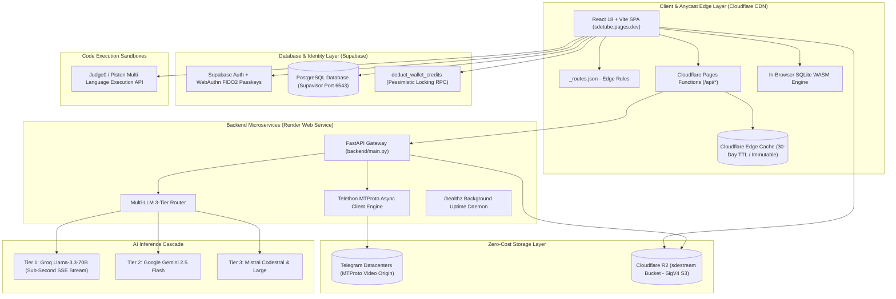
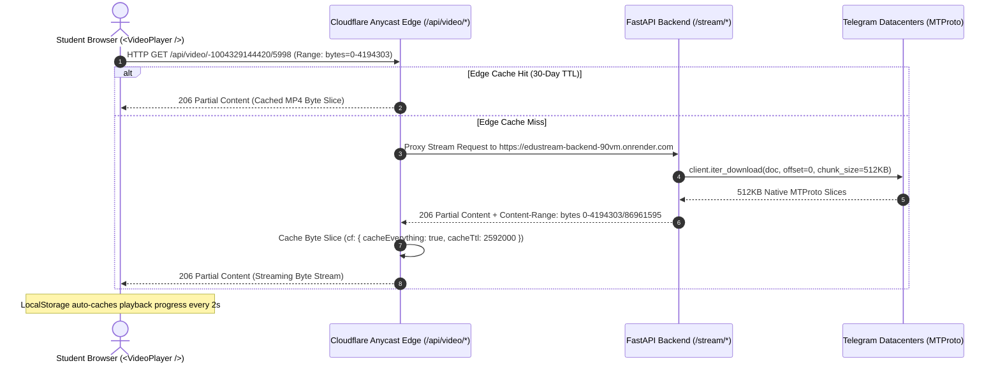
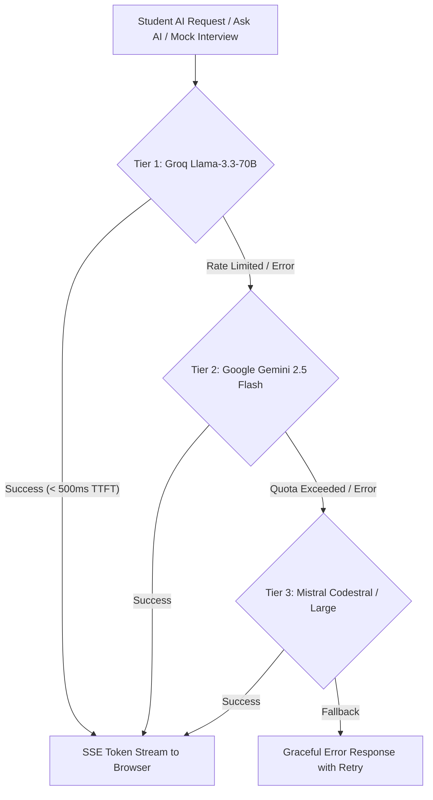
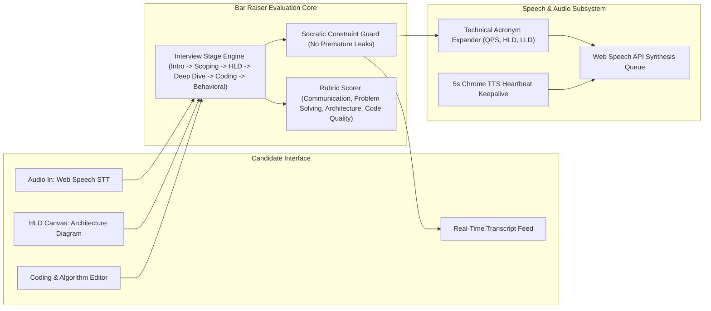
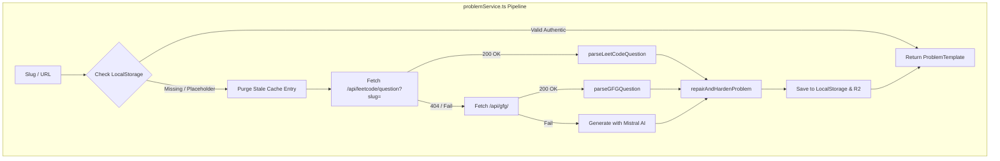
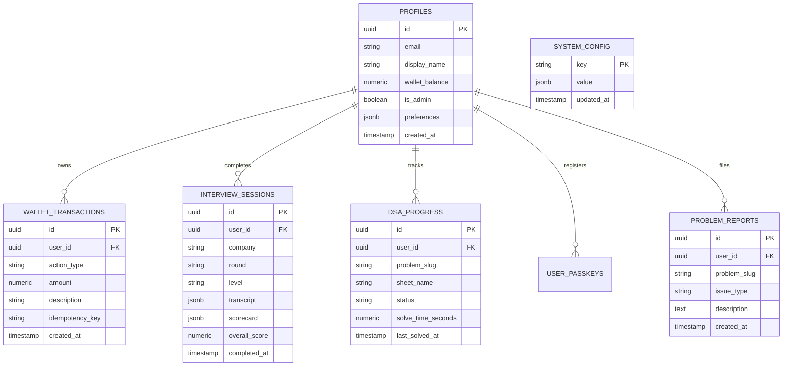

# SDETube / EduStream: Comprehensive High-Level & Low-Level Design (HLD & LLD)

**Live Production Platform**: [https://sdetube.pages.dev](https://sdetube.pages.dev)  
**Backend API Gateway**: `https://edustream-backend-90vm.onrender.com`  
**GitHub Repository**: `mdalamrahman/edustreams`

---

# Table of Contents
1. [System High-Level Design (HLD)](#1-system-high-level-design-hld)
   - 1.1 [End-to-End System Architecture](#11-end-to-end-system-architecture)
   - 1.2 [Zero-Cost Edge Video Delivery Engine](#12-zero-cost-edge-video-delivery-engine)
   - 1.3 [Multi-Tier AI Inference Cascade](#13-multi-tier-ai-inference-cascade)
   - 1.4 [Lead Bar Raiser Voice Mock Interview Subsystem](#14-lead-bar-raiser-voice-mock-interview-subsystem)
   - 1.5 [Atomic Concurrency & Wallet Ledger](#15-atomic-concurrency--wallet-ledger)
2. [Full Platform User & Data Flow](#2-full-platform-user--data-flow)
   - 2.1 [Student Onboarding & Passwordless Passkey Flow](#21-student-onboarding--passwordless-passkey-flow)
   - 2.2 [DSA Problem Solving & Code Execution Flow](#22-dsa-problem-solving--code-execution-flow)
   - 2.3 [SQL Challenge & In-Browser WASM Execution Flow](#23-sql-challenge--in-browser-wasm-execution-flow)
   - 2.4 [Video Lecture Streaming & Dual-Mode Notes Sync Flow](#24-video-lecture-streaming--dual-mode-notes-sync-flow)
   - 2.5 [Lead Bar Raiser Voice Interview & Scorecard Flow](#25-lead-bar-raiser-voice-interview--scorecard-flow)
   - 2.6 [Wallet Billing, 24-Hour Passes & Top-Up Flow](#26-wallet-billing-24-hour-passes--top-up-flow)
3. [Low-Level Design (LLD): Component Architecture (`src/components/`)](#3-low-level-design-lld-component-architecture-srccomponents)
   - 3.1 [Master Shell & Routing Controller (`App.tsx`)](#31-master-shell--routing-controller-apptsx)
   - 3.2 [Coding & Algorithm Workspaces](#32-coding--algorithm-workspaces)
   - 3.3 [System Design & Mock Interview Rooms](#33-system-design--mock-interview-rooms)
   - 3.4 [Video Streaming & Notes Subsystem](#34-video-streaming--notes-subsystem)
   - 3.5 [Identity, Wallet & Admin Portals](#35-identity-wallet--admin-portals)
   - 3.6 [Diagramming, Quizzes & Supporting UI Components](#36-diagramming-quizzes--supporting-ui-components)
4. [Low-Level Design (LLD): Core Services Deep Dive (`src/lib/`)](#4-low-level-design-lld-core-services-deep-dive-srclib)
   - 4.1 [Problem & Execution Pipeline (`problemService.ts`, `compiler.ts`, `sqlJudge.ts`)](#41-problem--execution-pipeline-problemservicets-compilerts-sqljudgets)
   - 4.2 [AI & Voice Engines (`interviewService.ts`, `interviewEvaluator.ts`, `mistral.ts`, `groq.ts`)](#42-ai--voice-engines-interviewservicets-interviewevaluatorts-mistralts-groqts)
   - 4.3 [Storage, Notes & Boss Sheets (`videoNotesService.ts`, `notesService.ts`, `kroki.ts`)](#43-storage-notes--boss-sheets-videonotesservicets-notesservicets-krokits)
   - 4.4 [Billing, Auth & Security (`billing.ts`, `auth.ts`, `passkey.ts`, `webauthn.ts`)](#44-billing-auth--security-billingts-authts-passkeyts-webauthnts)
   - 4.5 [Curated Datasets & Catalogs (`dsaSheetsData.ts`, `lldData.ts`, `supabase.ts`)](#45-curated-datasets--catalogs-dsasheetsdatats-llddatats-supabasets)
5. [Backend Microservices Low-Level Design (`backend/` & `functions/`)](#5-backend-microservices-low-level-design-backend--functions)
   - 5.1 [FastAPI Gateway & Route Handlers (`backend/main.py`)](#51-fastapi-gateway--route-handlers-backendmainpy)
   - 5.2 [Cloudflare R2 SigV4 Storage Manager (`backend/r2_storage.py`)](#52-cloudflare-r2-sigv4-storage-manager-backendr2_storagepy)
   - 5.3 [Edge Functions & Proxy Layer (`functions/api/`)](#53-edge-functions--proxy-layer-functionsapi)
6. [Database Schema, RPC Functions & Storage Architecture](#6-database-schema-rpc-functions--storage-architecture)
   - 6.1 [PostgreSQL Table Schemas & Relationships](#61-postgresql-table-schemas--relationships)
   - 6.2 [Stored Procedures & Concurrency Locks](#62-stored-procedures--concurrency-locks)
   - 6.3 [Cloudflare R2 Object Hierarchy](#63-cloudflare-r2-object-hierarchy)
7. [API Route Specifications & Contracts](#7-api-route-specifications--contracts)

---

# 1. System High-Level Design (HLD)

## 1.1 End-to-End System Architecture



---

## 1.2 Zero-Cost Edge Video Delivery Engine



---

## 1.3 Multi-Tier AI Inference Cascade



---

## 1.4 Lead Bar Raiser Voice Mock Interview Subsystem



---

## 1.5 Atomic Concurrency & Wallet Ledger

```mermaid
sequenceDiagram
    autonumber
    actor User as Client Request
    participant App as billing.ts
    participant RPC as deduct_wallet_credits (PL/pgSQL)
    participant DB as PostgreSQL (profiles & wallet_transactions)

    User->>App: Request Action (e.g. Unlock Lecture ₹2.00)
    App->>RPC: Call deduct_wallet_credits(p_user_id, p_amount, p_action, p_idempotency_key)
    activate RPC
    RPC->>DB: Check Idempotency Key
    alt Duplicate Request
        DB-->>RPC: Key Exists
        RPC-->>App: { success: true, balance: current, duplicate: true }
    else New Request
        RPC->>DB: SELECT wallet_balance FROM profiles WHERE id = p_user_id FOR UPDATE
        Note over DB: Row locked; concurrent requests wait
        alt wallet_balance < p_amount
            RPC-->>App: { success: false, error: 'INSUFFICIENT_FUNDS' }
        else wallet_balance >= p_amount
            RPC->>DB: UPDATE profiles SET wallet_balance = wallet_balance - p_amount
            RPC->>DB: INSERT INTO wallet_transactions (user_id, action_type, amount, idempotency_key)
            RPC-->>App: { success: true, balance: new_balance }
        end
    end
    deactivate RPC
```

---

# 2. Full Platform User & Data Flow

## 2.1 Student Onboarding & Passwordless Passkey Flow
1. **Initial Visit**: User navigates to `https://sdetube.pages.dev`. `auth.ts` checks `edustream_student_session` in `localStorage` or initiates `checkAndAutoLogin()`.
2. **Registration / Login (`AuthModal.tsx`)**:
   - **Email + Password**: Authenticates via `supabase.auth.signInWithPassword()` / `signUp()`.
   - **Biometric Passkey (`passkey.ts` & `webauthn.ts`)**: Invokes `navigator.credentials.get({ publicKey: ... })` using WebAuthn FIDO2 standards. Authenticates without password entry.
3. **Session Activation**: Student profile is pulled from PostgreSQL `profiles` table. Wallet balance is cached in `localStorage` and synced with `deduct_wallet_credits`.

## 2.2 DSA Problem Solving & Code Execution Flow
1. **Selection**: Student selects a problem from `SDESheetExplorer.tsx` or clicks the POTD modal (`POTDModal.tsx`).
2. **Routing**: App updates URL hash to `#/problem/{slug}`. `LeetCodeWorkspaceModal.tsx` opens.
3. **Spec Retrieval (`fetchEnrichedProblem`)**:
   - Checks `localStorage` cache `edustream_problem_spec_{slug}`.
   - If missing, queries `/api/leetcode/question?slug={slug}` (or `/api/problem/{slug}`).
   - Parses authentic description, constraints, and multi-language snippets.
   - Hardens testcase signatures via `repairAndHardenProblem()`.
4. **Coding & Execution (`compiler.ts`)**:
   - Student enters solution in Monaco Editor.
   - Clicking **"Run Code"**: Combines student's class with driver harness (`drivers/{slug}_{lang}.txt`), packages JSON, and dispatches to Judge0 API.
   - Displays real-time stdout, stderr, execution time, and memory usage.
5. **Submission**: Compares output against all hidden testcases in R2. Marks problem completed in `dsa_progress` table and updates `VelocityTracker.tsx`.

## 2.3 SQL Challenge & In-Browser WASM Execution Flow
1. **Opening SQL Mode**: Student opens a database problem (e.g. `duplicate-emails`).
2. **WASM Initialization (`sqlJudge.ts`)**: Loads `@sqlite.org/sqlite-wasm` Web Worker into memory.
3. **Table Setup**: Executes pre-configured schema DDL and inserts mock rows.
4. **Execution**: Student writes SQL query (`SELECT ...`). The worker executes query and compares output matrix against expected dataset with zero server overhead.

## 2.4 Video Lecture Streaming & Dual-Mode Notes Sync Flow
1. **Lecture Selection**: Student selects a lecture from `App.tsx` channel overview.
2. **Access Pass Check (`billing.ts`)**: Verifies active 24-hour pass (`edustream_video_passes`). If expired, deducts ₹2.00 (or ₹1.00 for re-watch) via `deduct_wallet_credits`.
3. **Streaming (`VideoPlayer.tsx`)**: Sends HTTP GET with `Range: bytes=0-4194303` to `/api/video/{channel}/{msgId}`. Cloudflare Anycast edge serves cached slice or fetches from Render MTProto backend.
4. **Notes Taking**:
   - **In-Tab Editor (`StudentVideoNotesTab.tsx`)**: Markdown notes below the video.
   - **Floating Canvas (`FloatingVideoNotesOverlay.tsx`)**: Glassmorphic draggable overlay inside video viewport during Fullscreen.
   - **Cloud Sync (`videoNotesService.ts`)**: Auto-syncs notes to Cloudflare R2 (`vnotes_{email}_{videoId}.md`) every 60 seconds.

## 2.5 Lead Bar Raiser Voice Interview & Scorecard Flow
1. **Setup (`InterviewCompanion.tsx`)**: Candidate selects target company (Google, Amazon, Meta), role level (L4, L5, L6), and round (HLD, LLD, Coding, Behavioral).
2. **Voice Interaction (`interviewService.ts`)**:
   - Candidate speaks into microphone; Web Speech STT streams transcript.
   - AI Lead Bar Raiser asks Socratic architectural questions.
   - Web Speech TTS synthesizes voice responses with keepalive protection.
3. **Architecture Diagramming (`HLDArchitectureCanvas.tsx`)**: Candidate drags load balancers, microservices, caches, and databases onto the canvas.
4. **Scorecard Generation (`interviewEvaluator.ts`)**: Upon interview completion, AI evaluates transcript and outputs a structured scorecard with rubric ratings (1-10) and actionable improvement feedback.

---

# 3. Low-Level Design (LLD): Component Architecture (`src/components/`)

## 3.1 Master Shell & Routing Controller (`App.tsx`)

| File / Component | State & Props | Submodules & Services | Purpose & Integration |
|---|---|---|---|
| **`App.tsx`** | `activeTab`: `'dashboard' \| 'channels' \| 'lesson' \| 'sde_sheet' \| 'lld' \| 'hld' \| 'interview' \| 'profile' \| 'admin'`<br>`selectedVideo`: `Video`<br>`selectedChannelId`: `string`<br>`sdeFullscreenProblem`: `SDEProblem \| null` | `Navbar.tsx`<br>`VideoPlayer.tsx`<br>`SDESheetExplorer.tsx`<br>`POTDModal.tsx`<br>`AskAIChatModal.tsx` | Master routing hub. Listens to `window.location.hash` and `window.history.pushState`. Handles pause/resume video global custom events. |

---

## 3.2 Coding & Algorithm Workspaces

| Component | Props & State | Key Methods / Handlers | Purpose |
|---|---|---|---|
| **`LeetCodeWorkspaceModal.tsx`** | `codingProblem`: `SDEProblem`<br>`isOpen`: `boolean`<br>`onClose`: `() => void`<br>`problemTemplate`: `ProblemTemplate`<br>`activeLang`: `SupportedLanguage` | `handleRun()`, `handleSubmit()`, `handleResetCode()`, `handleReportTestCase()` | Fullscreen Monaco coding IDE. Dynamically loads authentic problem specs and testcases from R2 / LeetCode GraphQL, executes code via `compiler.ts`, and displays execution results. |
| **`LeetCodeSQLWorkspaceModal.tsx`** | `problem`: `SQLProblem`<br>`isOpen`: `boolean`<br>`onClose`: `() => void` | `handleExecuteSQL()`, `handleResetSchema()` | Monaco-based SQL challenge IDE powered by in-browser SQLite WASM (`sqlJudge.ts`). Displays table schemas, expected outputs, and diff visualizers. |
| **`CodeWorkspace.tsx`** | `code`: `string`<br>`language`: `string`<br>`onChange`: `(val: string) => void` | `monaco.editor.create()`, `onDidChangeModelContent()` | Embedded Monaco code editor container with syntax highlighting, IntelliSense, theme customization, and keyboard shortcuts (`Ctrl+Enter` to run). |
| **`POTDModal.tsx`** | `isOpen`: `boolean`<br>`onClose`: `() => void`<br>`onOpenProblem`: `(prob: DSAProblem) => void` | `fetchPOTDData()`, `handleSolveDaily()` | Modal displaying daily challenges for both LeetCode and GeeksforGeeks with streak counters, company tags, and instant IDE launch. |
| **`ReportTestCaseModal.tsx`** | `problemSlug`: `string`<br>`isOpen`: `boolean`<br>`onClose`: `() => void` | `handleSubmitReport()` | Enables students to report mismatched testcases or buggy problem descriptions, persisting reports in Supabase `problem_reports`. |
| **`SubmissionVisualizer.tsx`** | `testResults`: `TestCaseResult[]`<br>`status`: `'accepted' \| 'failed'` | `renderDiff()`, `formatExecutionMetrics()` | Visual testcase matrix showing pass/fail status, expected vs actual outputs, execution time, and memory usage. |

---

## 3.3 System Design & Mock Interview Rooms

| Component | Props & State | Key Methods / Handlers | Purpose |
|---|---|---|---|
| **`InterviewCompanion.tsx`** | `isOpen`: `boolean`<br>`onClose`: `() => void`<br>`sessionStage`: `InterviewStage`<br>`transcript`: `ChatMessage[]` | `startListening()`, `stopListening()`, `speakResponse()`, `handleCompleteInterview()` | Voice-driven Lead Bar Raiser mock interview simulator. Manages real-time Web Speech STT/TTS, Socratic dialogue constraints, and stage progression. |
| **`InterviewScorecardModal.tsx`** | `scorecard`: `InterviewScorecard`<br>`isOpen`: `boolean`<br>`onClose`: `() => void` | `downloadReport()`, `handleRetake()` | Renders comprehensive interview scorecards with spider charts, rubric ratings (Communication, Architecture, Coding), and actionable feedback. |
| **`HLDArchitectureCanvas.tsx`** | `nodes`: `CanvasNode[]`<br>`edges`: `CanvasEdge[]`<br>`onExportDiagram`: `() => void` | `handleDropNode()`, `handleConnectEdge()`, `simulateTraffic()` | Drag-and-drop interactive architectural diagramming canvas for Microservices, Load Balancers, Message Queues, Caches, and Databases. |
| **`HLDBossSheet.tsx`** | `selectedTopic`: `string`<br>`viewMode`: `'notes' \| 'canvas'` | `fetchDocFromR2()`, `renderMarkdown()` | Curated High-Level Design guides (Distributed Caching, Rate Limiters, URL Shorteners, Video Transcoding, Kafka Streaming) with Kroki diagrams. |
| **`LLDBossSheet.tsx`** | `selectedDesign`: `string` | `renderUML()`, `renderDesignPatterns()` | Low-Level Design master guides covering SOLID principles, Design Patterns, Class Diagrams, and Machine Coding challenges (Parking Lot, Elevator). |
| **`HLDHub.tsx` & `LLDHub.tsx`** | None | `handleSelectTrack()` | Directory hubs showcasing curated learning roadmaps, system design tracks, and interview preparation guides. |

---

## 3.4 Video Streaming & Notes Subsystem

| Component | Props & State | Key Methods / Handlers | Purpose |
|---|---|---|---|
| **`VideoPlayer.tsx`** | `video`: `Video`<br>`onTimeUpdate`: `(t: number) => void`<br>`playbackRate`: `number` | `handleSeek()`, `toggleAudioBoost()`, `handleUnfreezeStall()` | Custom MTProto HTML5 video player with 16-band audio booster, frozen decoder watchdog, and playback speed controls ($0.5\times$ to $2.5\times$). |
| **`StudentVideoNotesTab.tsx`** | `videoId`: `string`<br>`currentTime`: `number` | `insertTimestampTag()`, `saveNotesToR2()` | Full markdown personal notes editor below the lecture player. Auto-syncs to Cloudflare R2 every 60s and allows clickable timestamp bookmarks. |
| **`FloatingVideoNotesOverlay.tsx`** | `videoId`: `string`<br>`currentTime`: `number`<br>`isVisible`: `boolean` | `handleDrag()`, `handleResize()` | Draggable, resizable glassmorphic notes canvas positioned directly inside the video viewport during native browser Fullscreen mode. |
| **`AINotesAndSimulation.tsx`** | `video`: `Video`<br>`transcript`: `string` | `generateSummary()`, `launchVisualSimulation()` | Generates AI lecture summaries, key architectural takeaways, and interactive algorithmic simulations from lecture transcripts. |

---

## 3.5 Identity, Wallet & Admin Portals

| Component | Props & State | Key Methods / Handlers | Purpose |
|---|---|---|---|
| **`AuthModal.tsx`** | `isOpen`: `boolean`<br>`onClose`: `() => void` | `handlePasswordAuth()`, `handlePasskeyAuth()`, `handleOTP()` | Modal handling Supabase Auth and WebAuthn FIDO2 biometric passkey registration and login. |
| **`UserProfileModal.tsx`** | `isOpen`: `boolean`<br>`onClose`: `() => void` | `handleRegisterPasskey()`, `handleUpdateProfile()` | Manages user passkeys, wallet transaction history, display name, and notification preferences. |
| **`DeveloperProfilePage.tsx`** | `user`: `Student` | `calculateStreak()`, `generateCert()` | Portfolio dashboard featuring coding velocity heatmaps, problem completion stats, badges, and verified completion certificates. |
| **`WalletTopupModal.tsx`** | `isOpen`: `boolean`<br>`onClose`: `() => void` | `handleTopup()`, `verifyTurnstile()` | Secure credit recharge modal protected by Cloudflare Turnstile bot verification. |
| **`InsufficientCreditsModal.tsx`** | `cost`: `number`<br>`action`: `string`<br>`isOpen`: `boolean` | `handleOneClickRecharge()` | Credit gating modal that triggers when a student attempts an action exceeding their balance. |
| **`AdminDashboardModal.tsx`** | `isOpen`: `boolean`<br>`onClose`: `() => void` | `loadMetrics()`, `editR2Problem()`, `grantCredits()` | Restricted operator portal for monitoring platform telemetry, AI token consumption, and editing Cloudflare R2 test suites. |

---

## 3.6 Diagramming, Quizzes & Supporting UI Components

| Component | Purpose |
|---|---|
| **`AskAIChatModal.tsx`** | Floating AI mentor with multi-tier streaming (Groq/Gemini/Mistral) for contextual code, video, and notes queries. |
| **`KrokiDiagramViewer.tsx` / `KrokiDiagramModal.tsx`** | Renders compressed PlantUML, Mermaid, and C4 architecture diagrams via Kroki API. |
| **`QuizModule.tsx`** | Generates real-time 5-question comprehension quizzes from video transcripts via Mistral AI. |
| **`CertificateModal.tsx`** | Generates downloadable SVG/PDF course completion certificates with verifiable credentials. |
| **`VelocityTracker.tsx`** | Visual GitHub-style coding velocity tracker and difficulty distribution charts. |
| **`Navbar.tsx`** | Navigation header displaying active tab, search bar, wallet credit counter, and user profile avatar. |
| **`TurnstileCaptcha.tsx`** | Cloudflare Turnstile zero-friction widget for bot prevention on wallet recharges. |
| **`MobileGatedOverlay.tsx`** | Informative banner gating desktop-first coding environments on mobile viewports. |

---

# 4. Low-Level Design (LLD): Core Services Deep Dive (`src/lib/`)

## 4.1 Problem & Execution Pipeline (`problemService.ts`, `compiler.ts`, `sqlJudge.ts`)



### 1. `problemService.ts`
- **`isProblemValidAndAuthentic(p)`**: Validates that problem definitions contain valid descriptions, authentic testcases ($N \ge 1$), and no hallucinated placeholders (`"An optimal algorithm is required to solve the..."`).
- **`repairAndHardenProblem(p)`**:
  - Examines starter signatures (e.g. `def twoSum(self, nums: List[int], target: int)`).
  - Ensures multi-parameter testcases are correctly structured as comma-separated pairs (`nums = [2,7,11,15], target = 9`) rather than broken across separate array elements.
- **`fetchFromLeetCodeAPI(slug)`**: Proxies GraphQL queries to LeetCode, parses `<pre>` example blocks, and extracts constraints and multi-language snippets.
- **`fetchFromGFGAPI(slug)`**: Queries GeeksforGeeks Practice API and extracts problem statements, examples, and constraints.

### 2. `compiler.ts`
- **`runMultiLanguageCode(source, lang, slug, testcases)`**:
  - Injects student method into driver harness:
    - **C++**: Generates `#include <iostream>`, `#include <vector>`, instantiation of `Solution`, and stdin parser.
    - **Python**: Injects `json` parser and custom test harness.
    - **Java**: Wraps solution in `public class Main` with stdin parser.
    - **JavaScript**: Wraps solution with Node.js `readline` parser.
  - Sends payload to Judge0 API and parses stdout/stderr and execution time.

### 3. `sqlJudge.ts`
- **`runSQLChallenge(query, schemaSql, expectedRows)`**:
  - Spawns `@sqlite.org/sqlite-wasm` worker.
  - Executes schema DDL and mock row insertion.
  - Runs student query and performs matrix comparison with expected results.

---

## 4.2 AI & Voice Engines (`interviewService.ts`, `interviewEvaluator.ts`, `mistral.ts`, `groq.ts`)

### 1. `interviewService.ts`
- **`speakUtterance(text, onEnd)`**:
  - Manages browser `window.speechSynthesis` queue.
  - Expands technical acronyms (`QPS` $\to$ `"Q P S"`, `HLD` $\to$ `"high level design"`, `API` $\to$ `"A P I"`).
  - Maintains a 5-second keepalive timer to prevent Chrome's Web Speech engine from garbage-collecting active utterances mid-sentence.
- **`startSpeechRecognition(onResult, onError)`**: Initializes `webkitSpeechRecognition` with continuous listening and automatic silence detection.

### 2. `interviewEvaluator.ts`
- **`generateInterviewScorecard(transcript, roundType, level)`**:
  - Prompts Tier 1 Groq / Tier 2 Gemini with the full interview transcript.
  - Generates numerical rubric ratings (1 to 10) across:
    1. **Communication & Clarification**
    2. **Problem Solving & Scoping**
    3. **Architecture & Scalability**
    4. **Code Quality & Edge Cases**
  - Outputs structured JSON scorecards with specific strengths and areas for improvement.

### 3. `mistral.ts` & `groq.ts`
- Direct connectors to Groq (Llama-3.3-70B) and Mistral (Codestral/Large) with streaming Server-Sent Events (SSE) support.

---

## 4.3 Storage, Notes & Boss Sheets (`videoNotesService.ts`, `notesService.ts`, `kroki.ts`)

- **`videoNotesService.ts`**:
  - Manages student video notes in `localStorage` under `vnotes_{email}_{videoId}`.
  - Syncs notes to Cloudflare R2 bucket `sdestream` under `vnotes/{email}_{videoId}.md`.
- **`notesService.ts`**: Retrieves curated HLD/LLD Boss Sheet markdown files from Cloudflare R2 (`notes/{docId}.md`).
- **`kroki.ts`**: Encodes PlantUML, Mermaid, and C4 diagram strings using `pako` deflate compression and generates SVG diagram URLs from `https://kroki.io`.

---

## 4.4 Billing, Auth & Security (`billing.ts`, `auth.ts`, `passkey.ts`, `webauthn.ts`)

- **`billing.ts`**:
  - **`PRICING_CONFIG`**:
    - Video Lecture First-Time 24h Pass: **₹2.00**
    - Video Lecture Re-Watch 24h Pass: **₹1.00**
    - AI Mock Interview Session: **₹10.00**
    - Ask AI Deep Query: **₹0.50**
  - **`canAffordAction(cost, email)`**: Validates wallet balance before triggering gated operations.
  - **`deductCredits(amount, action, description)`**: Invokes PostgreSQL RPC `deduct_wallet_credits`.
- **`passkey.ts` & `webauthn.ts`**:
  - Implements FIDO2 WebAuthn credential creation (`navigator.credentials.create`) and assertion (`navigator.credentials.get`).
  - Stores public key credentials in Supabase `user_passkeys` table.

---

## 4.5 Curated Datasets & Catalogs (`dsaSheetsData.ts`, `lldData.ts`, `supabase.ts`)

- **`dsaSheetsData.ts`**:
  - **Striver SDE Sheet**: 191 curated interview problems.
  - **Striver A2Z DSA Sheet**: 474 comprehensive problems.
  - **SDETube 79 Sheet**: 79 core SDET/Automation coding challenges.
  - **Blind 75 Sheet**: NeetCode / Blind 75 algorithmic staples.
  - **CodeStoryWithMIK Sheet**: Daily challenge and algorithmic patterns dataset.
- **`lldData.ts`**: Low-Level Design problem catalog, UML schemas, and design pattern challenges.
- **`supabase.ts`**: Supabase client initialization, mock channel catalogs, and fallback video feeds.

---

# 5. Backend Microservices Low-Level Design (`backend/` & `functions/`)

## 5.1 FastAPI Gateway & Route Handlers (`backend/main.py`)

### 1. MTProto Video Streaming Generator (`/stream/{channel_id}/{msg_id}`)
```python
@app.get("/stream/{channel_id}/{msg_id}")
async def stream_telegram_video(channel_id: str, msg_id: int, request: Request):
    """
    Asynchronously streams video from Telegram MTProto datacenters with HTTP 206 Range support.
    """
    # 1. Resolve channel peer and message document
    message = await client.get_messages(peer, ids=msg_id)
    doc = message.media.document
    file_size = doc.size

    # 2. Parse HTTP Range header (e.g. bytes=0-4194303)
    range_header = request.headers.get("Range")
    start, end = parse_range(range_header, file_size)

    # 3. Stream 512KB chunks via MTProto iter_download
    async def video_generator():
        async for chunk in client.iter_download(doc, offset=start, request_size=512*1024):
            yield chunk

    return StreamingResponse(
        video_generator(),
        status_code=206,
        headers={
            "Content-Range": f"bytes {start}-{end}/{file_size}",
            "Accept-Ranges": "bytes",
            "Content-Length": str(end - start + 1),
            "Content-Type": "video/mp4",
            "Access-Control-Allow-Origin": "*"
        }
    )
```

### 2. LeetCode & GFG Daily Problem Proxies
- **`GET /api/potd/leetcode`**: Scrapes today's LeetCode challenge using official GraphQL queries.
- **`GET /api/potd/gfg`**: Scrapes GeeksforGeeks POTD from Practice API.
- **`POST /api/potd/clear`**: Purges in-memory POTD state to trigger immediate live fetching.
- **`DELETE /api/problem/{slug}`**: Deletes stored problem JSON, testcases, and drivers from Cloudflare R2.

---

## 5.2 Cloudflare R2 SigV4 Storage Manager (`backend/r2_storage.py`)

Provides native SigV4 REST operations against Cloudflare R2 bucket `sdestream`:
- **`_get_sigv4_headers(method, key, payload)`**: Generates AWS SigV4 signed headers (`Authorization: AWS4-HMAC-SHA256 ...`) using Python's native `hmac` and `hashlib` libraries without requiring external SDKs.
- **`fetch_problem(slug)`**: Reads `problems/{slug}.json`.
- **`upload_problem(slug, data)`**: Stores `problems/{slug}.json`.
- **`delete_problem(slug)`**: Removes all problem JSON, testcase TXT, and multi-language driver files for a problem.

---

## 5.3 Edge Functions & Proxy Layer (`functions/api/`)

- **`[[catchall]].ts`**: Intercepts `/api/video/*` requests at Cloudflare edge, proxies them to Render backend, and caches 206 partial responses for 30 days (`Cache-Control: public, max-age=2592000, s-maxage=2592000, immutable`).
- **`potd/leetcode.ts` & `potd/gfg.ts`**: Edge proxies for daily challenges with zero-cache headers.
- **`leetcode/question.ts`**: Edge proxy that sanitizes problem slugs and queries LeetCode GraphQL with zero-cache headers.

---

# 6. Database Schema, RPC Functions & Storage Architecture

## 6.1 PostgreSQL Table Schemas & Relationships



---

## 6.2 Stored Procedures & Concurrency Locks

```sql
-- Atomic wallet deduction with pessimistic row locking
CREATE OR REPLACE FUNCTION public.deduct_wallet_credits(
  p_user_id UUID,
  p_amount NUMERIC,
  p_action_type TEXT,
  p_description TEXT,
  p_idempotency_key TEXT DEFAULT NULL
)
RETURNS JSONB
LANGUAGE plpgsql
SECURITY DEFINER
AS $$
DECLARE
  v_current_balance NUMERIC;
  v_new_balance NUMERIC;
BEGIN
  -- Idempotency check
  IF p_idempotency_key IS NOT NULL THEN
    IF EXISTS (SELECT 1 FROM public.wallet_transactions WHERE idempotency_key = p_idempotency_key) THEN
      SELECT wallet_balance INTO v_current_balance FROM public.profiles WHERE id = p_user_id;
      RETURN jsonb_build_object('success', true, 'balance', v_current_balance, 'duplicate', true);
    END IF;
  END IF;

  -- Acquire pessimistic row lock
  SELECT wallet_balance INTO v_current_balance 
  FROM public.profiles 
  WHERE id = p_user_id 
  FOR UPDATE;

  IF v_current_balance < p_amount THEN
    RETURN jsonb_build_object('success', false, 'error', 'INSUFFICIENT_FUNDS', 'balance', v_current_balance);
  END IF;

  v_new_balance := v_current_balance - p_amount;
  UPDATE public.profiles SET wallet_balance = v_new_balance WHERE id = p_user_id;

  INSERT INTO public.wallet_transactions (user_id, action_type, amount, description, idempotency_key)
  VALUES (p_user_id, p_action_type, p_amount, p_description, p_idempotency_key);

  RETURN jsonb_build_object('success', true, 'balance', v_new_balance);
END;
$$;
```

---

## 6.3 Cloudflare R2 Object Hierarchy

```
sdestream (R2 Bucket)
├── problems/
│   ├── {slug}.json                    # Problem metadata, title, constraints, examples
│   └── {slug}.txt                     # Formatted testcase input/output suite
├── drivers/
│   ├── {slug}_cpp.txt                 # C++ execution driver harness
│   ├── {slug}_python.txt              # Python execution driver harness
│   ├── {slug}_java.txt                # Java execution driver harness
│   ├── {slug}_javascript.txt          # JavaScript execution driver harness
│   ├── {slug}_go.txt                  # Go execution driver harness
│   └── {slug}_rust.txt                # Rust execution driver harness
├── notes/
│   └── {doc_id}.md                    # System Design HLD/LLD Boss Sheet Markdown
└── vnotes/
    └── {user_email}_{video_id}.md     # Student personal lecture video notes
```

---

# 7. API Route Specifications & Contracts

| Route | Method | Layer | Description | Request Payload | Response / Headers |
|---|---|---|---|---|---|
| `/stream/{channel}/{msgId}` | `GET` | Backend (FastAPI) | Direct MTProto streaming slice | `Range: bytes=0-4194303` | `206 Partial Content`, `Content-Range` |
| `/api/video/{channel}/{msgId}` | `GET` | Edge (Cloudflare) | Anycast video stream proxy | `Range: bytes=0-4194303` | `Cache-Control: public, max-age=2592000, immutable` |
| `/api/catalog` | `GET` | Backend | Ingested video lecture channel catalog | None | `200 OK` + JSON catalog |
| `/api/leetcode/{slug}` | `GET` | Backend & Edge | LeetCode GraphQL question proxy | None | `no-cache, must-revalidate` |
| `/api/gfg/{slug}` | `GET` | Backend & Edge | GeeksforGeeks Practice API proxy | None | `no-cache, must-revalidate` |
| `/api/potd/leetcode` | `GET` | Backend & Edge | Current authentic LeetCode Daily Challenge | None | `no-cache, max-age=0` |
| `/api/potd/gfg` | `GET` | Backend & Edge | Current authentic GFG Problem of the Day | None | `no-cache, max-age=0` |
| `/api/problem/{slug}` | `DELETE` | Backend | Purges stored problem JSON, testcases, and drivers from R2 | None | `200 OK` + Status JSON |
| `/api/potd/clear` | `POST` | Backend | Invalidates backend in-memory POTD caches | None | `200 OK` + Status JSON |
| `/api/chat` | `POST` | Backend | Multi-tier AI streaming endpoint (Groq/Gemini/Mistral) | `{ messages, model, stream }` | SSE Token Stream |
| `/api/hld/simulate` | `POST` | Backend | Simulates traffic load, latency, and failure on HLD canvas | `{ nodes, edges, rps }` | JSON simulation metrics |
| `/healthz` | `GET` | Backend | Uptime keepalive endpoint for Render instance | None | `200 OK` |
