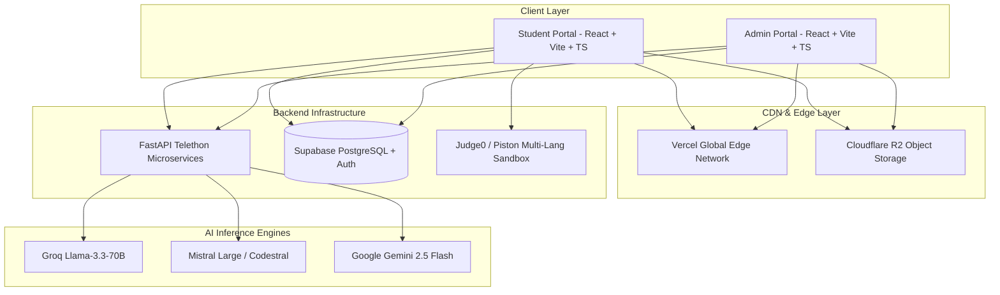
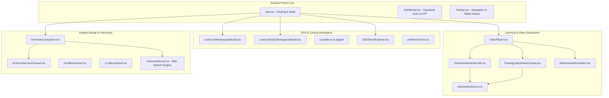
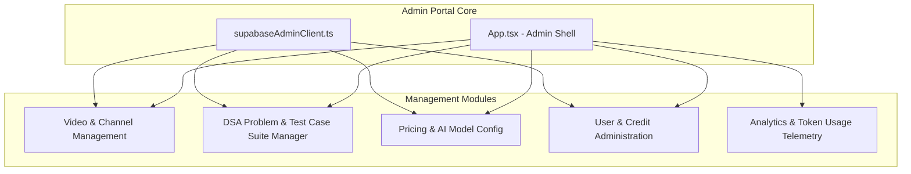
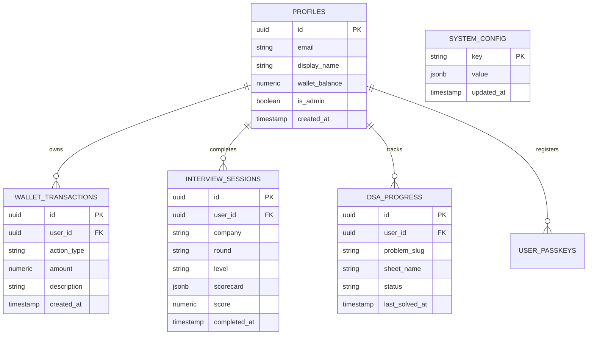

# SDETube Platform Architecture & System Design Document

**SDETube** (Live Production: [https://sdetube.vercel.app](https://sdetube.vercel.app)) is an enterprise-grade, full-stack educational and engineering interview preparation platform designed specifically for Software Development Engineers in Test (SDET) and Backend Software Engineers.

---

## 1. High-Level System Architecture Overview

---

## 2. Student Portal Architecture & Functionality

The Student Portal (`src/`) is designed with a dark-mode glassmorphic interface built on React, TypeScript, TailwindCSS/Vanilla CSS, and Monaco Editor.

### 2.1 Component & Service Map

---

### 2.2 Student Features & Technical Implementation

#### A. Video Streaming & Real-Time Learning Pipeline
1. **Telethon MTProto Cloud Proxy**:
   - Streams Telegram video bytes on demand via FastAPI backend chunked HTTP streaming (`getStreamUrl`).
   - Supports range requests (`bytes=...`) for instant seeking without buffering whole files.
2. **Web Audio API Hardware Booster**:
   - Custom `AudioContext` with `createGain()` amplifier (100% to 300% volume boost) to amplify quiet speech in lecture recordings.
3. **Speech-to-Text Verbatim Transcript**:
   - Synchronized speech transcript generated via backend Whisper/Mistral speech engine.
4. **AI Notes & Interactive Simulation**:
   - Time-coded dynamic visual simulations rendered alongside lectures for complex algorithmic patterns.
5. **Spacebar Global Control**:
   - Universal play/pause toggle with intelligent input/textarea focus bypass.

#### B. Student Personal Video Notes System
- **Dual-Mode Taking**:
  - **In-Tab View**: Dedicated `Student Notes` tab below player for comprehensive study.
  - **Floating Draggable Overlay**: Translucent glass overlay inside the video viewport (`FloatingVideoNotesOverlay.tsx`), enabling notes taking even in native **Fullscreen** mode.
- **Persistence & Sync Guarantee**:
  - Immediate local caching via `localStorage`.
  - Background auto-synchronization to Cloudflare R2 every 60 seconds.
  - One-click timestamp insertion (`@ MM:SS`) that bookmarks video playback.
  - One-click `.txt` notes export.

#### C. Full Multi-Language DSA Workspace
- **Monaco Editor Environment**:
  - Multi-language support: **TypeScript, JavaScript, Python, Java, C++**.
  - Intelligent driver injection (`compiler.ts`): Automatically merges user class/method solutions with hidden competitive test suites.
  - Live execution via Judge0/Piston sandbox with custom testcase runners.
  - In-browser SQLite WASM environment for SQL problem evaluation.
- **Curated DSA Sheets**:
  - Striver SDE Sheet, NeetCode 150, Blind 75, and CodeStoryWithMIK.
  - Company tags (Google, Amazon, Meta, Microsoft, Apple, Uber) and difficulty filtering.

#### D. AI Mock Interview Room (Lead Bar Raiser Engine)
- **FAANG Bar Raiser Voice Synthesis (TTS)**:
  - Chromium-optimized speech synthesis engine with 60ms cancel debounce, GC retention queue, and 5-second keepalive heartbeats.
  - Direct user-gesture audio unlock upon entering the room.
  - Technical acronym cleaner (`QPS` $\to$ `Q P S`, `HLD` $\to$ `high level design`).
- **Socratic System Design (HLD) Canvas**:
  - Interactive drag-and-drop architecture diagramming.
  - Full-width canvas maximizer toggle for complex architecture drafting.
  - Strict Socratic constraint (prevents the AI from prematurely leaking architectural solutions).
- **Billing & Token Gatekeeping**:
  - ₹10 standard interview fee deducted dynamically from user wallet via `billing.ts`.

---

## 3. Admin Portal Architecture & Functionality

The Admin Portal (`admin-portal/`) is an isolated, secure administrative management suite built for platform operators to manage courses, content, test cases, pricing, and system-wide telemetry.

---

### 3.1 Admin Features & Technical Implementation

#### A. Channel & Video Catalog Ingestion
1. **Telegram Channel Sync**:
   - Ingests video posts directly from Telegram educational channels using MTProto.
   - Batch parses message IDs, telegram captions, file sizes, and video durations.
2. **AI Transcript & Artifact Triggering**:
   - Admin can view real-time processing status of video speech recognition.
   - Admin can force-regenerate transcripts and AI lecture notes with a confirmation modal (`"i am sure"` guard).

#### B. DSA Problem & Test Case Suite Administration
1. **Problem Catalog Editor**:
   - Add, edit, and categorize DSA questions across sheets (Striver, NeetCode, Blind75, Mik).
   - Configure starter templates for all 5 languages (Python, Java, C++, TS, JS).
2. **Cloudflare R2 Test Suite Management**:
   - Upload and update comprehensive edge-case test case JSON suites in Cloudflare R2 (`problems/{slug}/testcases.json`).
   - Validate and test canonical driver code execution directly against Judge0.

#### C. Platform Pricing & AI Model Configuration
1. **Dynamic Credit Pricing**:
   - Configure global credit cost for platform actions:
     - `AI_MOCK_INTERVIEW`: Standard ₹10.00.
     - `AI_CHAT_QUERY`: ₹1.00.
     - `AI_CODE_SUBMISSION`: Free / ₹0.50.
2. **API Key & Model Selection Engine**:
   - Rotate Groq, Mistral, and Gemini API keys dynamically without downtime.
   - Select default LLM temperature, max token bounds, and reasoning effort levels.

#### D. User & Wallet Administration
1. **Student Account Overview**:
   - Search students by email, user ID, or creation date.
   - Inspect user wallet balances, verified email statuses, and passkey registrations.
2. **Credit Adjustments & Transaction History**:
   - Manual balance top-up / refund operations with mandatory audit reasons.
   - Live transaction logs with timestamps and action breakdowns.

#### E. Analytics & Platform Telemetry
1. **Engagement Metrics**:
   - Total active lecture watch minutes tracked in 5-second increments.
   - Mock interview completion rates and average candidate scores.
   - DSA sheet progress velocity across the user base.
2. **Financial & Token Telemetry**:
   - Gross wallet top-up revenue and credit consumption rates.
   - AI token usage breakdowns across Groq, Mistral, and Gemini providers.

---

## 4. Cloudflare R2 Storage Schema

Cloudflare R2 provides sub-millisecond, globally distributed object storage for persistent notes, problem drivers, test cases, and transcripts:

| R2 Key Pattern | Purpose | Format |
|---|---|---|
| `vnotes_{user_email}_{video_id}` | Student Personal Video Notes | Raw Text / Markdown |
| `notes/{doc_id}` | System Design Boss Sheets (LLD/HLD) | Markdown Document |
| `problems/{slug}/metadata.json` | DSA Problem Details & Constraints | JSON |
| `problems/{slug}/testcases.json` | Complete Test Case Suite | JSON Array |
| `problems/{slug}/driver.{lang}` | Hidden Multi-Language Test Harness | Python, Java, C++, TS, JS |
| `transcripts/{channel_id}_{msg_id}.txt` | Verbatim Speech-to-Text Transcript | Plain Text |

---

## 5. Database Schema (Supabase PostgreSQL)

---

## 6. Security, Authentication & Performance Design

1. **Authentication & Identity**:
   - Supabase Auth with strict email confirmation / OTP verification prior to session grant.
   - WebAuthn / FIDO2 Passkey biometric authentication support for passwordless login.
2. **Session Isolation & Rate Limiting**:
   - Token-bucket rate limiting across all AI chat and execution endpoints.
   - Anti-tamper Turnstile Captcha on authentication and wallet top-ups.
3. **Edge Optimization**:
   - Code splitting and asset gzip optimization across Vercel edge nodes.
   - LocalStorage client caching with cross-tab broadcast synchronization.
