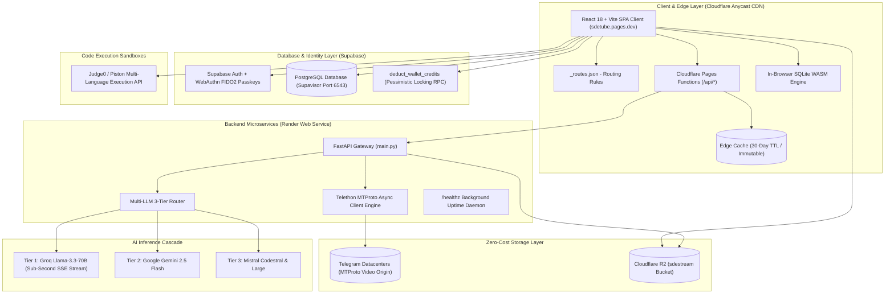
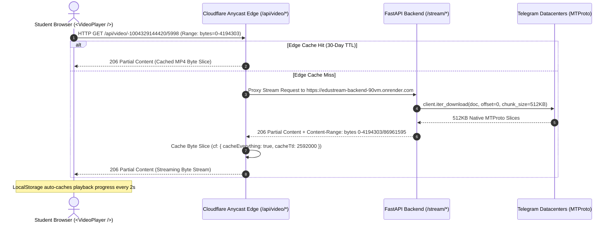
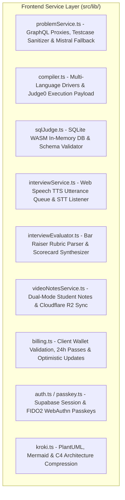
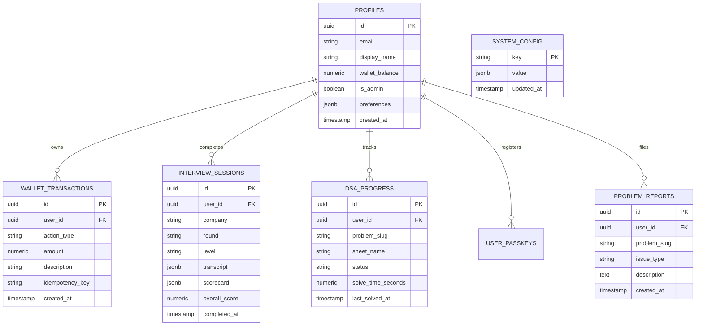

# SDETube Platform Architecture & System Design Document (HLD & LLD)

**SDETube (EduStream)** (Live Production: [https://sdetube.pages.dev](https://sdetube.pages.dev) | Backend Gateway: `https://edustream-backend-90vm.onrender.com`) is an enterprise-grade, full-stack educational and engineering interview preparation platform designed specifically for Software Development Engineers in Test (SDET) and Backend Software Engineers.

---

## 1. High-Level System Architecture Overview



---

## 2. Zero-Cost Edge Video Delivery & Streaming Engine



### Video Pipeline Specifications:
1. **Cloudflare Catch-All Edge Proxy (`functions/api/[[catchall]].ts`)**: Rewrites `/api/video/{channel}/{msgId}` to `/stream/{channel}/{msgId}` and locks byte slices in edge cache for 30 days (`Cache-Control: public, max-age=2592000, s-maxage=2592000, immutable`).
2. **Telethon MTProto Native Alignment (`backend/main.py`)**: 512 KB request parts (`REQUEST_SIZE = 512 * 1024`) with 4 MB range window (`DEFAULT_RANGE_SIZE = 4 * 1024 * 1024`).
3. **Byte-Offset Resumption Loop**: Automatically catches connection interruptions and resumes from the exact byte offset without dropping the HTTP stream.
4. **Player Buffering Watchdog (`src/components/VideoPlayer.tsx`)**: Unfreezes HTML5 decoder stalls by nudging `currentTime` $+0.05\text{s}$ after $3.5\text{s}$ stall.

---

## 3. Low-Level Design (LLD): Pages, Routes & Component Subsystems

### 3.1 Routing & URL Hash Specification

| Tab / Mode | Route / Hash | Associated React Component | Description |
|---|---|---|---|
| **Dashboard** | `#/dashboard` | `DashboardLandingPage.tsx` | Central platform hub with POTD cards, progress summary, and resume banner. |
| **DSA Sheets** | `#/dsa-sheets`, `#/sde-sheet` | `SDESheetExplorer.tsx` | Striver 191, A2Z 474, SDETube 79, Blind 75, Mik Sheet with search and filters. |
| **Coding IDE** | `#/problem/:slug` | `LeetCodeWorkspaceModal.tsx` | Fullscreen Monaco workspace, multi-language driver runner, custom test cases. |
| **SQL IDE** | `#/problem/:slug` (SQL) | `LeetCodeSQLWorkspaceModal.tsx` | SQLite WASM database workspace with table schemas, mock data, query runner. |
| **Video Channel** | `#/channel/:id` | `App.tsx` (channel overview/detail) | Lecture playlist browser with completion indicators and search. |
| **Video Lesson** | `#/lesson/:videoId` | `VideoPlayer.tsx` | MTProto video player with in-tab/floating notes, audio booster, and quiz. |
| **HLD Hub** | `#/hld`, `#/system-design` | `HLDHub.tsx`, `HLDBossSheet.tsx` | System Design master sheets and interactive architecture canvas. |
| **LLD Hub** | `#/lld` | `LLDHub.tsx`, `LLDBossSheet.tsx` | Low-Level Design patterns, UML class diagrams, and machine coding problems. |
| **Mock Interview** | `#/interview` | `InterviewCompanion.tsx` | AI Lead Bar Raiser voice simulator, Socratic guide, live canvas & scorecard. |
| **User Profile** | `#/profile`, `#/user/:id` | `DeveloperProfilePage.tsx` | Student velocity heatmap, solved challenges, badges, certificates. |
| **Admin Portal** | `#/admin` | `AdminDashboardModal.tsx` | Operator telemetry, token usage, R2 problem testcase editor, and user credits. |

---

## 4. Frontend Core Services (`src/lib/`)



---

## 5. Cloudflare R2 Storage Schema (`sdestream` Bucket)

| Key Pattern | Purpose | Format | Access Mode |
|---|---|---|---|
| `problems/{slug}.json` | Problem definition, metadata, constraints, examples | JSON | REST / SigV4 S3 |
| `problems/{slug}.txt` | Formatted plain-text test case suite | Plain Text | REST / SigV4 S3 |
| `drivers/{slug}_{lang}.txt` | Multi-language execution driver code (C++, Python, Java, JS, Go, Rust) | Source Code | REST / SigV4 S3 |
| `notes/{doc_id}.md` | System Design HLD/LLD Boss Sheet guides | Markdown | REST / SigV4 S3 |
| `vnotes/{user_email}_{video_id}.md` | Student personal video notes | Markdown | REST / SigV4 S3 |
| `transcripts/{channel_id}_{msg_id}.txt` | Speech-to-Text lecture transcripts | Plain Text | REST / SigV4 S3 |

---

## 6. Database Schema (Supabase PostgreSQL)



### 6.1 Atomic Concurrency Protection (`deduct_wallet_credits`)

```sql
CREATE OR REPLACE FUNCTION public.deduct_wallet_credits(
  p_user_id UUID,
  p_amount NUMERIC,
  p_action_type TEXT,
  p_description TEXT,
  p_idempotency_key TEXT DEFAULT NULL
)
RETURNS JSONB
LANGUAGE plpgsql
SECURITY DEFINER
AS $$
DECLARE
  v_current_balance NUMERIC;
  v_new_balance NUMERIC;
BEGIN
  -- Idempotency protection
  IF p_idempotency_key IS NOT NULL THEN
    IF EXISTS (SELECT 1 FROM public.wallet_transactions WHERE idempotency_key = p_idempotency_key) THEN
      SELECT wallet_balance INTO v_current_balance FROM public.profiles WHERE id = p_user_id;
      RETURN jsonb_build_object('success', true, 'balance', v_current_balance, 'duplicate', true);
    END IF;
  END IF;

  -- Acquire pessimistic row lock
  SELECT wallet_balance INTO v_current_balance 
  FROM public.profiles 
  WHERE id = p_user_id 
  FOR UPDATE;

  IF v_current_balance < p_amount THEN
    RETURN jsonb_build_object('success', false, 'error', 'INSUFFICIENT_FUNDS', 'balance', v_current_balance);
  END IF;

  v_new_balance := v_current_balance - p_amount;
  UPDATE public.profiles SET wallet_balance = v_new_balance WHERE id = p_user_id;

  INSERT INTO public.wallet_transactions (user_id, action_type, amount, description, idempotency_key)
  VALUES (p_user_id, p_action_type, p_amount, p_description, p_idempotency_key);

  RETURN jsonb_build_object('success', true, 'balance', v_new_balance);
END;
$$;
```

---

## 7. Complete API Route Reference

| Route | Method | Layer | Description | Response / Headers |
|---|---|---|---|---|
| `/stream/{channel}/{msgId}` | `GET` | Backend (FastAPI) | Direct MTProto streaming slice | `206 Partial Content`, Range-based |
| `/api/video/{channel}/{msgId}` | `GET` | Edge (Cloudflare) | Anycast video stream proxy | `Cache-Control: public, max-age=2592000, immutable` |
| `/api/catalog` | `GET` | Backend | Ingested video lecture channel catalog | `public, max-age=3600` |
| `/api/leetcode/{slug}` | `GET` | Backend & Edge | LeetCode GraphQL question proxy | `no-cache, must-revalidate` |
| `/api/gfg/{slug}` | `GET` | Backend & Edge | GeeksforGeeks Practice API proxy | `no-cache, must-revalidate` |
| `/api/potd/leetcode` | `GET` | Backend & Edge | Current authentic LeetCode Daily Challenge | `no-cache, max-age=0` |
| `/api/potd/gfg` | `GET` | Backend & Edge | Current authentic GFG Problem of the Day | `no-cache, max-age=0` |
| `/api/problem/{slug}` | `DELETE` | Backend | Purges stored problem JSON, testcases, and drivers from R2 | `200 OK` |
| `/api/potd/clear` | `POST` | Backend | Invalidates backend in-memory POTD caches | `200 OK` |
| `/api/chat` | `POST` | Backend | Multi-tier AI streaming endpoint (Groq/Gemini/Mistral) | SSE Token Stream |
| `/api/hld/simulate` | `POST` | Backend | Simulates traffic load, latency, and failure on HLD canvas | JSON simulation telemetry |
| `/healthz` | `GET` | Backend | Uptime keepalive endpoint for Render instance | `200 OK` |
