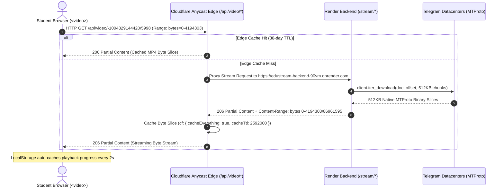
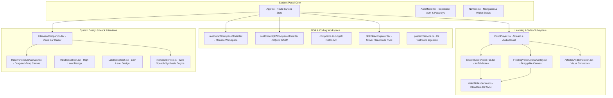
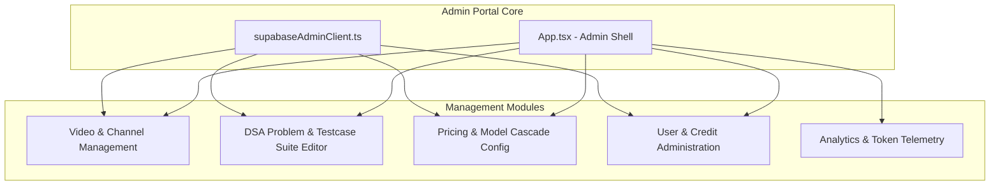
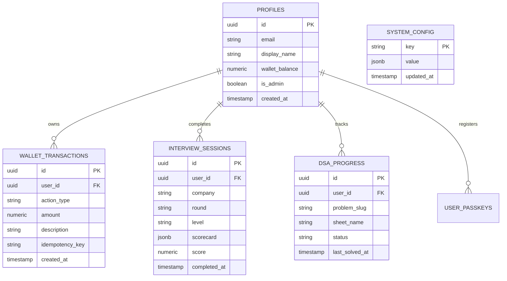

# SDETube Platform Architecture & System Design Document

**SDETube** (Live Production: [https://sdetube.pages.dev](https://sdetube.pages.dev)) is an enterprise-grade, full-stack educational and engineering interview preparation platform designed specifically for Software Development Engineers in Test (SDET) and Backend Software Engineers.

---

## 1. High-Level System Architecture Overview

```mermaid
graph TB
    subgraph Client & Edge Layer "Cloudflare Anycast Global Edge"
        SPA[React 18 + Vite SPA Client]
        RTE[_routes.json - Routing Engine]
        CF_EDGE[Cloudflare Pages Functions Proxy - /api/*]
        CF_CACHE[(Edge Cache - 30 Days TTL / Immutable)]
    end

    subgraph Backend Microservices "Render Web Service"
        FA[FastAPI Gateway]
        TEL[Telethon MTProto Async Client]
        AI_ROUTER[Multi-LLM 3-Tier Cascade Engine]
        PING[/healthz - Uptime Keepalive]
    end

    subgraph Storage Layer "$0 Cloud"
        TG[(Telegram Private Channels - MTProto Origin)]
        R2[(Cloudflare R2 - Testcases, Drivers & Notes)]
    end

    subgraph Data & Auth "Supabase PostgreSQL"
        AUTH[Supabase Auth & FIDO2 Passkeys]
        DB[(PostgreSQL - Supavisor Port 6543)]
        RPC[deduct_wallet_credits - Atomic Transaction RPC]
    end

    subgraph AI Inference Providers
        GRQ[Tier 1: Groq Llama-3.3-70B - SSE Streaming]
        GEM[Tier 2: Google Gemini 2.5 Flash]
        MST[Tier 3: Mistral Codestral / Large]
    end

    subgraph Code Execution Sandbox
        J0[Judge0 / Piston Multi-Lang Execution API]
        WASM[In-Browser SQLite WASM Compiler]
    end

    SPA --> RTE
    SPA --> CF_EDGE
    CF_EDGE --> CF_CACHE
    CF_EDGE --> FA
    FA --> TEL
    TEL --> TG
    FA --> AI_ROUTER
    AI_ROUTER --> GRQ
    AI_ROUTER --> GEM
    AI_ROUTER --> MST
    SPA --> DB
    SPA --> AUTH
    SPA --> RPC
    SPA --> R2
    SPA --> J0
    SPA --> WASM
```

---

## 2. Zero-Cost Edge Video Delivery & Streaming Engine



### 2.1 Video Pipeline Specifications

1. **Cloudflare Catch-All Edge Proxy (`functions/api/[[catchall]].ts`)**:
   - Runs on Cloudflare V8 Workers at Anycast edge locations worldwide.
   - Automatically rewrites `/api/video/{channel}/{msgId}` to `/stream/{channel}/{msgId}` on the Render backend.
   - Locks byte-range responses into Cloudflare Edge Cache for 30 days (`Cache-Control: public, max-age=2592000, s-maxage=2592000, immutable`).
2. **Telethon MTProto Native Alignment (`backend/main.py`)**:
   - MTProto request chunk size: **512 KB** (`REQUEST_SIZE = 512 * 1024`), the native maximum throughput part size for Telegram datacenters.
   - Default range window: **4 MB** (`DEFAULT_RANGE_SIZE = 4 * 1024 * 1024`) to ensure deep client buffer ahead of playback.
   - **Byte-Offset Retry Loop**: If MTProto drops a socket connection mid-stream (`0 bytes read on total of 8 expected bytes`), the generator automatically re-authenticates and continues from the exact byte offset without dropping the HTTP stream.
3. **Player Buffering Watchdog & Multi-Tier Failover (`src/components/VideoPlayer.tsx`)**:
   - **Origin Failover**: If the edge proxy experiences cold start or network failure, the player seamlessly falls back to the direct Render origin (`https://edustream-backend-90vm.onrender.com/stream/...`).
   - **Frozen Decoder Watchdog**: If playback stalls for $> 3.5\text{s}$ while in playing state, the player nudges `currentTime` by $+0.05\text{s}$ to unstuck the HTML5 media decoder pipeline.
   - **Progress Caching & Auto-Resume**: `localStorage` records video progress under `edustream_prog_{channelId}_{msgId}`. Reopening any lecture automatically resumes from the saved second with a `"⏩ Resumed from MM:SS"` notification.

---

## 3. Student Portal Architecture & Subsystems

The Student Portal (`src/`) is built on React 18, TypeScript, TailwindCSS/Vanilla CSS, and Monaco Editor.

### 3.1 Component & Service Map



---

### 3.2 Key Capabilities & Modules

#### A. Full Multi-Language DSA Workspace
- **Monaco Editor Environment**:
  - Languages supported: **TypeScript, JavaScript, Python, Java, C++**.
  - Intelligent Driver Injection (`compiler.ts`): Combines student class/method solutions with hidden competitive test harnesses.
  - Live execution via Judge0 / Piston sandboxes with custom testcase execution.
  - In-browser SQLite WASM compiler for real-time SQL problem evaluation.
- **Curated DSA Sheets**:
  - Striver SDE Sheet (191), Striver A2Z (474), SDETube 79, NeetCode Blind 75, and CodeStoryWithMIK.
  - Real-time company tags (Google, Amazon, Meta, Microsoft, Apple, Uber) and difficulty filtering.

#### B. AI Mock Interview Room (Lead Bar Raiser Engine)
- **Chromium-Optimized Web Speech Synthesis (TTS)**:
  - 60ms cancel debounce, GC audio retention queue, and 5-second keepalive heartbeats.
  - Automatic user-gesture audio unlock upon entering the room.
  - Technical acronym expansion (`QPS` $\to$ `Q P S`, `HLD` $\to$ `high level design`).
- **Socratic System Design (HLD) Canvas**:
  - Drag-and-drop architectural diagramming canvas.
  - Strict Socratic constraint (prevents the AI from prematurely leaking architectural solutions).
- **Multi-LLM 3-Tier Cascade**:
  - **Tier 1 (Groq Llama-3.3-70B)**: Sub-second Server-Sent Events (SSE) streaming token output.
  - **Tier 2 (Google Gemini 2.5 Flash)**: Complex contextual and architectural evaluation.
  - **Tier 3 (Mistral Codestral)**: Code syntax and algorithmic correctness analysis.

#### C. Student Personal Video Notes System
- **Dual-Mode Taking**:
  - **In-Tab View**: Full markdown notes editor below the lecture player.
  - **Floating Draggable Overlay**: Glassmorphic overlay inside video viewport (`FloatingVideoNotesOverlay.tsx`), enabling notes taking during native **Fullscreen** mode.
- **Persistence & Cloud Backup**:
  - Local caching via `localStorage`.
  - Automatic cloud synchronization to Cloudflare R2 every 60 seconds.
  - One-click timestamp bookmarks (`@ MM:SS`) that jump directly to video timestamps.

---

## 4. Admin Portal Architecture

The Admin Portal (`admin-portal/`) is an isolated, secure administrative suite for platform operators to manage curriculum, video feeds, testcase suites, pricing, and system-wide telemetry.



---

## 5. Cloudflare R2 Storage Schema

Cloudflare R2 provides sub-millisecond, globally distributed object storage for persistent notes, problem drivers, test cases, and transcripts:

| R2 Key Pattern | Purpose | Format |
|---|---|---|
| `vnotes_{user_email}_{video_id}` | Student Personal Video Notes | Raw Text / Markdown |
| `notes/{doc_id}` | System Design Boss Sheets (LLD/HLD) | Markdown Document |
| `problems/{slug}/metadata.json` | DSA Problem Details & Constraints | JSON |
| `problems/{slug}/testcases.json` | Complete Test Case Suite | JSON Array |
| `problems/{slug}/driver.{lang}` | Hidden Multi-Language Test Harness | Python, Java, C++, TS, JS |
| `transcripts/{channel_id}_{msg_id}.txt` | Verbatim Speech-to-Text Transcript | Plain Text |

---

## 6. Database Schema (Supabase PostgreSQL)



### 6.1 Atomic Concurrency Protection (`deduct_wallet_credits`)

All wallet deductions execute through a PostgreSQL transaction with pessimistic row-level locking (`SELECT ... FOR UPDATE`):

```sql
CREATE OR REPLACE FUNCTION public.deduct_wallet_credits(
  p_user_id UUID,
  p_amount NUMERIC,
  p_action_type TEXT,
  p_description TEXT,
  p_idempotency_key TEXT DEFAULT NULL
)
RETURNS JSONB
LANGUAGE plpgsql
SECURITY DEFINER
AS $$
DECLARE
  v_current_balance NUMERIC;
  v_new_balance NUMERIC;
BEGIN
  -- Check for duplicate idempotency key
  IF p_idempotency_key IS NOT NULL THEN
    IF EXISTS (SELECT 1 FROM public.wallet_transactions WHERE idempotency_key = p_idempotency_key) THEN
      SELECT wallet_balance INTO v_current_balance FROM public.profiles WHERE id = p_user_id;
      RETURN jsonb_build_object('success', true, 'balance', v_current_balance, 'duplicate', true);
    END IF;
  END IF;

  -- Acquire pessimistic lock on profile row
  SELECT wallet_balance INTO v_current_balance 
  FROM public.profiles 
  WHERE id = p_user_id 
  FOR UPDATE;

  IF v_current_balance < p_amount THEN
    RETURN jsonb_build_object('success', false, 'error', 'INSUFFICIENT_FUNDS', 'balance', v_current_balance);
  END IF;

  v_new_balance := v_current_balance - p_amount;

  UPDATE public.profiles SET wallet_balance = v_new_balance WHERE id = p_user_id;

  INSERT INTO public.wallet_transactions (user_id, action_type, amount, description, idempotency_key)
  VALUES (p_user_id, p_action_type, p_amount, p_description, p_idempotency_key);

  RETURN jsonb_build_object('success', true, 'balance', v_new_balance);
END;
$$;
```

---

## 7. Security, Authentication & Performance Design

1. **Authentication & Identity**:
   - Supabase Auth with email confirmation / OTP verification prior to session grant.
   - WebAuthn / FIDO2 Passkey biometric authentication support for passwordless login.
2. **Session Isolation & Rate Limiting**:
   - Token-bucket rate limiting across all AI chat and code execution endpoints.
   - Cloudflare Turnstile bot protection on authentication and wallet top-ups.
3. **Edge Optimization**:
   - Cloudflare Pages Anycast global edge network with gzip and Brotli compression.
   - Automatic route and state synchronization across browser reloads via `window.history.replaceState`.
   - LocalStorage client caching with cross-tab broadcast synchronization.
