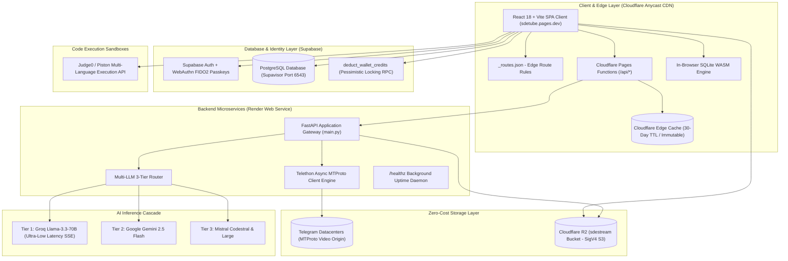
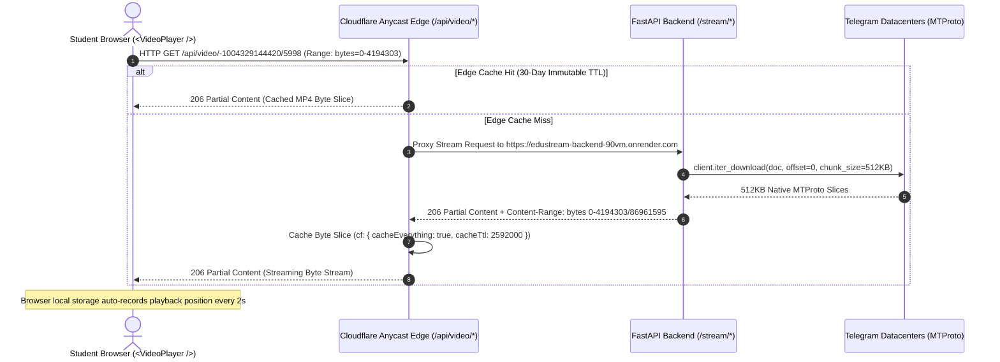
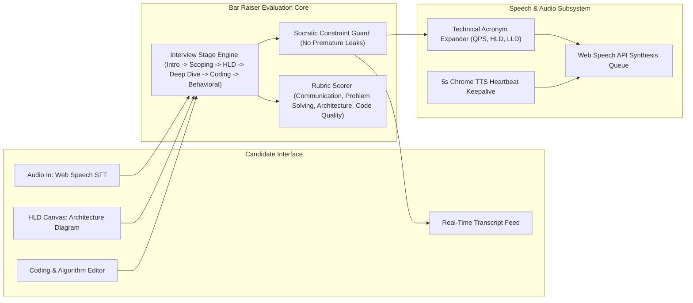
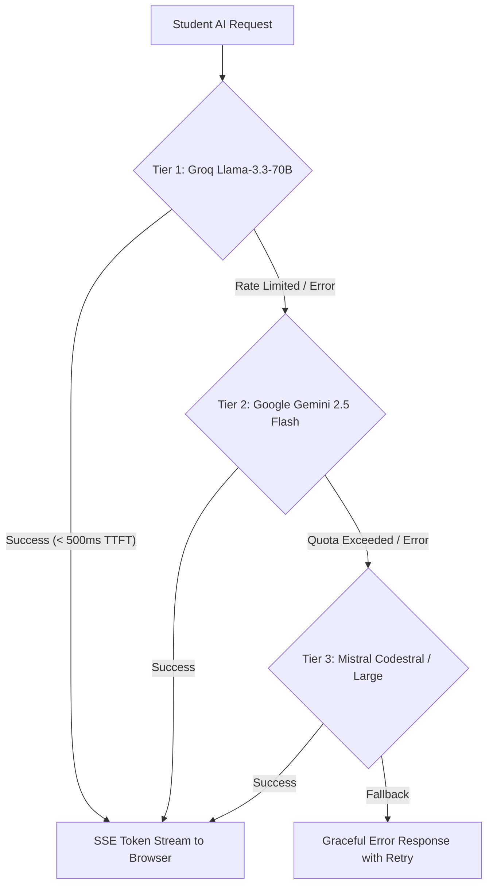
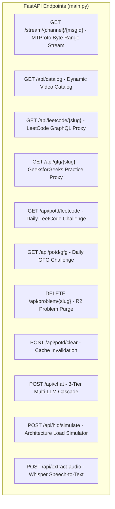
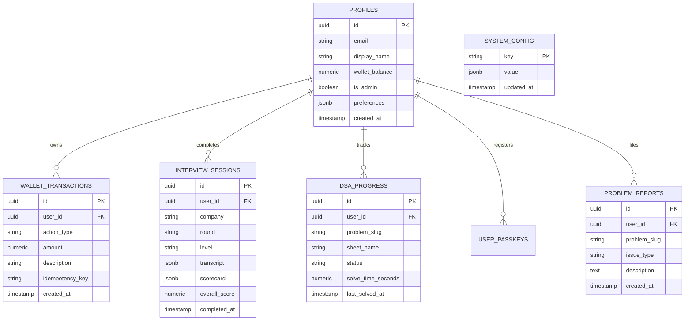
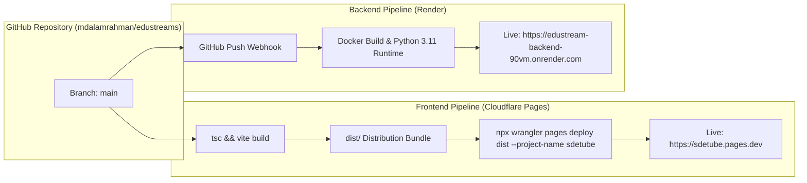

# SDETube / EduStream: Comprehensive High-Level & Low-Level System Design Document (HLD & LLD)

**Live Production Platform**: [https://sdetube.pages.dev](https://sdetube.pages.dev)  
**Backend Origin Gateway**: `https://edustream-backend-90vm.onrender.com`  
**Target Audience**: Software Development Engineers in Test (SDET), Distributed Backend Engineers, Full-Stack Developers.

---

# Table of Contents
1. [Executive Summary & Product Vision](#1-executive-summary--product-vision)
2. [High-Level Design (HLD)](#2-high-level-design-hld)
   - 2.1 [End-to-End System Architecture](#21-end-to-end-system-architecture)
   - 2.2 [Edge Video Delivery & Streaming Engine ($0 Cloud Storage)](#22-edge-video-delivery--streaming-engine-0-cloud-storage)
   - 2.3 [AI Mock Interview Engine (Lead Bar Raiser)](#23-ai-mock-interview-engine-lead-bar-raiser)
   - 2.4 [Multi-Tier AI Inference Cascade](#24-multi-tier-ai-inference-cascade)
   - 2.5 [Atomic Concurrency & Wallet Transaction Ledger](#25-atomic-concurrency--wallet-transaction-ledger)
3. [Low-Level Design (LLD)](#3-low-level-design-lld)
   - 3.1 [Frontend Architecture & Module Hierarchy](#31-frontend-architecture--module-hierarchy)
   - 3.2 [Pages, Views & Modal Systems](#32-pages-views--modal-systems)
   - 3.3 [Routing Engine & Hash Navigation Specification](#33-routing-engine--hash-navigation-specification)
   - 3.4 [State Management, Browser Storage & Custom Events](#34-state-management-browser-storage--custom-events)
   - 3.5 [Frontend Core Services Deep Dive (`src/lib/`)](#35-frontend-core-services-deep-dive-srclib)
4. [Backend Architecture Deep Dive (`backend/` & `functions/`)](#4-backend-architecture-deep-dive-backend--functions)
   - 4.1 [FastAPI Gateway (`backend/main.py`)](#41-fastapi-gateway-backendmainpy)
   - 4.2 [Cloudflare R2 Object Storage Manager (`backend/r2_storage.py`)](#42-cloudflare-r2-object-storage-manager-backendr2_storagepy)
   - 4.3 [Cloudflare Edge Functions (`functions/api/`)](#43-cloudflare-edge-functions-functionsapi)
5. [Database & Storage Data Models](#5-database--storage-data-models)
   - 5.1 [Supabase PostgreSQL Entity Relationship (ER) Diagram](#51-supabase-postgresql-entity-relationship-er-diagram)
   - 5.2 [Cloudflare R2 Object Storage Key Hierarchy](#52-cloudflare-r2-object-storage-key-hierarchy)
6. [API Route Specifications (Backend & Edge)](#6-api-route-specifications-backend--edge)
7. [DevOps, CI/CD & Deployment Pipeline](#7-devops-cicd--deployment-pipeline)

---

# 1. Executive Summary & Product Vision

**SDETube (EduStream)** is an enterprise-grade educational ecosystem engineered for Software Engineers and SDETs. It combines:
1. **Interactive Coding & Problem Workspace**: Real-time multi-language code execution (C++, Python, Java, JavaScript, Go, Rust) with Monaco Editor, automatic driver synthesis, and hidden test harnesses.
2. **In-Browser SQL WASM Sandbox**: Zero-latency SQLite WebAssembly database simulation for SQL challenge validation without server overhead.
3. **Voice-Driven AI Mock Interview Room**: Lead Bar Raiser interview companion with real-time speech synthesis (TTS), speech recognition (STT), Socratic constraint checking, interactive HLD drag-and-drop architecture canvas, and automated rubric scoring.
4. **Zero-Cost Edge Video Streaming Engine**: Streams high-definition video directly from Telegram MTProto datacenters through Cloudflare Anycast edge caching with byte-range slicing and 30-day immutable caching.
5. **System Design & DSA Master Sheets**: Complete curated collections including Striver SDE 191, Striver A2Z 474, SDETube 79, Blind 75, and CodeStoryWithMIK, paired with HLD/LLD Boss Sheets and interactive Kroki/PlantUML diagrams.

---

# 2. High-Level Design (HLD)

## 2.1 End-to-End System Architecture



---

## 2.2 Edge Video Delivery & Streaming Engine ($0 Cloud Storage)

The platform delivers high-definition lecture videos with $0 recurring storage and bandwidth costs by utilizing Telegram's distributed MTProto datacenters as the origin media repository and Cloudflare Pages Functions as an Anycast caching proxy.



### Key Technical Specifications:
1. **512 KB MTProto Alignment**: Requests to Telegram are chunked in `512 * 1024` bytes, exactly matching MTProto datacenter packet boundaries.
2. **4 MB Sliding Range Window**: Range responses default to a 4 MB window (`DEFAULT_RANGE_SIZE = 4 * 1024 * 1024`) to provide deep player buffers.
3. **Byte-Offset Resumption**: If MTProto drops mid-stream, the generator re-authenticates and resumes from the exact byte offset without terminating the HTTP stream.
4. **Frozen Decoder Watchdog**: If the HTML5 video element stalls for $> 3.5\text{s}$, the player micro-nudges `currentTime` by $+0.05\text{s}$ to unstuck the browser hardware decoder.

---

## 2.3 AI Mock Interview Engine (Lead Bar Raiser)



---

## 2.4 Multi-Tier AI Inference Cascade

When students interact with Ask AI, Mock Interviews, or AI Problem Synthesis, queries are routed through a 3-tier cascade to maximize speed and ensure 100% uptime:



---

## 2.5 Atomic Concurrency & Wallet Transaction Ledger

To prevent double-spending and race conditions when unlocking video lectures, mock interview credits, or AI queries, all balance operations execute through a PostgreSQL transaction with pessimistic row-level locking (`SELECT ... FOR UPDATE`):

```mermaid
sequenceDiagram
    autonumber
    actor User as Client Request
    participant App as billing.ts
    participant RPC as deduct_wallet_credits (PL/pgSQL)
    participant DB as PostgreSQL (profiles & wallet_transactions)

    User->>App: Request Action (e.g. Unlock Lecture ₹2.00)
    App->>RPC: Call deduct_wallet_credits(p_user_id, p_amount, p_action, p_idempotency_key)
    activate RPC
    RPC->>DB: Check Idempotency Key
    alt Duplicate Request
        DB-->>RPC: Key Exists
        RPC-->>App: { success: true, balance: current, duplicate: true }
    else New Request
        RPC->>DB: SELECT wallet_balance FROM profiles WHERE id = p_user_id FOR UPDATE
        Note over DB: Row locked; concurrent requests wait
        alt wallet_balance < p_amount
            RPC-->>App: { success: false, error: 'INSUFFICIENT_FUNDS' }
        else wallet_balance >= p_amount
            RPC->>DB: UPDATE profiles SET wallet_balance = wallet_balance - p_amount
            RPC->>DB: INSERT INTO wallet_transactions (user_id, action_type, amount, idempotency_key)
            RPC-->>App: { success: true, balance: new_balance }
        end
    end
    deactivate RPC
```

---

# 3. Low-Level Design (LLD)

## 3.1 Frontend Architecture & Module Hierarchy

```
src/
├── App.tsx                           # Master application controller, hash-router & global state
├── main.tsx                          # React 18 DOM root mount
├── index.css                         # Tailored dark-mode glassmorphic design system
│
├── components/                       # 44 Modular React UI Components
│   ├── DashboardLandingPage.tsx      # Main platform dashboard & quick-access cards
│   ├── SDESheetExplorer.tsx          # Multi-sheet DSA explorer (1000+ problems, company tags)
│   ├── LeetCodeWorkspaceModal.tsx    # Monaco-based coding IDE, custom testcases, driver runner
│   ├── LeetCodeSQLWorkspaceModal.tsx # In-browser SQLite WASM SQL challenge IDE
│   ├── POTDModal.tsx                 # Problem of the Day modal (LeetCode & GFG daily challenges)
│   ├── VideoPlayer.tsx               # MTProto video player, 16-band audio boost, timestamp bookmarking
│   ├── StudentVideoNotesTab.tsx      # In-tab markdown personal video notes editor
│   ├── FloatingVideoNotesOverlay.tsx # Draggable glassmorphic notes overlay for fullscreen video mode
│   ├── InterviewCompanion.tsx        # Voice-driven Lead Bar Raiser mock interview companion
│   ├── InterviewScorecardModal.tsx   # Detailed rubric evaluation & interview scorecard modal
│   ├── HLDHub.tsx                    # System Design / HLD module directory & curated roadmaps
│   ├── HLDBossSheet.tsx              # Deep-dive High-Level Design architectural guides
│   ├── HLDArchitectureCanvas.tsx     # Interactive drag-and-drop architecture diagramming canvas
│   ├── LLDHub.tsx                    # Low-Level Design directory & design pattern catalog
│   ├── LLDBossSheet.tsx              # Comprehensive Object-Oriented Design & LLD guides
│   ├── DeveloperProfilePage.tsx      # Student velocity tracker, solved problems & achievements
│   ├── UserProfileModal.tsx          # Passkey management, wallet history & personal settings
│   ├── AdminDashboardModal.tsx       # Operator dashboard: metrics, token usage, testcase manager
│   ├── WalletTopupModal.tsx          # Credit recharge modal with Turnstile captcha
│   ├── InsufficientCreditsModal.tsx  # Dynamic credit gate popup with one-click topup
│   ├── AskAIChatModal.tsx            # Context-aware floating AI mentor with multi-tier streaming
│   ├── KrokiDiagramModal.tsx         # Interactive PlantUML / Mermaid / C4 diagram viewer
│   ├── QuizModule.tsx                # Auto-generated lecture video comprehension quiz
│   └── MobileGatedOverlay.tsx        # Desktop-first gating banner for mobile screen viewports
│
└── lib/                              # Core Frontend Services & Data Modules
    ├── problemService.ts             # LeetCode/GFG GraphQL proxies, testcase repair, AI synthesis
    ├── compiler.ts                   # Multi-language Judge0 payload synthesis & driver injection
    ├── sqlJudge.ts                   # In-browser SQLite WASM compiler & query validator
    ├── leetcodeApi.ts                # Direct LeetCode API client & POTD scrapers
    ├── interviewService.ts           # Speech synthesis (TTS) & Web Speech recognition (STT)
    ├── interviewEvaluator.ts         # Bar Raiser rubric scoring & feedback parser
    ├── interviewHistoryService.ts    # Past interview session persistence (Supabase + LocalStorage)
    ├── videoNotesService.ts          # Dual-mode student video notes sync with Cloudflare R2
    ├── notesService.ts               # LLD/HLD Boss Sheet R2 synchronization
    ├── billing.ts                    # Client-side wallet checks, video view billing & pricing config
    ├── auth.ts                       # Supabase auth session, auto-login & student profile
    ├── passkey.ts & webauthn.ts      # FIDO2 WebAuthn credential registration & verification
    ├── supabase.ts                   # Supabase client singleton, mock channels & video catalog
    ├── analytics.ts                  # Velocity tracking, problem solved metrics & heatmaps
    ├── kroki.ts                      # Kroki diagram compression & SVG generation
    ├── mistral.ts & groq.ts          # AI client connectors with streaming support
    └── dsaSheetsData.ts              # Striver 191, A2Z 474, SDETube 79, Blind 75, Mik Sheet datasets
```

---

## 3.2 Pages, Views & Modal Systems

| View / Component | URL Hash / Route | Description | Key Subcomponents |
|---|---|---|---|
| **Dashboard** | `#/dashboard` | Central hub displaying POTDs, video lectures, progress stats, and quick resume. | `DashboardLandingPage.tsx`, `POTDModal.tsx` |
| **DSA Sheets Explorer** | `#/dsa-sheets` or `#/sde-sheet` | 5 curated DSA sheets with company tags, difficulty filters, and search. | `SDESheetExplorer.tsx`, `SubmissionVisualizer.tsx` |
| **Coding IDE** | `#/problem/:slug` | Fullscreen Monaco coding workspace with multi-lang drivers and testcase execution. | `LeetCodeWorkspaceModal.tsx`, `CodeWorkspace.tsx`, `ReportTestCaseModal.tsx` |
| **SQL IDE** | `#/problem/:slug` (SQL) | SQLite WASM database workspace with table schemas, sample data, and query runner. | `LeetCodeSQLWorkspaceModal.tsx`, `sqlJudge.ts` |
| **Video Lectures** | `#/channel/:id` & `#/lesson/:videoId` | Course channel catalog and video player with personal notes and quizzes. | `VideoPlayer.tsx`, `StudentVideoNotesTab.tsx`, `FloatingVideoNotesOverlay.tsx`, `QuizModule.tsx` |
| **HLD Hub** | `#/hld` or `#/system-design` | High-Level Design roadmaps, system architectures, and interactive diagramming. | `HLDHub.tsx`, `HLDBossSheet.tsx`, `HLDArchitectureCanvas.tsx` |
| **LLD Hub** | `#/lld` | Low-Level Design, design patterns, UML class diagrams, and machine coding problems. | `LLDHub.tsx`, `LLDBossSheet.tsx`, `KrokiDiagramViewer.tsx` |
| **Mock Interview Room** | `#/interview` | Voice-driven AI Lead Bar Raiser interview simulator with live HLD canvas and scoring. | `InterviewCompanion.tsx`, `InterviewScorecardModal.tsx` |
| **Developer Profile** | `#/profile` or `#/user/:id` | Student portfolio, coding velocity heatmap, solved problem history, and certificates. | `DeveloperProfilePage.tsx`, `VelocityTracker.tsx`, `CertificateModal.tsx` |
| **Admin Portal** | `#/admin` | Operator dashboard for telemetry, token cost tracking, R2 testcase suite editor, and user credits. | `AdminDashboardModal.tsx`, `supabaseAdmin.ts` |

---

## 3.3 Routing Engine & Hash Navigation Specification

The routing engine in `src/App.tsx` handles browser back/forward history, query parameters, and direct deep-linking through URL hashes:

```ts
// Hash & Route Resolution Hierarchy (App.tsx)
const getInitialTab = (): TabType => {
  const hash = window.location.hash || '';
  const pathname = window.location.pathname || '';
  const params = new URLSearchParams(window.location.search);

  // 1. Explicit query parameter (?tab=...)
  const qTab = params.get('tab');
  if (qTab && VALID_TABS.includes(qTab)) return qTab;

  // 2. Hash-based routing
  if (hash.startsWith('#/problem/') || hash.startsWith('#/dsa-sheets')) return 'sde_sheet';
  if (hash.startsWith('#/lld')) return 'lld';
  if (hash.startsWith('#/hld') || hash.startsWith('#/system-design')) return 'hld';
  if (hash.startsWith('#/interview')) return 'interview';
  if (hash.startsWith('#/profile') || hash.startsWith('#/user/')) return 'profile';
  if (hash.startsWith('#/analytics')) return 'analytics';
  if (hash.startsWith('#/channels') || hash.startsWith('#/channel/')) return 'channels';
  if (hash.startsWith('#/lesson') || hash.startsWith('#/video/')) return 'lesson';

  return 'dashboard';
};
```

---

## 3.4 State Management, Browser Storage & Custom Events

### LocalStorage Schema:
| LocalStorage Key | Purpose |
|---|---|
| `edustream_student_session` | Authenticated student profile session payload |
| `edustream_prog_{channelId}_{msgId}` | Video playback progress in seconds for auto-resume |
| `edustream_problem_spec_{slug}` | Cached authentic problem specification (description, examples, constraints) |
| `edustream_testcases_txt_{slug}` | Formatted plain-text test case suite |
| `edustream_driver_{slug}_{lang}` | Cached multi-language execution driver code |
| `edustream_saved_code_{slug}_{lang}` | Student's in-progress solution code per problem & language |
| `vnotes_{email}_{videoId}` | Student's personal lecture video notes |
| `edustream_interview_history` | History of completed mock interview scorecards |
| `edustream_video_passes` | Active 24-hour video lecture access passes |

### Global Window Custom Events:
- `sdetube_pause_video`: Pauses active video playback when opening modals (e.g. Ask AI, POTD, Workspace).
- `sdetube_resume_video`: Resumes playback upon modal dismissal.
- `edustream_wallet_updated`: Broadcasts real-time wallet balance changes to all navbar and modal listeners.

---

## 3.5 Frontend Core Services Deep Dive (`src/lib/`)

### 1. `problemService.ts` (Problem Enrichment & Testcase Repair)
- **LeetCode GraphQL Integration**: Fetches problem specifications via `/api/leetcode/question?slug={slug}` or direct GraphQL query.
- **GFG Practice API Integration**: Fetches problem details via `/api/gfg/{slug}` and practice API.
- **Sanitization & Hardening (`repairAndHardenProblem`)**:
  - Automatically identifies single-parameter vs multi-parameter functions.
  - Formats parameter names (e.g. `nums = [1, 2, 3]`, `target = 9`).
  - Guards against hallucinated AI templates with strict signature matching.
- **Cache Eviction**: Automatically purges stale placeholder descriptions from `localStorage`.

### 2. `compiler.ts` (Multi-Language Execution Engine)
- Combines student's class/method solution with language-specific driver code.
- Serializes payloads for the Judge0 / Piston execution sandboxes:
  - **C++**: Injects `<iostream>`, `<vector>`, `<string>`, `<algorithm>`, parsing stdin into inputs and printing structured outputs.
  - **Python**: Injects `json` parser and custom test harness.
  - **Java**: Wraps solution inside `public class Main` with stdin parser.
  - **JavaScript / TypeScript**: Wraps solution with Node.js `readline` parser.

### 3. `sqlJudge.ts` (In-Browser SQLite WASM Sandbox)
- Initializes `@sqlite.org/sqlite-wasm` inside the browser Web Worker.
- Executes DDL schema statements, inserts mock table records, runs student's SQL query, and compares output matrices with expected SQL tables.

### 4. `interviewService.ts` & `interviewEvaluator.ts` (Bar Raiser Voice Engine)
- **Speech Synthesis (TTS)**: Utterance queue manager with GC retention to prevent Chrome TTS stuttering.
- **Speech Recognition (STT)**: Continuous speech recognition with silence detection.
- **Socratic Prompting**: Ensures the AI acts as a Senior Staff Bar Raiser, asking probing architectural questions without revealing answers prematurely.
- **Rubric Evaluator**: Analyzes transcript against 4 criteria (Communication, Problem Solving, System Design, Coding) and outputs structured JSON scorecards.

---

# 4. Backend Architecture Deep Dive (`backend/` & `functions/`)

## 4.1 FastAPI Gateway (`backend/main.py`)

The backend is an asynchronous FastAPI application running on Render:



### Core Backend Modules:
1. **Telethon MTProto Streamer**:
   - Maintains an authenticated Telegram client session (`edustream_session`).
   - Streams video files directly from Telegram datacenters using `client.iter_download()`.
   - Supports HTTP `Range` headers for seeking and progressive download.
2. **Dynamic POTD Scraper & Proxy**:
   - Scrapes daily challenges from LeetCode GraphQL and GFG.
   - Automatically cleans problem HTML, extracts example test cases, and caches results.
3. **Multi-LLM Inference Cascade**:
   - Dispatches prompts to Groq (Llama-3.3-70B), Gemini 2.5 Flash, or Mistral with automatic fallback.

---

## 4.2 Cloudflare R2 Object Storage Manager (`backend/r2_storage.py`)

Provides native AWS SigV4 signed REST and Boto3 operations for Cloudflare R2 bucket `sdestream`:
- **Zero Third-Party Dependency SigV4 Implementation**: Computes SHA256 HMAC authorization headers natively using Python `hashlib` and `hmac`.
- **Upload & Retrieval**:
  - `upload_problem(slug, data)`: Stores `problems/{slug}.json`.
  - `upload_testcases_txt(slug, text)`: Stores `problems/{slug}.txt`.
  - `upload_driver(slug, lang, code)`: Stores `drivers/{slug}_{lang}.txt`.
- **Purge & Deletion**:
  - `delete_problem(slug)`: Deletes JSON specs, text testcases, and multi-language drivers for clean regeneration.

---

## 4.3 Cloudflare Edge Functions (`functions/api/`)

Cloudflare Pages Functions execute at 300+ Anycast edge datacenters:
- **`[[catchall]].ts`**: Intercepts `/api/video/*` and proxies to the Render backend, caching 206 Partial Content video slices for 30 days (`Cache-Control: public, max-age=2592000, s-maxage=2592000, immutable`).
- **`potd/leetcode.ts` & `potd/gfg.ts`**: Edge proxies for daily challenges with zero-cache headers.
- **`leetcode/question.ts`**: Sanitizes problem slugs and proxies GraphQL requests to LeetCode with zero-cache headers.

---

# 5. Database & Storage Data Models

## 5.1 Supabase PostgreSQL Entity Relationship (ER) Diagram



---

## 5.2 Cloudflare R2 Object Storage Key Hierarchy

```
sdestream (R2 Bucket)
├── problems/
│   ├── {slug}.json                    # Problem metadata, title, constraints, examples
│   └── {slug}.txt                     # Formatted testcase input/output suite
├── drivers/
│   ├── {slug}_cpp.txt                 # C++ execution driver harness
│   ├── {slug}_python.txt              # Python execution driver harness
│   ├── {slug}_java.txt                # Java execution driver harness
│   ├── {slug}_javascript.txt          # JavaScript execution driver harness
│   ├── {slug}_go.txt                  # Go execution driver harness
│   └── {slug}_rust.txt                # Rust execution driver harness
├── notes/
│   └── {doc_id}.md                    # System Design HLD/LLD Boss Sheet Markdown
└── vnotes/
    └── {user_email}_{video_id}.md     # Student personal lecture video notes
```

---

# 6. API Route Specifications (Backend & Edge)

| Endpoint | Method | Layer | Description | Cache Policy |
|---|---|---|---|---|
| `/stream/{channel}/{msgId}` | `GET` | Backend (FastAPI) | Streams MP4 video chunk directly from Telegram MTProto | `206 Partial Content`, Range-based |
| `/api/video/{channel}/{msgId}` | `GET` | Edge (Cloudflare) | Anycast video proxy with immutable edge caching | `public, max-age=2592000, immutable` |
| `/api/catalog` | `GET` | Backend | Ingested video lecture channel catalog & message IDs | `public, max-age=3600` |
| `/api/leetcode/{slug}` | `GET` | Backend & Edge | LeetCode GraphQL problem spec proxy | `no-cache, must-revalidate` |
| `/api/gfg/{slug}` | `GET` | Backend & Edge | GeeksforGeeks Practice API problem spec proxy | `no-cache, must-revalidate` |
| `/api/potd/leetcode` | `GET` | Backend & Edge | Current authentic LeetCode Daily Challenge | `no-cache, max-age=0` |
| `/api/potd/gfg` | `GET` | Backend & Edge | Current authentic GFG Problem of the Day | `no-cache, max-age=0` |
| `/api/problem/{slug}` | `DELETE` | Backend | Purges stored problem JSON, testcases, and drivers from R2 | No cache |
| `/api/potd/clear` | `POST` | Backend | Invalidates backend in-memory POTD caches | No cache |
| `/api/chat` | `POST` | Backend | Multi-tier AI streaming endpoint (Groq/Gemini/Mistral) | SSE Stream |
| `/api/hld/simulate` | `POST` | Backend | Simulates traffic load, latency, and failure on HLD canvas | No cache |
| `/healthz` | `GET` | Backend | Uptime keepalive endpoint for Render free tier | `200 OK` |

---

# 7. DevOps, CI/CD & Deployment Pipeline



### Production Deployment Commands:
- **Frontend Build & Deploy**:
  ```bash
  npm run build
  npx wrangler pages deploy dist --project-name sdetube --branch main
  ```
- **Backend Deploy**:
  ```bash
  git push origin main  # Automatic Render build trigger via Webhook
  ```
