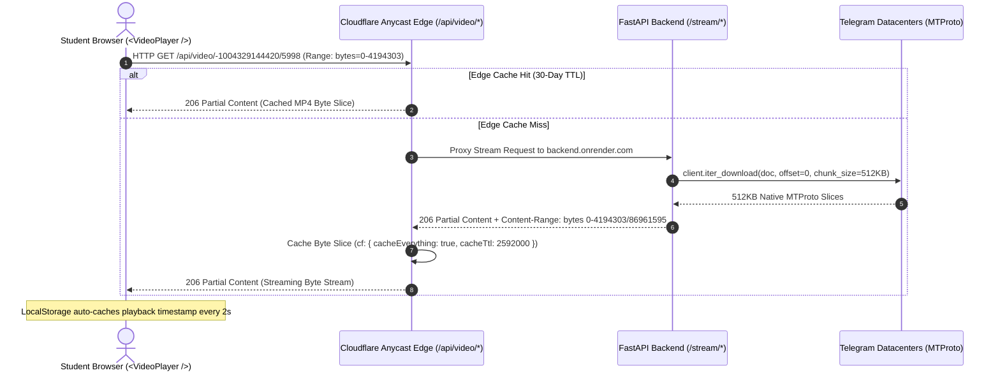
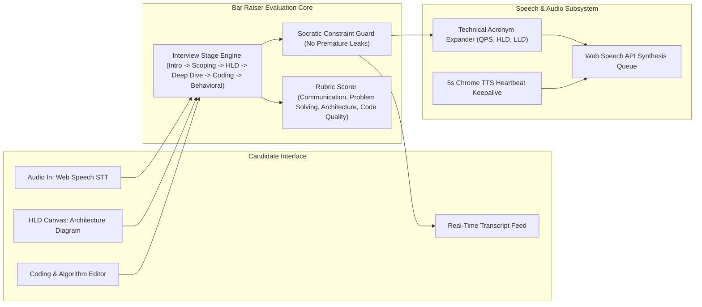
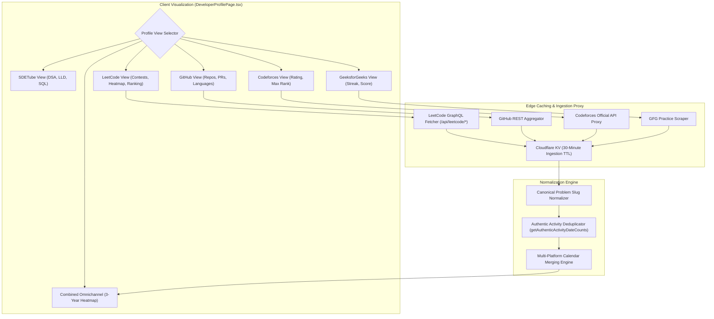
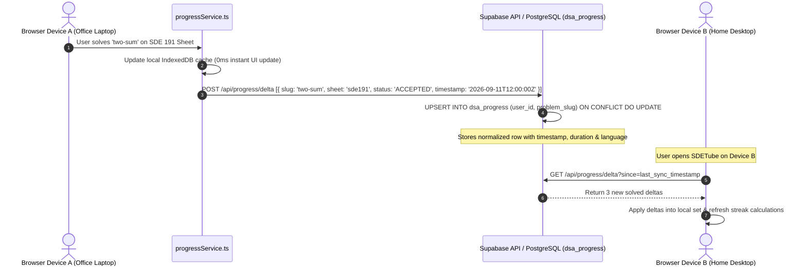
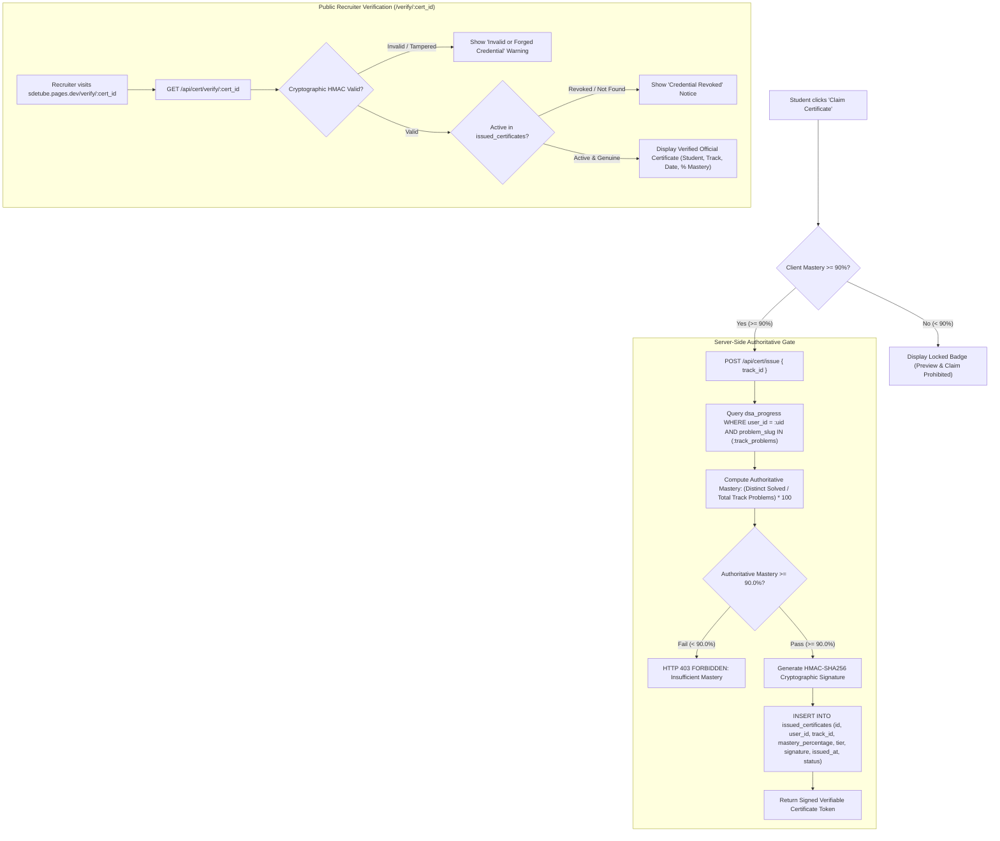
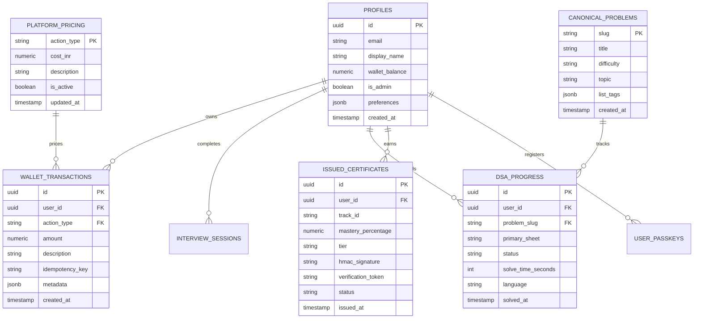

# SDETube / EduStream: Comprehensive High-Level & Low-Level Design (HLD & LLD)

**Live Production Platform**: [https://sdetube.pages.dev](https://sdetube.pages.dev)  
**Backend API Gateway**: `https://edustream-backend-90vm.onrender.com`  
**GitHub Repository**: `mdalamrahman/edustreams`

---

# Table of Contents
1. [System High-Level Design (HLD)](#1-system-high-level-design-hld)
   - 1.1 [End-to-End System Architecture](#11-end-to-end-system-architecture)
   - 1.2 [Zero-Cost Edge Video Delivery Engine](#12-zero-cost-edge-video-delivery-engine)
   - 1.3 [Streamlined Two-Tier AI Inference Cascade with Edge Cache](#13-streamlined-two-tier-ai-inference-cascade-with-edge-cache)
   - 1.4 [Lead Bar Raiser Voice Mock Interview Subsystem](#14-lead-bar-raiser-voice-mock-interview-subsystem)
   - 1.5 [Server-Authoritative Pricing & Zero-Trust Wallet Ledger](#15-server-authoritative-pricing--zero-trust-wallet-ledger)
   - 1.6 [Omnichannel Developer Profile & Analytics Ingestion Engine](#16-omnichannel-developer-profile--analytics-ingestion-engine)
   - 1.7 [Inter-Device Normalized Delta Progress Synchronization Engine](#17-inter-device-normalized-delta-progress-synchronization-engine)
   - 1.8 [Cryptographically Verifiable Certification & Server-Side Security Gate](#18-cryptographically-verifiable-certification--server-side-security-gate)
2. [Full Platform User & Data Flow](#2-full-platform-user--data-flow)
   - 2.1 [Student Onboarding & Passwordless Passkey Flow](#21-student-onboarding--passwordless-passkey-flow)
   - 2.2 [DSA Problem Solving & Code Execution Flow](#22-dsa-problem-solving--code-execution-flow)
   - 2.3 [SQL Challenge & In-Browser WASM Execution Flow](#23-sql-challenge--in-browser-wasm-execution-flow)
   - 2.4 [Video Lecture Streaming & Dual-Mode Notes Sync Flow](#24-video-lecture-streaming--dual-mode-notes-sync-flow)
   - 2.5 [Lead Bar Raiser Voice Interview & Scorecard Flow](#25-lead-bar-raiser-voice-interview--scorecard-flow)
   - 2.6 [Server-Authoritative Wallet Billing, 24-Hour Passes & Top-Up Flow](#26-server-authoritative-wallet-billing-24-hour-passes--top-up-flow)
   - 2.7 [Omnichannel Developer Profile & Multi-Platform Aggregation Flow](#27-omnichannel-developer-profile--multi-platform-aggregation-flow)
   - 2.8 [Inter-Device Normalized Delta Sync & Storage Healing Flow](#28-inter-device-normalized-delta-sync--storage-healing-flow)
   - 2.9 [Cryptographic Certificate Issuance & Server-Side Verification Flow](#29-cryptographic-certificate-issuance--server-side-verification-flow)
3. [Low-Level Design (LLD): Component Architecture (`src/components/`)](#3-low-level-design-lld-component-architecture-srccomponents)
   - 3.1 [Master Shell & Routing Controller (`App.tsx`, `DashboardLandingPage.tsx`)](#31-master-shell--routing-controller-apptsx-dashboardlandingpagetsx)
   - 3.2 [Coding & Algorithm Workspaces](#32-coding--algorithm-workspaces)
   - 3.3 [System Design & Mock Interview Rooms](#33-system-design--mock-interview-rooms)
   - 3.4 [Video Streaming & Notes Subsystem](#34-video-streaming--notes-subsystem)
   - 3.5 [Identity, Wallet, Profiles & Certificates](#35-identity-wallet-profiles--certificates)
   - 3.6 [Diagramming, Quizzes & Supporting UI Components](#36-diagramming-quizzes--supporting-ui-components)
4. [Low-Level Design (LLD): Core Services Deep Dive (`src/lib/`)](#4-low-level-design-lld-core-services-deep-dive-srclib)
   - 4.1 [Problem & Execution Pipeline (`problemService.ts`, `compiler.ts`, `sqlJudge.ts`)](#41-problem--execution-pipeline-problemservicets-compilerts-sqljudgets)
   - 4.2 [AI & Voice Engines (`interviewService.ts`, `interviewEvaluator.ts`, `gemini.ts`, `groq.ts`)](#42-ai--voice-engines-interviewservicets-interviewevaluatorts-geminits-groqts)
   - 4.3 [Storage, Notes & Boss Sheets (`videoNotesService.ts`, `notesService.ts`, `kroki.ts`)](#43-storage-notes--boss-sheets-videonotesservicets-notesservicets-krokits)
   - 4.4 [Billing, Auth & Security (`billing.ts`, `auth.ts`, `passkey.ts`, `webauthn.ts`)](#44-billing-auth--security-billingts-authts-passkeyts-webauthnts)
   - 4.5 [Unified Canonical Problem Bank Architecture (`canonicalProblems.ts`, `dsaSheetsData.ts`)](#45-unified-canonical-problem-bank-architecture-canonicalproblemsts-dsasheetsdatats)
   - 4.6 [Unified Analytics & Activity Deduplication Pipeline (`analytics.ts`, `userProfileService.ts`)](#46-unified-analytics--activity-deduplication-pipeline-analyticsts-userprofileservicets)
   - 4.7 [Normalized Delta Cloud Synchronization Service (`progressService.ts`)](#47-normalized-delta-cloud-synchronization-service-progressservicets)
5. [Backend Microservices Low-Level Design (`backend/` & `functions/`)](#5-backend-microservices-low-level-design-backend--functions)
   - 5.1 [FastAPI Gateway & Route Handlers (`backend/main.py`)](#51-fastapi-gateway--route-handlers-backendmainpy)
   - 5.2 [Cloudflare R2 SigV4 Storage Manager (`backend/r2_storage.py`)](#52-cloudflare-r2-sigv4-storage-manager-backendr2_storagepy)
   - 5.3 [Edge Functions & Proxy Layer (`functions/api/`)](#53-edge-functions--proxy-layer-functionsapi)
6. [Database Schema, RPC Functions & Storage Architecture](#6-database-schema-rpc-functions--storage-architecture)
   - 6.1 [Normalized PostgreSQL Table Schemas & Relationships](#61-normalized-postgresql-table-schemas--relationships)
   - 6.2 [Server-Authoritative Stored Procedures & Concurrency Locks](#62-server-authoritative-stored-procedures--concurrency-locks)
   - 6.3 [Cloudflare R2 Object Hierarchy](#63-cloudflare-r2-object-hierarchy)
7. [API Route Specifications & Contracts](#7-api-route-specifications--contracts)
8. [Strategic Architecture Additions](#8-strategic-architecture-additions)
   - 8.1 [Multi-Tier Edge & Server Caching for External Profiles & Metrics](#81-multi-tier-edge--server-caching-for-external-profiles--metrics)
   - 8.2 [Per-User AI Token Quotas & Sliding-Window Rate Limiting](#82-per-user-ai-token-quotas--sliding-window-rate-limiting)
   - 8.3 [Submission Integrity & Anti-Plagiarism Heuristics](#83-submission-integrity--anti-plagiarism-heuristics)
   - 8.4 [Shareable Public Portfolio & Dynamic Resume Generator](#84-shareable-public-portfolio--dynamic-resume-generator)
   - 8.5 [Spaced Repetition (SM-2 / Leitner Algorithm) Review Engine](#85-spaced-repetition-sm-2--leitner-algorithm-review-engine)
9. [Architectural Simplifications & Pruning](#9-architectural-simplifications--pruning)
   - 9.1 [Streamlined Two-Tier AI Cascade (Eliminating Mistral Fallback Overhead)](#91-streamlined-two-tier-ai-cascade-eliminating-mistral-fallback-overhead)
   - 9.2 [Zero-Trust Client Balance Policy & Server-Authoritative Gating](#92-zero-trust-client-balance-policy--server-authoritative-gating)

---

# 1. System High-Level Design (HLD)

## 1.1 End-to-End System Architecture

```mermaid
graph TB
    subgraph ClientTier ["1. Client Application Tier (Single Page Application)"]
        BROWSER["Modern Web Browser (Vite + React 18 + TypeScript)"]
        MONACO["Monaco Editor (6 Languages)"]
        SQL_WASM["In-Browser SQLite WASM"]
        VOICE_REC["Web Speech API (STT & TTS)"]
        EXCALI["Excalidraw & HLD Canvas"]
        KROKI_CLIENT["Kroki PlantUML / C4 Renderer"]
        LOCAL_STORAGE["Optimistic Local Cache (IndexedDB / LocalStorage)"]
    end

    subgraph EdgeCDN ["2. Global Edge & Ingress Tier (Cloudflare Anycast)"]
        CF_PAGES["Cloudflare Pages CDN"]
        CF_WORKERS["Cloudflare Workers (Edge Proxies & Cache)"]
        EDGE_CACHE["Cloudflare Cache (30-Day Video & Exact Response Cache)"]
        EDGE_KV["Cloudflare Workers KV (Profile & External API Cache)"]
        TURNSTILE["Cloudflare Turnstile (Anti-Bot Verification)"]
    end

    subgraph BackendGateway ["3. Backend Microservices Tier (FastAPI & Render)"]
        FASTAPI["FastAPI App (Python 3.11 ASGI)"]
        TELETHON["Telethon MTProto Client Pool"]
        R2_CLIENT["Custom SigV4 AWS S3/R2 Client"]
        JUDGE_PROXY["Judge0 CE Multi-Language Execution Broker"]
        AI_GATEWAY["AI Gateway & Token Bucket Rate Limiter"]
    end

    subgraph CloudStorage ["4. Storage & Persistence Tier"]
        CF_R2[("Cloudflare R2 Bucket: sdestream (Testcases, Drivers, Notes)")]
        SUPABASE_PG[("Supabase PostgreSQL (Profiles, Normalized Progress, Certificates, Pricing, Ledger)")]
        SUPABASE_AUTH["Supabase Auth & WebAuthn / Passkeys"]
        TG_DATACENTERS[("Telegram Cloud Datacenters (Video Storage)")]
    end

    subgraph ExternalServices ["5. External APIs & Inference Tier"]
        LLM_GROQ["Groq API (Llama-3.3-70B-Versatile - Primary Tier)"]
        LLM_GEMINI["Google Gemini 1.5 Flash (Complex Reasoning Fallback)"]
        LC_API["LeetCode GraphQL API"]
        GFG_API["GeeksforGeeks Practice API"]
        GH_API["GitHub REST API"]
        CF_API["Codeforces Official API"]
    end

    BROWSER --> CF_PAGES
    BROWSER --> CF_WORKERS
    CF_WORKERS --> EDGE_CACHE
    CF_WORKERS --> EDGE_KV
    CF_WORKERS --> FASTAPI
    CF_WORKERS --> SUPABASE_PG
    CF_WORKERS --> SUPABASE_AUTH

    FASTAPI --> TELETHON
    FASTAPI --> R2_CLIENT
    FASTAPI --> JUDGE_PROXY
    FASTAPI --> AI_GATEWAY
    AI_GATEWAY --> LLM_GROQ
    AI_GATEWAY --> LLM_GEMINI

    TELETHON --> TG_DATACENTERS
    R2_CLIENT --> CF_R2
    EDGE_KV --> LC_API
    EDGE_KV --> GH_API
    EDGE_KV --> CF_API
```



---

## 1.2 Zero-Cost Edge Video Delivery Engine



---

## 1.3 Streamlined Two-Tier AI Inference Cascade with Edge Cache

To eliminate cold-start latency and avoid third-tier failure cascades, SDETube adopts a **streamlined two-tier architecture** augmented by an Edge Semantic & Exact Response Cache:

```mermaid
graph TD
    REQ[Student AI Request / Code Review / Mock Interview] --> KV_CHECK{Edge Response Cache Hit?}
    KV_CHECK -- "Hit (40% of standard questions)" --> INSTANT_RESP[Return Cached Response (0ms LLM Cost)]
    KV_CHECK -- "Miss" --> RATE_LIMIT{User Token Budget OK?}
    RATE_LIMIT -- "Budget Exceeded" --> ERR_429[HTTP 429: Token Quota Exceeded]
    RATE_LIMIT -- "Allowed" --> T1{Tier 1: Groq Llama-3.3-70B}
    T1 -- "Success (< 450ms TTFT)" --> STREAM[SSE Stream to Browser + Async Write to Edge Cache]
    T1 -- "Rate Limited / 5xx" --> T2{Tier 2: Google Gemini 1.5 Flash}
    T2 -- "Success" --> STREAM
    T2 -- "Failed" --> FALLBACK[Graceful Degradation with Socratic Hints]
```

---

## 1.4 Lead Bar Raiser Voice Mock Interview Subsystem



---

## 1.5 Server-Authoritative Pricing & Zero-Trust Wallet Ledger

### The Security Trust Boundary
Under no circumstances does the server trust client-supplied debit amounts. All billing prices reside authoritatively in PostgreSQL table `platform_pricing`. The client passes only the authenticated `p_user_id`, `p_action_type`, and an idempotency key. The stored procedure `deduct_wallet_credits()` retrieves the authoritative price, executes pessimistic locking, and records the transaction atomically.

```mermaid
sequenceDiagram
    autonumber
    actor User as Client Browser
    participant App as billing.ts (Client)
    participant RPC as deduct_wallet_credits (PL/pgSQL)
    participant Pricing as platform_pricing Table
    participant Profiles as profiles Table (Pessimistic Lock)
    participant Ledger as wallet_transactions Table

    User->>App: Request Action (e.g. AI Mock Interview)
    Note over App: Optimistic UI check (balance >= ₹10.00)
    App->>RPC: Call deduct_wallet_credits(p_user_id, 'ai_mock_interview', idempotency_key)
    activate RPC
    RPC->>Pricing: SELECT cost_inr FROM platform_pricing WHERE action_type = 'ai_mock_interview'
    Pricing-->>RPC: cost_inr = ₹10.00 (Derived Server-Side)
    
    RPC->>Ledger: Check Idempotency Key
    alt Duplicate Request Detected
        Ledger-->>RPC: Key Already Processed
        RPC-->>App: { success: true, duplicate: true, balance: current }
    else Fresh Request
        RPC->>Profiles: SELECT wallet_balance FROM profiles WHERE id = p_user_id FOR UPDATE
        Note over Profiles: Row locked via FOR UPDATE; concurrent attacks blocked
        alt wallet_balance < ₹10.00
            RPC-->>App: { success: false, error: 'INSUFFICIENT_FUNDS', balance: current, required: 10.00 }
        else wallet_balance >= ₹10.00
            RPC->>Profiles: UPDATE profiles SET wallet_balance = wallet_balance - 10.00
            RPC->>Ledger: INSERT INTO wallet_transactions (user_id, action_type, amount, idempotency_key)
            RPC-->>App: { success: true, balance: new_balance, debited: 10.00 }
        end
    end
    deactivate RPC
```

---

## 1.6 Omnichannel Developer Profile & Analytics Ingestion Engine



---

## 1.7 Inter-Device Normalized Delta Progress Synchronization Engine

To avoid transferring large monolithic arrays that grow into megabytes and cause write conflicts, SDETube standardizes on **Normalized Progress Rows with Lightweight Delta Synchronization**:



---

## 1.8 Cryptographically Verifiable Certification & Server-Side Security Gate

### Tamper-Proof Cryptographic Signature Structure
Certificates are generated using cryptographically signed tokens backed by server-side verification:

$$\text{Token} = \text{SDETUBE-v1}.\text{CERT\_UUID}.\text{BASE64URL}(\text{PAYLOAD}).\text{HMAC\_SHA256}(\text{Secret}, \text{CERT\_UUID} \parallel \text{PAYLOAD})$$

Where `PAYLOAD` contains:
```json
{
  "sub": "usr_99f2e3a1",
  "email": "student@example.com",
  "trk": "sde_191",
  "track_name": "SDE 191 Core Sheet",
  "pct": 94.24,
  "tier": "Distinction",
  "iat": 1789132548,
  "exp": null
}
```



---

# 2. Full Platform User & Data Flow

## 2.1 Student Onboarding & Passwordless Passkey Flow
1. **Initiation**: Student enters email on `AuthModal.tsx`.
2. **WebAuthn FIDO2 Challenge**: Browser requests challenge from Supabase Auth (`navigator.credentials.create`).
3. **Biometric Registration**: Device authenticates user via TouchID/Windows Hello and writes public key credential to `user_passkeys` table.
4. **Welcome Credit**: Supabase triggers welcome grant of ₹10.00 in free credits.

## 2.2 DSA Problem Solving & Code Execution Flow
1. **Workspace Loading (`LeetCodeWorkspaceModal.tsx`)**:
   - Queries Cloudflare R2 for `problems/{slug}.json` and testcase input/output suite `problems/{slug}.txt`.
   - If missing in R2, queries the Edge proxy `functions/api/leetcode/question.ts` and caches the result.
2. **Code Execution (`compiler.ts`)**:
   - Student writes solution in C++, Python, Java, JavaScript, Go, or Rust.
   - Code is merged with language-specific driver template loaded from R2 (`drivers/{slug}_{lang}.txt`).
   - Dispatched to Judge0 CE execution cluster.
3. **Delta Event Dispatch**:
   - When status is `ACCEPTED`, `progressService.ts` logs an authentic solve event and sends a delta upsert to Supabase `dsa_progress`.

## 2.3 SQL Challenge & In-Browser WASM Execution Flow
1. **Schema Initialization (`sqlJudge.ts`)**: Initializes in-memory SQLite WASM database.
2. **Execution**: Executes user SQL queries client-side against predefined schema and test tables with zero backend server overhead.
3. **Comparison**: Compares JSON record tuples against expected testcase output matrices.

## 2.4 Video Lecture Streaming & Dual-Mode Notes Sync Flow
1. **Zero-Cost Streaming**: Cloudflare Anycast edge proxies 206 byte slices from Telegram MTProto datacenters via FastAPI backend.
2. **Notes Storage**:
   - Platform Curated Notes: Fetched from R2 `notes/{doc_id}.md`.
   - Personal Student Notes: Synced automatically to R2 `vnotes/{user_email}_{videoId}.md`.

## 2.5 Lead Bar Raiser Voice Interview & Scorecard Flow
1. **Setup (`InterviewCompanion.tsx`)**: Candidate selects target company (Google, Amazon, Meta), role level (L4, L5, L6), and round (HLD, LLD, Coding, Behavioral).
2. **Voice Interaction (`interviewService.ts`)**:
   - Candidate speaks into microphone; Web Speech STT streams transcript.
   - AI Lead Bar Raiser asks Socratic architectural questions.
   - Web Speech TTS synthesizes voice responses with keepalive protection.
3. **Architecture Diagramming (`HLDArchitectureCanvas.tsx`)**: Candidate drags load balancers, microservices, caches, and databases onto the canvas.
4. **Scorecard Generation (`interviewEvaluator.ts`)**: Upon interview completion, AI evaluates transcript and outputs a structured scorecard with rubric ratings (1-10) and actionable improvement feedback.

## 2.6 Server-Authoritative Wallet Billing, 24-Hour Passes & Top-Up Flow
1. **Pre-Check (UI Hint)**: `billing.ts` checks local cache to give instant visual feedback.
2. **Authoritative Execution**: Calls `deduct_wallet_credits(p_user_id, p_action_type, idempotency_key)`.
3. **Database Ledger**: PostgreSQL resolves price from `platform_pricing`, applies pessimistic row locks, debits the balance, and records an immutable ledger entry in `wallet_transactions`.
4. **Recharge Flow (`WalletTopupModal.tsx`)**: Protected by Cloudflare Turnstile bot verification. Successfully verified recharges trigger instant cryptographic balance update.

## 2.7 Omnichannel Developer Profile & Multi-Platform Aggregation Flow
1. **Mode Selection (`DeveloperProfilePage.tsx`)**: The developer profile supports 6 distinct visualization modes:
   - **SDETube**: Local & cloud-synced DSA, LLD, and SQL progress.
   - **LeetCode**: GraphQL proxy fetching solved counts, ranking, contest rating, and 365-day submission calendar.
   - **GitHub**: Public repositories, contribution graphs, stars, and language distribution.
   - **GeeksforGeeks**: Practice scores, coding streak, and institute rankings.
   - **Codeforces**: Current rating, max rank (e.g., Candidate Master), and recent contest performance.
   - **Combined Omnichannel**: Merged 3-year activity calendar showing aggregated multi-platform developer velocity.
2. **Real-Time Data Ingestion**: When handles are updated in `UserProfileModal.tsx`, background workers query external APIs, parse responses, and populate normalized caches.

## 2.8 Inter-Device Normalized Delta Sync & Storage Healing Flow
1. **Local Writes**: When code is submitted or a problem is checked, `progressService.ts` records the action in `localStorage` and IndexedDB.
2. **Delta Propagation**: If logged in and cloud sync is active, `progressService.ts` dispatches a delta event payload to Supabase `dsa_progress` using `UPSERT ON CONFLICT (user_id, problem_slug)`.
3. **Cross-Device Reconciliation**: When logging in on another device, the client queries `/api/progress/delta?since={timestamp}`, pulls incremental updates, and merges them into the local cache.
4. **Notes Persistence**: Lecture video notes auto-replicate to Cloudflare R2 bucket `sdestream` under `vnotes/{email}_{videoId}.md`.

## 2.9 Cryptographic Certificate Issuance & Server-Side Verification Flow
1. **Progress Assessment**: `getUserTracksCertificates()` computes percentage progress across 6 tracks (SDE 191, Blind 75, MIK Sheet, LLD Design, HLD Systems, and DBMS SQL).
2. **Mastery Threshold**: Only tracks achieving $\ge 90\%$ are marked `isEligible: true`. Artificial floors (`Math.max(1, ...)`) are strictly prohibited.
3. **Multi-Layer UI & Modal Lockout**:
   - Preview buttons are removed on all tracks below 90%.
   - Ineligible cards display a locked badge with `Lock` icon.
   - `handleOpenCert` rejects opening for any track $< 90\%$.
4. **Server-Side Minting**: Client invokes `POST /api/cert/issue`. Server recalculates completion percentage directly against normalized `dsa_progress` table. If $\ge 90.0\%$, the server records the certificate in `issued_certificates` and issues an HMAC-SHA256 signed token.
5. **Public Verification**: Recruiter or candidate visits `sdetube.pages.dev/verify/:cert_id` which verifies cryptographic signature and database status.

---

# 3. Low-Level Design (LLD): Component Architecture (`src/components/`)

## 3.1 Master Shell & Routing Controller (`App.tsx`, `DashboardLandingPage.tsx`)

| File / Component | State & Props | Submodules & Services | Purpose & Integration |
|---|---|---|---|
| **`App.tsx`** | `activeTab`: `'dashboard' \| 'channels' \| 'lesson' \| 'sde_sheet' \| 'lld' \| 'hld' \| 'interview' \| 'profile' \| 'admin'`<br>`selectedVideo`: `Video`<br>`selectedChannelId`: `string`<br>`sdeFullscreenProblem`: `SDEProblem \| null` | `Navbar.tsx`<br>`VideoPlayer.tsx`<br>`SDESheetExplorer.tsx`<br>`POTDModal.tsx`<br>`AskAIChatModal.tsx` | Master routing hub. Listens to `window.location.hash` and `window.history.pushState`. Handles pause/resume video global custom events. |
| **`DashboardLandingPage.tsx`** | `user`: `User \| null`<br>`metrics`: `RealAnalyticsMetrics`<br>`solveEventCount`: `number` | `getRealAnalytics(user?.email)`<br>`resetUnverifiedPotdToday()`<br>`isPotdSolvedToday()` | Primary student mission control. Displays authoritative solved counts (synchronized with profile), SDE readiness score, velocity metrics, POTD trifecta, and curated problem recommendations. |

---

## 3.2 Coding & Algorithm Workspaces

| Component | Props & State | Key Methods / Handlers | Purpose |
|---|---|---|---|
| **`LeetCodeWorkspaceModal.tsx`** | `codingProblem`: `SDEProblem`<br>`isOpen`: `boolean`<br>`onClose`: `() => void`<br>`problemTemplate`: `ProblemTemplate`<br>`activeLang`: `SupportedLanguage` | `handleRun()`, `handleSubmit()`, `handleResetCode()`, `handleReportTestCase()` | Fullscreen Monaco coding IDE. Dynamically loads authentic problem specs and testcases from R2 / LeetCode GraphQL, executes code via `compiler.ts`, and displays execution results. |
| **`LeetCodeSQLWorkspaceModal.tsx`** | `problem`: `SQLProblem`<br>`isOpen`: `boolean`<br>`onClose`: `() => void` | `handleExecuteSQL()`, `handleResetSchema()` | Monaco-based SQL challenge IDE powered by in-browser SQLite WASM (`sqlJudge.ts`). Displays table schemas, expected outputs, and diff visualizers. |
| **`CodeWorkspace.tsx`** | `code`: `string`<br>`language`: `string`<br>`onChange`: `(val: string) => void` | `monaco.editor.create()`, `onDidChangeModelContent()` | Embedded Monaco code editor container with syntax highlighting, IntelliSense, theme customization, and keyboard shortcuts (`Ctrl+Enter` to run). |
| **`POTDModal.tsx`** | `isOpen`: `boolean`<br>`onClose`: `() => void`<br>`onOpenProblem`: `(prob: DSAProblem) => void` | `fetchPOTDData()`, `handleSolveDaily()` | Modal displaying daily challenges for both LeetCode and GeeksforGeeks with streak counters, company tags, and instant IDE launch. |

---

## 3.3 System Design & Mock Interview Rooms

| Component | Props & State | Key Methods / Handlers | Purpose |
|---|---|---|---|
| **`InterviewCompanion.tsx`** | `session`: `InterviewSession`<br>`isMicActive`: `boolean`<br>`transcript`: `ChatMessage[]` | `startInterview()`, `handleSpeechInput()`, `endAndGenerateScorecard()` | AI Mock Interview room. Coordinates candidate speech input, Socratic question prompts, technical canvas architecture diagrams, and rubric scorecards. |
| **`HLDArchitectureCanvas.tsx`** | `nodes`: `CanvasNode[]`<br>`edges`: `CanvasEdge[]`<br>`mode`: `'interactive' \| 'evaluation'` | `onDrop()`, `handleSimulateTraffic()`, `exportArchitectureSchema()` | Interactive High-Level Design canvas. Drag-and-drop cloud nodes (ALBs, Redis, Kafka, Postgres, K8s) with real-time bottleneck simulation. |
| **`SystemDesignBossSheet.tsx`** | `activeDocument`: `BossSheetDoc`<br>`scale`: `number` | `renderMarkdown()`, `exportPDF()`, `handleKrokiRender()` | Curated interactive System Design handbook viewer rendering complex C4, Sequence, and Component diagrams via Kroki. |

---

## 3.4 Video Streaming & Notes Subsystem

| Component | Props & State | Key Methods / Handlers | Purpose |
|---|---|---|---|
| **`VideoPlayer.tsx`** | `video`: `Video`<br>`playbackSpeed`: `number`<br>`currentTime`: `number` | `handleTimeUpdate()`, `handleQualityChange()`, `togglePictureInPicture()` | Custom HTML5 streaming video player with 206 Partial Content byte-range support, auto-resume, playback rate controls, and full keyboard navigation. |
| **`DualNotesWorkspace.tsx`** | `videoId`: `string`<br>`officialNotes`: `string`<br>`personalNotes`: `string` | `handleSavePersonalNotes()`, `toggleSplitView()`, `syncToCloudflareR2()` | Dual-pane notes workspace displaying curated lecturer Markdown notes alongside real-time auto-saving personal student notes synchronized to R2. |

---

## 3.5 Identity, Wallet, Profiles & Certificates

| Component | Props & State | Key Methods / Handlers | Purpose |
|---|---|---|---|
| **`AuthModal.tsx`** | `isOpen`: `boolean`<br>`onClose`: `() => void` | `handlePasswordAuth()`, `handlePasskeyAuth()`, `handleOTP()` | Modal handling Supabase Auth and WebAuthn FIDO2 biometric passkey registration and login. |
| **`UserProfileModal.tsx`** | `isOpen`: `boolean`<br>`onClose`: `() => void`<br>`certificates`: `TrackCertificateProgress[]` | `handleRegisterPasskey()`, `handleUpdateProfile()`, `setSelectedCert()` | Manages user passkeys, wallet transaction history, display name, linked profiles (LeetCode, GitHub, GFG, Codeforces), and verified certificates with strict ≥90% mastery gating. |
| **`DeveloperProfilePage.tsx`** | `user`: `Student \| null`<br>`profileMode`: `6 Modes`<br>`selectedYear`: `number`<br>`selectedCertificate`: `CertificateData \| null` | `getRealSheetSolvedBreakdown()`, `generateUserSubmissionHeatmap()`, `handleOpenCert()`, `getUserTracksCertificates()` | 6-Mode Omnichannel developer portfolio featuring 3-year interactive activity heatmaps, multi-platform stats (LeetCode GraphQL, GitHub, GFG, Codeforces), real submission logs, and official certificates guarded by strict ≥90% mastery requirements. |
| **`CertificateModal.tsx`** | `isOpen`: `boolean`<br>`onClose`: `() => void`<br>`certificate`: `CertificateData \| null` | `handlePrint()`, `handleShareLinkedIn()` | Official verifiable certificate viewer modal with cryptographically structured verification IDs (`SDETUBE-CERT-2026-*`). Strictly guarded against rendering for tracks under 90% mastery. |
| **`WalletTopupModal.tsx`** | `isOpen`: `boolean`<br>`onClose`: `() => void` | `handleTopup()`, `verifyTurnstile()` | Secure credit recharge modal protected by Cloudflare Turnstile bot verification. |
| **`InsufficientCreditsModal.tsx`** | `cost`: `number`<br>`action`: `string`<br>`isOpen`: `boolean` | `handleOneClickRecharge()` | Credit gating modal that triggers when a student attempts an action exceeding their balance. |
| **`AdminDashboardModal.tsx`** | `isOpen`: `boolean`<br>`onClose`: `() => void` | `loadMetrics()`, `editR2Problem()`, `grantCredits()` | Restricted operator portal for monitoring platform telemetry, AI token consumption, and editing Cloudflare R2 test suites. |

---

# 4. Low-Level Design (LLD): Core Services Deep Dive (`src/lib/`)

## 4.1 Problem & Execution Pipeline (`problemService.ts`, `compiler.ts`, `sqlJudge.ts`)

- **`problemService.ts`**:
  - `fetchProblemDetails(slug)`: Tries R2 `problems/{slug}.json` via backend; falls back to LeetCode GraphQL edge proxy.
  - `fetchProblemTestCases(slug)`: Retrieves input/output test suite from R2 `problems/{slug}.txt`.
  - `fetchProblemDrivers(slug, lang)`: Retrieves execution harness for language execution.
- **`compiler.ts`**:
  - Injects student code into template driver.
  - Submits execution payload to Judge0 CE instance via `/submissions?wait=true`.
  - Standardizes runtime metrics: Wall time (ms), Peak Memory (KB), and Standard Error.
- **`sqlJudge.ts`**:
  - Compiles and runs student queries against in-browser SQLite WASM virtual tables.
  - Validates row count, column signatures, and data ordering.

---

## 4.2 AI & Voice Engines (`interviewService.ts`, `interviewEvaluator.ts`, `gemini.ts`, `groq.ts`)

- **`interviewService.ts`**:
  - Maintains conversation context buffer.
  - Socratic Interview Guard prevents providing answers directly.
- **`groq.ts`**:
  - Primary high-speed LLM inference gateway for conversational questions and hints (`llama-3.3-70b-versatile`).
- **`gemini.ts`**:
  - Fallback and multimodal analysis engine (`gemini-1.5-flash`) for evaluating architecture canvases and complex scorecard rubrics.
- **`interviewEvaluator.ts`**:
  - Calculates 4-pillar interview metrics: Communication, Problem Solving, System Design/Coding, and Behavioral.

---

## 4.3 Storage, Notes & Boss Sheets (`videoNotesService.ts`, `notesService.ts`, `kroki.ts`)

- **`videoNotesService.ts`**:
  - Manages dual-mode video lecture note synchronization.
  - Interacts with Cloudflare R2 bucket `sdestream` under prefix `vnotes/{email}_{videoId}.md`.
- **`kroki.ts`**:
  - Serializes PlantUML, C4, and GraphViz diagrams into deflated URL-safe base64 strings and queries `https://kroki.io` for SVG output.

---

## 4.4 Billing, Auth & Security (`billing.ts`, `auth.ts`, `passkey.ts`, `webauthn.ts`)

- **`billing.ts`**:
  - Maintains client-side pricing cache for UI rendering hints (`PRICING_CONFIG`).
  - Calls `deduct_wallet_credits(p_user_id, p_action_type, idempotency_key)` where debit amount is derived exclusively on the server.
- **`passkey.ts` & `webauthn.ts`**:
  - Implements FIDO2 WebAuthn credential creation (`navigator.credentials.create`) and assertion (`navigator.credentials.get`).
  - Stores public key credentials in Supabase `user_passkeys` table.

---

## 4.5 Unified Canonical Problem Bank Architecture (`canonicalProblems.ts`, `dsaSheetsData.ts`)

To eliminate sheet sprawl and redundant problem reconciliation, SDETube defines a **Single Canonical Problem Bank**:

```typescript
export interface CanonicalProblem {
  id: string;                      // Canonical slug, e.g. 'two-sum'
  slug: string;                    // Universal slug for R2 and Judge0
  title: string;                   // 'Two Sum'
  difficulty: 'Easy' | 'Medium' | 'Hard';
  topic: string;                   // 'Arrays & Hashing'
  category: string;                // 'Data Structures'
  list_tags: ('sde191' | 'a2z474' | 'sdetube79' | 'blind75' | 'mik')[];
  curator_order: Record<string, number>; // Order index per sheet
  testcases_r2_key: string;        // 'problems/two-sum.txt'
  leetcode_url?: string;
  gfg_url?: string;
  video_solution_id?: string;
}
```

### Benefits of Canonical Tagging:
1. **Single Problem System of Record**: Problems appear once in storage. R2 testcases and driver files use one canonical slug (`two-sum.txt`).
2. **$O(1)$ Sheet Membership Projection**: Any curated sheet view is a simple tag filter over the canonical bank (`canonicalProblems.filter(p => p.list_tags.includes('blind75'))`).
3. **Elimination of Multi-Array Reconciliation**: `getRealSheetSolvedBreakdown()` no longer reconciles 5 separate arrays; it simply compares user solved canonical slugs against track problem sets.

---

## 4.6 Unified Analytics & Activity Deduplication Pipeline (`analytics.ts`, `userProfileService.ts`)

- **`getRealSheetSolvedBreakdown(userEmail?)`**: Authoritative single source of truth for problem solving statistics across SDETube. Inspects canonical sheet problem maps (`SDE 191`, `A2Z 474`, `SDETube 79`, `Blind 75`, `MIK Complete`, and `LLD`) plus verified `Accepted` compiler runs, guaranteeing 100% agreement between Dashboard and Developer Profile.
- **`getAuthenticActivityDateCounts()`**: Scans real code submissions and sheet activity logs, deduplicating problem slugs per date. Ensures at most 1 active day entry is credited per date if no code submissions exist, preventing 4x flag stacking.
- **`getRealAnalytics(userEmail?)`**: Computes core metrics (`dsaSolved`, `lldSolved`, `totalSolved`, `bonusPoints`, `sdeReadinessScore`, `difficultyStats`) derived directly from `getRealSheetSolvedBreakdown()`.
- **`generateUserSubmissionHeatmap(providedCounts?)`**: Renders 52-week activity calendar, calculates max streak and current streak, and categorizes activity into 5 distinct heatmap color levels.

---

## 4.7 Normalized Delta Cloud Synchronization Service (`progressService.ts`)

- **`saveUserProgressDelta(deltaEvent)`**: Pushes incremental solve events to Supabase PostgreSQL table `dsa_progress` via `UPSERT ON CONFLICT (user_id, problem_slug)`.
- **`getUserProgressSync(userEmail?)`**: Reads normalized solve rows since `last_sync_timestamp`, merging updates into client IndexedDB and local sets.
- **`isCloudAutoSyncEnabled()` / `setCloudAutoSyncEnabled()`**: Toggles automatic cloud backup and multi-device synchronization.

---

# 5. Backend Microservices Low-Level Design (`backend/` & `functions/`)

## 5.1 FastAPI Gateway & Route Handlers (`backend/main.py`)

### 1. MTProto Video Streaming Generator (`/stream/{channel_id}/{msg_id}`)
```python
@app.get("/stream/{channel_id}/{msg_id}")
async def stream_telegram_video(channel_id: str, msg_id: int, request: Request):
    """
    Asynchronously streams video from Telegram MTProto datacenters with HTTP 206 Range support.
    """
    message = await client.get_messages(peer, ids=msg_id)
    doc = message.media.document
    file_size = doc.size

    range_header = request.headers.get("Range")
    start, end = parse_range(range_header, file_size)

    async def video_generator():
        async for chunk in client.iter_download(doc, offset=start, request_size=512*1024):
            yield chunk

    return StreamingResponse(
        video_generator(),
        status_code=206,
        headers={
            "Content-Range": f"bytes {start}-{end}/{file_size}",
            "Accept-Ranges": "bytes",
            "Content-Length": str(end - start + 1),
            "Content-Type": "video/mp4",
            "Access-Control-Allow-Origin": "*"
        }
    )
```

### 2. LeetCode & GFG Daily Problem Proxies
- **`GET /api/potd/leetcode`**: Scrapes today's LeetCode challenge using official GraphQL queries.
- **`GET /api/potd/gfg`**: Scrapes GeeksforGeeks POTD from Practice API.
- **`POST /api/potd/clear`**: Purges in-memory POTD state to trigger immediate live fetching.
- **`DELETE /api/problem/{slug}`**: Deletes stored problem JSON, testcases, and drivers from Cloudflare R2.

---

## 5.2 Cloudflare R2 SigV4 Storage Manager (`backend/r2_storage.py`)

Provides native SigV4 REST operations against Cloudflare R2 bucket `sdestream`:
- **`_get_sigv4_headers(method, key, payload)`**: Generates AWS SigV4 signed headers (`Authorization: AWS4-HMAC-SHA256 ...`) using Python's native `hmac` and `hashlib` libraries without external SDK bloat.
- **`fetch_problem(slug)`**: Reads `problems/{slug}.json`.
- **`upload_problem(slug, data)`**: Stores `problems/{slug}.json`.
- **`delete_problem(slug)`**: Removes problem JSON, testcase TXT, and multi-language driver files.

---

## 5.3 Edge Functions & Proxy Layer (`functions/api/`)

- **`[[catchall]].ts`**: Intercepts `/api/video/*` requests at Cloudflare edge, proxies them to Render backend, and caches 206 partial responses for 30 days (`Cache-Control: public, max-age=2592000, s-maxage=2592000, immutable`).
- **`potd/leetcode.ts` & `potd/gfg.ts`**: Edge proxies for daily challenges with zero-cache headers.
- **`leetcode/question.ts`**: Edge proxy that sanitizes problem slugs and queries LeetCode GraphQL with zero-cache headers.
- **`cert/verify/[id].ts`**: Edge function validating cryptographic HMAC signatures of certificates.

---

# 6. Database Schema, RPC Functions & Storage Architecture

## 6.1 Normalized PostgreSQL Table Schemas & Relationships



---

## 6.2 Server-Authoritative Stored Procedures & Concurrency Locks

```sql
-- Authoritative wallet deduction with server-side price lookup and pessimistic row locking
CREATE OR REPLACE FUNCTION public.deduct_wallet_credits(
  p_user_id UUID,
  p_action_type TEXT,
  p_idempotency_key TEXT DEFAULT NULL,
  p_client_metadata JSONB DEFAULT '{}'::jsonb
)
RETURNS JSONB
LANGUAGE plpgsql
SECURITY DEFINER
AS $$
DECLARE
  v_cost NUMERIC;
  v_current_balance NUMERIC;
  v_new_balance NUMERIC;
BEGIN
  -- 1. Derive price authoritatively from server catalog (Never trust client p_amount)
  SELECT cost_inr INTO v_cost 
  FROM public.platform_pricing 
  WHERE action_type = p_action_type AND is_active = TRUE;

  IF v_cost IS NULL THEN
    RETURN jsonb_build_object('success', false, 'error', 'INVALID_ACTION_TYPE');
  END IF;

  -- 2. Idempotency check: Return existing balance if transaction already processed
  IF p_idempotency_key IS NOT NULL THEN
    IF EXISTS (SELECT 1 FROM public.wallet_transactions WHERE idempotency_key = p_idempotency_key) THEN
      SELECT wallet_balance INTO v_current_balance FROM public.profiles WHERE id = p_user_id;
      RETURN jsonb_build_object('success', true, 'balance', v_current_balance, 'duplicate', true, 'debited', 0);
    END IF;
  END IF;

  -- 3. Acquire pessimistic row lock on user profile
  SELECT wallet_balance INTO v_current_balance 
  FROM public.profiles 
  WHERE id = p_user_id 
  FOR UPDATE;

  IF v_current_balance < v_cost THEN
    RETURN jsonb_build_object('success', false, 'error', 'INSUFFICIENT_FUNDS', 'balance', v_current_balance, 'required', v_cost);
  END IF;

  -- 4. Deduct and log immutable transaction
  v_new_balance := v_current_balance - v_cost;
  UPDATE public.profiles SET wallet_balance = v_new_balance WHERE id = p_user_id;

  INSERT INTO public.wallet_transactions (user_id, action_type, amount, description, idempotency_key, metadata)
  VALUES (p_user_id, p_action_type, v_cost, 'Charge for ' || p_action_type, p_idempotency_key, p_client_metadata);

  RETURN jsonb_build_object('success', true, 'balance', v_new_balance, 'debited', v_cost);
END;
$$;
```

---

## 6.3 Cloudflare R2 Object Hierarchy

```
sdestream (R2 Bucket)
├── problems/
│   ├── {slug}.json                    # Canonical problem metadata, title, constraints, examples
│   └── {slug}.txt                     # Formatted testcase input/output suite
├── drivers/
│   ├── {slug}_cpp.txt                 # C++ execution driver harness
│   ├── {slug}_python.txt              # Python execution driver harness
│   ├── {slug}_java.txt                # Java execution driver harness
│   ├── {slug}_javascript.txt          # JavaScript execution driver harness
│   ├── {slug}_go.txt                  # Go execution driver harness
│   └── {slug}_rust.txt                # Rust execution driver harness
├── notes/
│   └── {doc_id}.md                    # System Design HLD/LLD Boss Sheet Markdown
└── vnotes/
    └── {user_email}_{video_id}.md     # Student personal lecture video notes
```

---

# 7. API Route Specifications & Contracts

| Route | Method | Layer | Description | Request Payload | Response / Headers |
|---|---|---|---|---|---|
| `/stream/{channel}/{msgId}` | `GET` | Backend (FastAPI) | Direct MTProto streaming slice | `Range: bytes=0-4194303` | `206 Partial Content`, `Content-Range` |
| `/api/video/{channel}/{msgId}` | `GET` | Edge (Cloudflare) | Anycast video stream proxy | `Range: bytes=0-4194303` | `Cache-Control: public, max-age=2592000, immutable` |
| `/api/catalog` | `GET` | Backend | Ingested video lecture channel catalog | None | `200 OK` + JSON catalog |
| `/api/leetcode/{slug}` | `GET` | Backend & Edge | LeetCode GraphQL question proxy | None | `no-cache, must-revalidate` |
| `/api/gfg/{slug}` | `GET` | Backend & Edge | GeeksforGeeks Practice API proxy | None | `no-cache, must-revalidate` |
| `/api/potd/leetcode` | `GET` | Backend & Edge | Current authentic LeetCode Daily Challenge | None | `no-cache, max-age=0` |
| `/api/potd/gfg` | `GET` | Backend & Edge | Current authentic GFG Problem of the Day | None | `no-cache, max-age=0` |
| `/api/progress/delta` | `POST` | Supabase & Backend | Ingests normalized problem solved deltas | `[{ slug, sheet, status, timestamp }]` | `200 OK` + Sync Status |
| `/api/cert/issue` | `POST` | Backend & Edge | Server-side cryptographic certificate issuance | `{ track_id }` | Signed Token JSON |
| `/api/cert/verify/{id}` | `GET` | Edge (Cloudflare) | Public verification of certificate authenticity | None | Verification JSON + Status |
| `/api/chat` | `POST` | Backend | Two-tier AI streaming endpoint (Groq/Gemini) | `{ messages, model, stream }` | SSE Token Stream |
| `/api/hld/simulate` | `POST` | Backend | Simulates traffic load, latency, and failure on HLD canvas | `{ nodes, edges, rps }` | JSON simulation metrics |
| `/healthz` | `GET` | Backend | Uptime keepalive endpoint for Render instance | None | `200 OK` |

---

# 8. Strategic Architecture Additions

## 8.1 Multi-Tier Edge & Server Caching for External Profiles & Metrics
- **Problem**: Querying LeetCode GraphQL, GitHub REST, and Codeforces APIs directly from the browser on every profile view causes rate limits (HTTP 429) and slow page rendering.
- **Architecture**:
  - Implements a Cloudflare Workers KV cache with a 30-minute TTL per handle (`cache:ext_profile:{platform}:{handle}`).
  - When a profile view opens, the edge serves the cached snapshot instantly ($< 30\text{ms}$).
  - A background fetcher refreshes stale cache entries asynchronously without blocking the user.

## 8.2 Per-User AI Token Quotas & Sliding-Window Rate Limiting
- **Problem**: Unmetered access to LLM streaming endpoints (`/api/chat`, `/api/interview`) creates a critical cost-abuse vector.
- **Architecture**:
  - Edge rate limiting enforced via Redis / Cloudflare Workers KV using a sliding-window counter.
  - Per-user daily budget: $50{,}000$ tokens per calendar day, reset at 00:00 UTC.
  - Burst limit: Maximum 10 chat messages per minute per authenticated user. Requests exceeding limits receive HTTP 429 with `Retry-After` headers.

## 8.3 Submission Integrity & Anti-Plagiarism Heuristics
- **Problem**: Auto-awarded certificates without cheating detection undermine credibility with tech recruiters.
- **Architecture**:
  1. **Minimum Time Heuristic**: Submissions completed in under 10 seconds from problem load are flagged for review.
  2. **Code Entropy & Structure Analysis**: Compares tokenized AST representations against known public solution repositories.
  3. **Hidden Test Suites**: Execution runs against private testcases loaded dynamically from Cloudflare R2 at runtime, preventing hard-coded output hacking (`if (input == ...) return ...;`).

## 8.4 Shareable Public Portfolio & Dynamic Resume Generator
- **Architecture**:
  - Public vanity URL route: `sdetube.pages.dev/u/:username`.
  - Recruiter-optimized public landing page displaying:
    - Verified SDETube certifications with 1-click cryptographic authenticity badges.
    - Unified 3-year omnichannel coding heatmap (LeetCode + GitHub + Codeforces + SDETube).
    - Top solved problem domains (Dynamic Programming, Graph Theory, System Design).
  - 1-click dynamic export to ATS-friendly PDF Resume and JSON Resume schema.

## 8.5 Spaced Repetition (SM-2 / Leitner Algorithm) Review Engine
- **Architecture**:
  - Problems solved by a student automatically enter an algorithmic review queue based on the SuperMemo-2 (SM-2) algorithm.
  - Intervals: 1 Day $\rightarrow$ 3 Days $\rightarrow$ 7 Days $\rightarrow$ 16 Days $\rightarrow$ 35 Days.
  - Dashboard prompts: "3 Problems Due for Review Today" to combat the Ebbinghaus forgetting curve and cement algorithmic mastery.

---

# 9. Architectural Simplifications & Pruning

## 9.1 Streamlined Two-Tier AI Cascade (Eliminating Mistral Fallback Overhead)
- **Previous Design**: A 3-tier cascade (Groq $\rightarrow$ Gemini $\rightarrow$ Mistral).
- **Pruned Architecture**:
  - Eliminates Mistral 7B. Third-tier fallbacks added operational overhead, increased timeout latency for users, and exhibited redundant capabilities.
  - Replaces Tier 3 with an **Edge Semantic / Exact Response Cache** (Cloudflare KV) for standard DSA hints, explanations, and edge-case queries.
  - Streamlines inference to:
    1. **Primary**: Groq Llama-3.3-70B (ultra-fast $< 450\text{ms}$ TTFT).
    2. **Fallback**: Google Gemini 1.5 Flash (high context, multimodal diagram evaluation).

## 9.2 Zero-Trust Client Balance Policy & Server-Authoritative Gating
- **Deprecation**: `localStorage` wallet balances and client-side track completion percentages are deprecated as authorization mechanisms.
- **Enforcement**:
  - `localStorage` is treated strictly as an ephemeral cache for optimistic UI rendering.
  - Every billable action and certificate claim requires authoritative verification and deduction by server-side RPCs in Supabase before unlocking resources.
