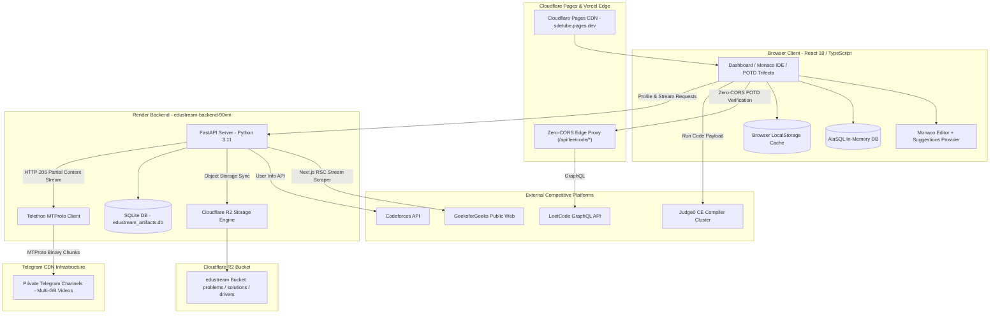
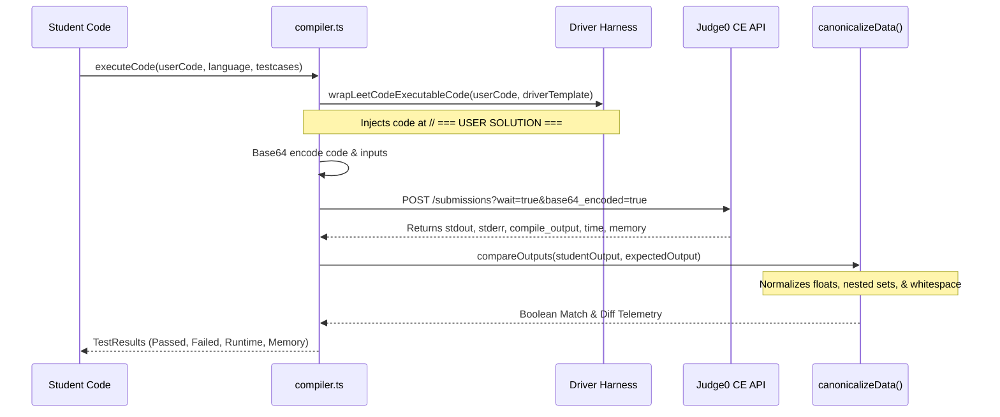
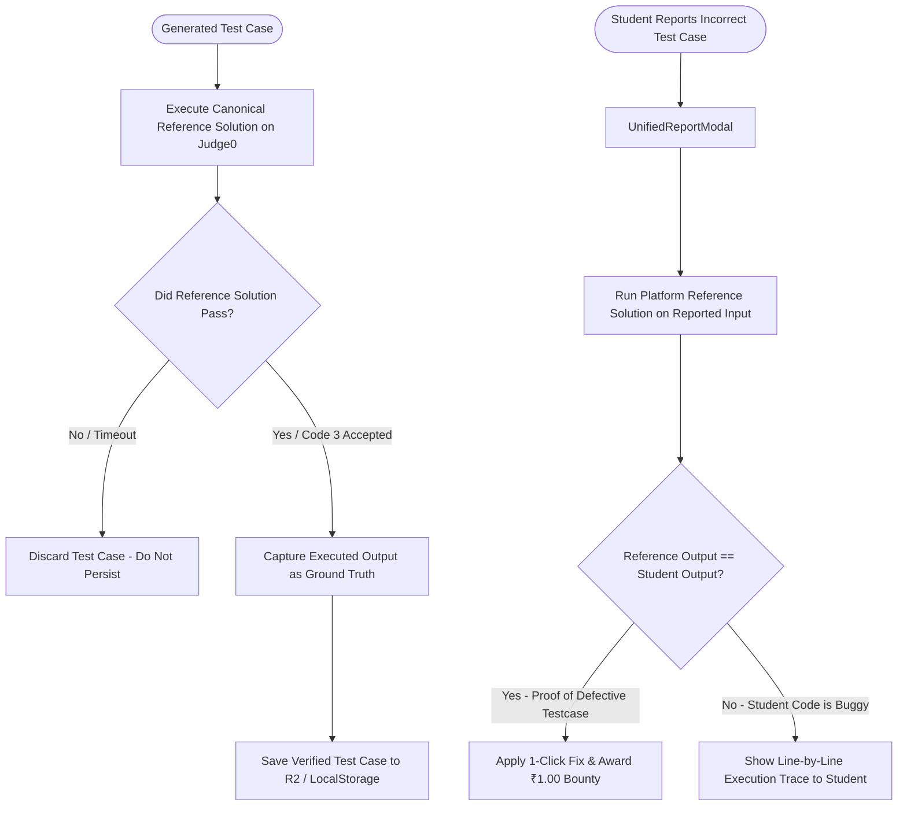

# SDETube / EduStream — Comprehensive Code-Level Architectural Specification

> **Document Version:** 4.8.0  
> **Status:** Code-Level Architectural Reference  
> **Repository:** [`github.com/mdalamrahman/edustreams`](https://github.com/mdalamrahman/edustreams)  
> **Production URLs:**
> - Student Frontend: `https://sdetube.pages.dev`
> - Core Backend: `https://edustream-backend-90vm.onrender.com`
> - Admin Portal: `https://admin.sdetube.pages.dev`

---

## 1. Architectural Philosophy & Design Principles

SDETube is architected as an **execution-first, client-resilient, zero-CORS competitive engineering platform**. The platform adheres to six fundamental engineering tenets:

1. **Execution-First Truth Over LLM Hallucinations**:
   Large Language Models are never allowed to dictate the expected outputs of algorithmic test cases. Every generated test case is verified by executing a canonical reference solution against Judge0. The actual output produced by execution is stored as ground truth.
2. **Zero-CORS Serverless Edge Gateways**:
   Third-party platforms (LeetCode GraphQL, GeeksforGeeks, Codeforces) do not allow browser client requests due to CORS and authentication constraints. All external platform queries route through lightweight serverless edge proxies or the backend microservice.
3. **Offline-First & Cache-Tiered Persistence**:
   The student web app operates on a multi-tier caching hierarchy: In-Memory State $\to$ Browser `localStorage` $\to$ Cloudflare R2 Object Storage $\to$ SQLite Artifacts Database. Submissions and streaks survive network disconnects.
4. **Decoupled Local vs. Remote State Semantics**:
   The platform strictly decouples activities performed in the SDETube IDE from activities verified on external platforms. For example, solving a problem on LeetCode marks it as `isLcRemoteSolved`, which updates the LeetCode action button to `✓ Solved on LeetCode` without falsely claiming it was compiled in the local Monaco IDE.
5. **Idempotent Bug Bounty & Micro-Billing**:
   When users report and repair defective test cases, bounty credits (₹1.00 per verified fix) are locked behind SHA-256 idempotency keys (`problemSlug + category + userEmail`) to eliminate double-spending.
6. **Telegram MTProto Video CDN**:
   High-definition video lectures are stored in categorized Telegram channels and streamed on-demand via Telethon MTProto using chunked HTTP 206 Partial Content range requests, avoiding recurring cloud hosting costs.

---

## 2. Monorepo Structural Blueprint

```
c:\Users\User\Desktop\edustream\
├── src/                               # Student Web Application
│   ├── components/                    # UI Components, Modals, Workspaces
│   │   ├── DashboardLandingPage.tsx   # Command Deck, POTD Trifecta, IDE preview
│   │   ├── MonacoWorkspace.tsx        # Monaco IDE, test runner, output console
│   │   ├── POTDModal.tsx              # Multi-platform daily streak tracker modal
│   │   ├── LeetCodeSQLWorkspaceModal.tsx # In-browser AlaSQL database arena
│   │   ├── InterviewPrepHub.tsx       # AI mock interview simulation & ATS resume scanner
│   │   ├── UnifiedReportModal.tsx     # Single report & bug bounty repair modal
│   │   ├── VelocityTracker.tsx        # Real-time analytics, heatmaps, streak stats
│   │   ├── DeveloperProfilePage.tsx   # Public developer portfolio & platform handles
│   │   ├── UserProfileModal.tsx       # Profile settings & platform linking modal
│   │   ├── Navbar.tsx                 # Navigation bar, coin balance, user profile pill
│   │   └── ...                        # Specialized sheet views & code visualizers
│   ├── lib/                           # Core Domain Services & Business Logic
│   │   ├── compiler.ts                # Judge0 runner, driver wrappers, output canonicalization
│   │   ├── monacoEditorSuggestions.ts # Cross-language autocomplete & AST extractors
│   │   ├── problemService.ts          # Master problem specs, R2 sync, test suite builder
│   │   ├── pipelineVerifier.ts        # Execution-first verifier & self-healing engine
│   │   ├── userProfileService.ts      # LeetCode/GFG/Codeforces profile sync & verifiers
│   │   ├── leetcodeApi.ts             # Daily POTD client & GraphQL query definitions
│   │   ├── analytics.ts               # Telemetry, SDE readiness score, activity heatmaps
│   │   ├── billing.ts                 # Wallet state, bug bounties, Razorpay/Cashfree checkout
│   │   ├── interviewService.ts        # AI mock interview state machine & rubric evaluator
│   │   ├── dsaSheetsData.ts           # Curated DSA sheets (SDE 191, Striver, NeetCode)
│   │   ├── sdeSheetData.ts            # SDE 191 Sheet master problems & daily POTD selector
│   │   ├── AppContext.tsx             # Global application state provider
│   │   └── useSEO.ts                  # Dynamic SEO meta tags, OpenGraph, Twitter cards
│   ├── types/                         # TypeScript Type Definitions
│   │   └── problem.ts                 # Problem, Testcase, Submission, and Driver types
│   ├── App.tsx                        # Root layout, routing, modal orchestration
│   ├── main.tsx                       # React DOM root entry point
│   └── index.css                      # Tailwind base & custom Google Stitch styling
├── backend/                           # Core Backend Microservice (FastAPI)
│   ├── main.py                        # API routes, Telethon MTProto streamer, scrapers
│   ├── r2_storage.py                  # Cloudflare R2 (S3-compatible) object storage client
│   ├── telegram_ingest.py             # Channel crawler & video catalog builder
│   └── requirements.txt               # Python package dependencies
├── api/                               # Serverless Edge Handlers (Node.js)
│   └── leetcode/
│       ├── verify-potd.js             # Zero-CORS LeetCode GraphQL & calendar verifier
│       └── profile.js                 # Serverless LeetCode profile proxy
├── admin-portal/                      # Internal Administrative Web Application
├── public/                            # Static assets, manifests, icons, company datasets
│   └── data/company_problems.json     # 1.8MB offline company question index
├── scripts/                           # Build & deployment helpers
│   └── copy_dist_assets.py            # Post-build asset distributor
├── package.json                       # NPM dependencies, scripts, and Wrangler config
├── tsconfig.json                      # Strict TypeScript compiler options
├── vite.config.ts                     # Vite build, code-splitting, and asset bundling
├── vercel.json                        # Vercel rewrites & serverless configuration
└── render.yaml                        # Infrastructure-as-Code for Render backend
```

---

## 3. High-Level System Architecture Diagram



---

## 4. Frontend Code-Level Architecture

### 4.1. Application Entry & Component Tree
- **`src/main.tsx`**: Bootstraps the React root using `createRoot(document.getElementById('root')!)`.
- **`src/App.tsx`**: The master container managing:
  - Global navigation and tab selection (`dashboard`, `sde-sheet`, `sql-arena`, `lld-studio`, `interview-prep`, `videos`, `analytics`).
  - Global modal stack (`POTDModal`, `MonacoWorkspace`, `LeetCodeSQLWorkspaceModal`, `UnifiedReportModal`, `UserProfileModal`).
  - User authentication session state via Supabase.
  - Event listener bindings for cross-component triggers (`sdetube_potd_solved`, `open_problem_in_ide`).

```
App
├── Navbar
│   ├── Logo & Brand Pill
│   ├── Tab Navigation Bar
│   ├── POTD Quick-Trigger (Flame Icon)
│   ├── Coin Wallet Display
│   └── User Profile Trigger
├── Main Viewport
│   ├── [activeTab === 'dashboard'] -> DashboardLandingPage
│   │   ├── Section 1: Command Deck & System Metrics HUD
│   │   ├── Section 2: POTD Trifecta (Curated SDE, LeetCode Live, GFG Official)
│   │   ├── Section 3: Interactive Monaco IDE & Test Telemetry Sandbox
│   │   └── Section 4: SDE 191 Sheet Quick Navigator
│   ├── [activeTab === 'sde-sheet'] -> SDESheetView
│   ├── [activeTab === 'sql-arena'] -> SQLProblemsArena
│   ├── [activeTab === 'lld-studio'] -> LLDMachineCodingStudio
│   ├── [activeTab === 'interview-prep'] -> InterviewPrepHub
│   ├── [activeTab === 'videos'] -> TelegramVideoStreamingHub
│   └── [activeTab === 'analytics'] -> VelocityTracker
└── Modal Overlays (Mounted conditionally)
    ├── MonacoWorkspace (Full IDE experience)
    ├── POTDModal (3-Platform Daily Challenge modal)
    ├── LeetCodeSQLWorkspaceModal (AlaSQL editor & schema diff)
    ├── UnifiedReportModal (Bug bounty & test case repair)
    └── UserProfileModal (Account settings & platform linking)
```

---

### 4.2. Compiler Pipeline (`src/lib/compiler.ts`)

`compiler.ts` is the heart of the execution environment. It bridges user code with remote Judge0 clusters.



#### Key Functional Exports in `compiler.ts`:
- **`wrapLeetCodeExecutableCode(userCode, language, driverTemplate)`**:
  Validates the driver sentinel (`// === USER SOLUTION ===` or `# === USER SOLUTION ===`). Injects language-specific headers (e.g. `CPP_STANDARD_HEADERS_PRELUDE`), standard classes (`TreeNode`, `ListNode`), and test input loop drivers.
- **`canonicalizeData(data)`**:
  Standardizes nested array and object representations so order-independent algorithmic outputs evaluate correctly.
- **`compareOutputs(actual, expected)`**:
  Performs multi-stage comparison:
  1. Exact trimmed string equality.
  2. Number parsing with float tolerance ($\epsilon = 1e-6$).
  3. Boolean string normalization (`"true" == true`).
  4. JSON parse and deep canonicalized sorting.
- **`isValidHeightBalancedBSTForNums(root, nums)`**:
  Validates mathematical BST correctness and AVL height balance ($|height_L - height_R| \le 1$) for tree reconstruction problems.

---

### 4.3. Monaco Autocomplete & Language Intelligence (`src/lib/monacoEditorSuggestions.ts`)

Provides enterprise LeetCode-grade code intelligence inside Monaco without requiring heavy Language Server Protocol (LSP) backends:

```typescript
export function registerLeetCodeCompletions(monaco: any, language: string): IDisposable {
  return monaco.languages.registerCompletionItemProvider(language, {
    triggerCharacters: ['.', '>', ':', ' '],
    provideCompletionItems: (model: any, position: any) => {
      const code = model.getValue();
      const extractedParams = extractParametersFromCode(code);
      const suggestions = [
        ...generateParameterSuggestions(extractedParams, monaco),
        ...generateDataStructureSnippets(code, language, monaco),
        ...generateAlgorithmIdioms(language, monaco)
      ];
      return { suggestions };
    }
  });
}
```

- **Dynamic Signature Parameter Extraction**:
  `extractParametersFromCode()` parses signatures such as `vector<int>& nums, int target` using regex heuristics, providing instant completions for variable names throughout the editor.
- **Context-Aware Tree & List Helpers**:
  Detects `TreeNode` or `ListNode` and injects `.val`, `.left`, `.right`, `.next` hints.
- **Algorithm Idioms**:
  Bundles boilerplate snippets for Two Pointers, Binary Search, Sliding Window, Fast I/O, and BFS/DFS.

---

### 4.4. Execution-First Verification & Self-Healing (`src/lib/pipelineVerifier.ts`)

Eliminates LLM test case hallucinations by enforcing execution on Judge0:



---

### 4.5. Zero-CORS POTD Auto-Verification & Profile Sync (`src/lib/userProfileService.ts`)

Manages student identity across LeetCode, GeeksforGeeks, and Codeforces:

- **`verifyLeetCodePotdSubmission(username, slug, title, date)`**:
  Queries `/api/leetcode/verify-potd` at the edge. Inspects both recent accepted submissions and `userCalendar.submissionCalendar` epoch timestamp counts.
- **`fetchGFGProfile(username, forceFresh)`**:
  Queries `/api/gfg/profile/{username}` on the backend. Extracts coding score, rank, and `pod_solved_current_streak`.
- **`isGfgProblemSolvedToday(gfgData)`**:
  Verifies that `gfgData.current_streak >= 1`.
- **`fetchCodeforcesProfile(handle)`**:
  Direct client fetch or proxy fallback to `https://codeforces.com/api/user.info`.

---

### 4.6. Analytics, Telemetry & SDE Readiness Calculus (`src/lib/analytics.ts`)

Computes real-time student readiness and activity heatmaps:

$$\text{SDE Readiness Score} = \min\left(100, \left( \frac{\text{Easy Solved}}{30} \times 20 \right) + \left( \frac{\text{Medium Solved}}{50} \times 50 \right) + \left( \frac{\text{Hard Solved}}{20} \times 30 \right) + \text{Streak Bonus}\right)$$

- **`getRealAnalytics()`**:
  Aggregates solved problems across sheets, computes runtime percentiles, and constructs the 365-day activity heatmap matrix.
- **`markProblemSolved(identifier, timeSpent, slug)`**:
  Persists solved state, triggers telemetry events, updates streak counters, and fires cross-tab synchronization events.

---

## 5. Backend Architecture (FastAPI & Telethon MTProto)

### 5.1. Backend Server Overview (`backend/main.py`)
Built on Python 3.11 and FastAPI, running as an asynchronous single-worker microservice on Render:

| Endpoint Route | HTTP Method | Subsystem | Description |
| :--- | :--- | :--- | :--- |
| `/stream/{chat_id}/{msg_id}` | `GET` | Video CDN | Streams video files from Telegram channels with HTTP 206 range support |
| `/api/gfg/{username}` | `GET` | Profile Scraper | Scrapes GeeksforGeeks metrics from Next.js RSC payload streams |
| `/api/codeforces/{handle}` | `GET` | CF Proxy | Fetches user rating, rank, and submission counts from Codeforces API |
| `/api/potd/leetcode` | `GET` | POTD Proxy | Returns official daily LeetCode challenge with zero CORS |
| `/api/potd/gfg` | `GET` | POTD Proxy | Scrapes official GeeksforGeeks Problem of the Day |
| `/api/r2/sync` | `POST` | R2 Storage | Commits verified problem specs, solutions, and drivers to Cloudflare R2 |
| `/api/bounty/claim` | `POST` | Billing | Idempotent bug bounty registration |
| `/docs` | `GET` | System | OpenAPI Swagger documentation |

---

### 5.2. Telethon HTTP 206 Byte-Range Video Streaming Pipeline

```python
@app.get("/stream/{chat_id}/{msg_id}")
async def stream_telegram_video(chat_id: int, msg_id: int, request: Request):
    """
    Streams multi-gigabyte video files directly from Telegram MTProto storage
    with full HTTP 206 Partial Content byte-range support for Safari & mobile.
    """
    client = await get_telegram_client()
    msg = await client.get_messages(chat_id, ids=msg_id)
    if not msg or not msg.media:
        raise HTTPException(status_code=404, detail="Video media not found")
        
    file_size = msg.file.size
    range_header = request.headers.get("Range")
    
    start = 0
    end = file_size - 1
    if range_header:
        m = re.search(r"bytes=(\d+)-(\d*)", range_header)
        if m:
            start = int(m.group(1))
            if m.group(2):
                end = int(m.group(2))
                
    chunk_size = (end - start) + 1
    
    async def chunk_generator():
        async for chunk in client.iter_download(msg.media, offset=start, request_size=chunk_size):
            yield chunk

    headers = {
        "Content-Range": f"bytes {start}-{end}/{file_size}",
        "Accept-Ranges": "bytes",
        "Content-Length": str(chunk_size),
        "Content-Type": msg.file.mime_type or "video/mp4",
    }
    return StreamingResponse(chunk_generator(), status_code=206, headers=headers)
```

---

### 5.3. GeeksforGeeks Next.js RSC Stream Scraper

Modern GeeksforGeeks profiles render via React Server Components. Traditional HTML element scrapers fail because data is serialized in `self.__next_f.push([1, "..."])` streaming chunks.

`backend/main.py` decodes this stream to extract:
- `total_problems_solved`
- `score` / `coding_score`
- `pod_solved_current_streak` (Daily POTD Streak)
- `pod_solved_longest_streak`
- Difficulty breakdown (`school`, `basic`, `easy`, `medium`, `hard`)

---

## 6. Serverless Edge Gateway Architecture (`api/`)

### `api/leetcode/verify-potd.js`
Zero-CORS edge serverless function deployed to handle LeetCode verification:

```javascript
export default async function handler(req, res) {
  res.setHeader('Access-Control-Allow-Origin', '*');
  res.setHeader('Access-Control-Allow-Methods', 'GET, POST, OPTIONS');
  
  const { username, slug, date } = req.query;
  const query = `
    query userProfileUserQuestionProgress($username: String!) {
      matchedUser(username: $username) {
        userCalendar { submissionCalendar }
      }
      recentAcSubmissionList(username: $username, limit: 15) {
        titleSlug status timestamp
      }
    }
  `;
  
  const response = await fetch('https://leetcode.com/graphql', {
    method: 'POST',
    headers: { 'Content-Type': 'application/json', 'User-Agent': 'Mozilla/5.0' },
    body: JSON.stringify({ query, variables: { username } })
  });
  
  const json = await response.json();
  // 1. Check recent submissions matching titleSlug
  // 2. If private, check submissionCalendar for today's epoch day count >= 1
  return res.json({ verified: isSolved, method: matchMethod });
}
```

---

## 7. Storage Architecture & LocalStorage Schema

### Client-Side `localStorage` Key Map

| Storage Key Pattern | Type | Subsystem | Purpose |
| :--- | :--- | :--- | :--- |
| `sdetube_potd_sdetube_solved_{YYYY-MM-DD}` | `"true"` | POTD | Solved flag for Curated SDETube POTD |
| `sdetube_potd_leetcode_solved_{YYYY-MM-DD}` | `"true"` | POTD | Solved flag for LeetCode POTD |
| `sdetube_potd_gfg_solved_{YYYY-MM-DD}` | `"true"` | POTD | Solved flag for GeeksforGeeks POTD |
| `sdetube_potd_gfg_synced_{YYYY-MM-DD}` | `"true"` | POTD | Immutable sync flag preventing cache resets |
| `sdetube_potd_gfg_manual_solved_{YYYY-MM-DD}` | `"true"` | POTD | User manual confirmation flag |
| `sdetube_potd_solved_{YYYY-MM-DD}` | `"true"` | POTD | Aggregate flag (at least one POTD solved) |
| `edustream_submissions_{slug}` | `JSON Array` | Compiler | Local IDE submission history with timestamps |
| `edustream_linked_profiles_{email}` | `JSON Object` | Identity | Stored handles (`leetcodeUsername`, `gfgUsername`, `cfHandle`) |
| `edustream_wallet_balance` | `Number` | Billing | Current coin balance in student wallet |
| `edustream_claimed_bounties` | `JSON Array` | Billing | List of claimed bounty idempotency keys |
| `edustream_problem_spec_{slug}` | `JSON Object` | Catalog | Cached problem description and starter templates |
| `edustream_driver_{slug}_{language}` | `String` | Compiler | Driver harness overrides |
| `edustream_testcase_override_{slug}` | `String` | Compiler | Repaired test cases committed via bounty modal |

---

## 8. Build, Release & Deployment Pipelines

### 8.1. Student Frontend (`sdetube.pages.dev`)
The frontend pipeline compiles TypeScript, minifies assets with Vite, distributes static data catalogs, and uploads to Cloudflare Pages:

```powershell
npm run deploy:student
```
**Underlying 4-Step Chain:**
1. `tsc` — Strict type-check verification across all components and services.
2. `vite build` — Minified production bundle in `dist/`.
3. `python scripts/copy_dist_assets.py` — Copies `company_problems.json` (1.8MB) to `dist/data/`.
4. `npx wrangler pages deploy dist --project-name sdetube --branch main --commit-dirty=true` — Deploys directly to Cloudflare Pages.

### 8.2. Core Backend (`edustream-backend-90vm.onrender.com`)
- Pushing to GitHub `main` triggers Render's automated build runner:
  - **Build Command**: `pip install -U pip && pip install -r requirements.txt`
  - **Start Command**: `uvicorn main:app --host 0.0.0.0 --port $PORT`
- Manual deploy trigger via Render API:
  ```powershell
  python -c "import urllib.request, os, sys; token = os.environ.get('RENDER_TOKEN'); srv = os.environ.get('RENDER_SERVICE_ID'); sys.exit('RENDER_TOKEN missing') if not token or not srv else None; req = urllib.request.Request(f'https://api.render.com/v1/services/{srv}/deploys', headers={'Authorization': 'Bearer ' + token, 'Content-Type': 'application/json'}, data=b'{}', method='POST'); res = urllib.request.urlopen(req); print('Triggered Status:', res.status)"
  ```

---

## 9. Code Conventions & Best Practices

1. **Clickable File Links**:
   All referenced file paths in internal documentation and error logs must use standard GitHub-style markdown file links (e.g. `[compiler.ts](file:///c:/Users/User/Desktop/edustream/src/lib/compiler.ts)`).
2. **Sentinel Inviolability**:
   Never alter or remove the sentinel strings `// === USER SOLUTION ===` or `# === USER SOLUTION ===` in driver templates.
3. **No Unverified Testcases**:
   Never persist a test case without running it through `verifyExpectedOutputsByExecution()`.
4. **Idempotent Storage Updates**:
   Always pair POTD solved states with their immutable sync counterparts (`sdetube_potd_gfg_synced_${today}`) to prevent race conditions during background analytics sweeps.
