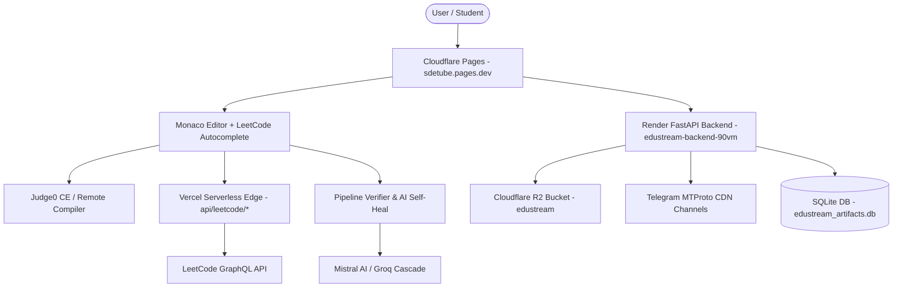

# SDETube / EduStream — Comprehensive Codebase Context, Architecture & Deployment Guide

Welcome to the central architectural specification, codebase context, and operational manual for **SDETube** (formerly *EduStream*). This document serves as the single source of truth for the entire platform, covering all systems, data flows, core modules, compiler pipelines, database schemas, deployment protocols, and operational runbooks.

---

## 1. Executive Summary & Product Mission

**SDETube** is an enterprise-grade EdTech, Competitive Programming, and Technical Interview Preparation platform engineered specifically for Software Engineers and Software Development Engineers in Test (SDET).

### Core Value Propositions
1. **Interactive Coding Workspaces**: High-performance in-browser IDE with Monaco Editor, multi-language Judge0 compilation, custom driver injection, and real-time output evaluation.
2. **LeetCode-Parity Autocompletions**: Intelligent code suggestions, snippet injection, and context-aware parameter hints across C++, Java, Python, JavaScript/TypeScript, Go, and Rust.
3. **Automated Problem of the Day (POTD)**: Multi-platform daily streak tracker (LeetCode, GeeksforGeeks, and internal problem sets) featuring zero-CORS serverless edge verification.
4. **Interactive SQL Arena**: Complete catalog of 300+ LeetCode SQL questions powered by an in-browser AlaSQL database engine, real-time table schema rendering, and automated query grading.
5. **Low-Level Design (LLD) Machine Coding Arena**: Machine coding sandbox for Design Patterns (Factory Method, Singleton, Strategy, Observer, Builder, etc.) with method-call sequence execution and facade evaluation.
6. **Telegram-Backed Video Streaming CDN**: Telegram cloud integration using Telethon/MTProto to stream multi-gigabyte video lectures with HTTP byte-range seekability.
7. **AI Mock Interviewer & Resume Engine**: Real-time conversational interview simulations, rubric-based evaluation scoring, FAANG offer letter generation, and ATS resume scanning.
8. **Automated Verification & Self-Healing Pipeline**: Execution-first verification that tests algorithms on Judge0 before persisting test cases or driver harnesses, eliminating LLM hallucinations.
9. **Micro-Billing & Bug Bounty Ecosystem**: Integrated wallet supporting Razorpay, Cashfree, and UPI payments, with automatic ₹1.00 bounty credits when users successfully report and repair defective test cases or driver code.

---

## 2. Global Repository & Technology Stack

The codebase is organized as a unified monorepo containing the student web application, backend API services, admin portal, serverless edge functions, and data migration scripts.

```
c:\Users\User\Desktop\edustream\
├── src/                     # Student Frontend (React 18, Vite, TypeScript, Tailwind)
│   ├── components/          # UI Modals, Workspaces, Dashboards, and Visualizers
│   ├── lib/                 # Core domain logic, APIs, compiler, billing, suggestions
│   └── types/               # TypeScript type definitions and interfaces
├── backend/                 # Core Backend (Python 3.11, FastAPI, Telethon, SQLite, R2)
│   ├── main.py              # Primary FastAPI server and route handlers
│   ├── r2_storage.py        # Cloudflare R2 object storage manager
│   ├── telegram_ingest.py   # Telegram MTProto client and video ingest pipeline
│   └── requirements.txt     # Python dependencies
├── api/                     # Serverless Edge Handlers (Node.js for Vercel/Pages)
│   └── leetcode/            # Zero-CORS proxies for LeetCode GraphQL & verification
├── admin-portal/            # Internal Admin Application (Course management, user analytics)
├── public/                  # Static assets, manifests, icons, company problem datasets
├── scripts/                 # Build & deployment helpers (copy_dist_assets.py, etc.)
├── scratch/                 # Ad-hoc migration, verification, and inspection scripts
├── vercel.json              # Vercel deployment & rewrite configuration
├── package.json             # NPM project manifest & build scripts
├── context.md               # Codebase context & deployment runbook
└── ARCHITECTURE_AND_FUNCTIONALITY.md # Complete architectural & functional deep dive
```

### Technology Matrix

| Layer | Technologies | Deployment Host |
| :--- | :--- | :--- |
| **Monorepo** | GitHub | [`github.com/mdalamrahman/edustreams`](https://github.com/mdalamrahman/edustreams) |
| **Frontend UI** | React 18, TypeScript, Vite, Tailwind CSS, Lucide React, Recharts | Cloudflare Pages (`https://sdetube.pages.dev`) |
| **Code Editor** | Monaco Editor (`@monaco-editor/react`), custom CompletionItemProviders | Client-Side In-Browser |
| **Compiler Runner** | Judge0 CE API (`ce.judge0.com`), AlaSQL (Client-Side SQL Engine) | External Judge0 Cluster & Web Workers |
| **Core Backend** | Python 3.11, FastAPI, Uvicorn, Telethon (Telegram MTProto), Pydantic | Render Web Service (`https://edustream-backend-90vm.onrender.com`) |
| **Serverless API** | Node.js Serverless Functions (`api/leetcode/*`, `api/potd/*`) | Vercel / Cloudflare Edge Functions |
| **Admin Portal** | React 18, Vite, TypeScript | Vercel (`admin-portal/`) |
| **Object Storage** | Cloudflare R2 (S3-compatible bucket `edustream`) | Cloudflare Edge |
| **Primary Database** | SQLite (`edustream_artifacts.db`), Supabase PostgreSQL | Render Persistent Storage & Supabase |
| **AI LLM Cascade** | Mistral AI (`mistral-large-latest`), Groq (`llama-3.3-70b`), HuggingFace | Multi-Tier Client & Server AI Cascade |

---

## 3. Core Architectural Subsystems



### 3.1. Monaco Editor Intelligence & Cross-Language Autocomplete
- **Implementation File**: `src/lib/monacoEditorSuggestions.ts`
- **Supported Languages**: C++, Java, Python, JavaScript, TypeScript, Go, Rust.
- **Dynamic Parameter Extraction**: The `extractParametersFromCode()` utility parses function signatures in starter code (e.g. `solve(vector<int>& nums, int target)`) using regex and heuristics, instantly generating context-aware completion items for variable names and parameter pairs.
- **Data Structure Awareness**: Automatically recognizes `TreeNode` and `ListNode` contexts, suggesting `.val`, `.left`, `.right`, `.next` and tree-traversal idioms.
- **High-Frequency Algorithms**: Bundles pre-formatted snippets for Binary Search, Sliding Window, Two Pointers, BFS/DFS Traversal, Fast I/O, and Topological Sort.
- **IDE Settings**: Enforces `bracketPairColorization`, `suggestOnTriggerCharacters`, `parameterHints`, `snippetSuggestions: 'top'`, and `tabCompletion: 'on'`.

### 3.2. Compiler & Execution Pipeline
- **Implementation File**: `src/lib/compiler.ts`
- **Execution Wrapper**: `wrapLeetCodeExecutableCode()` takes raw user solution classes, combines them with standard includes (e.g. `CPP_STANDARD_HEADERS_PRELUDE`), parses test input parameters, and wraps them in a language-specific driver harness.
- **Remote Execution**: Dispatches base64-encoded code payloads to Judge0 CE (`https://ce.judge0.com/submissions?wait=true&base64_encoded=true`).
- **Output Canonicalization**:
  - `canonicalizeData()` standardizes nested lists and sets so that problems with order-independent outputs (e.g. *3Sum*, *Subsets*, *Permutations*, *Group Anagrams*) evaluate correctly regardless of internal array ordering.
  - `compareOutputs()` performs flexible whitespace-trimmed, float-tolerant (1e-6 epsilon), and boolean-normalized comparison.
  - `isValidHeightBalancedBSTForNums()` validates BST reconstruction questions (*Convert Sorted Array to Binary Search Tree*) where multiple height-balanced trees are mathematically valid.

### 3.3. Pipeline Verifier & Execution-First Verification Engine
- **Implementation Files**: `src/lib/pipelineVerifier.ts`, `src/lib/problemService.ts`
- **Execution-First Rule**: AI-generated test cases often contain hallucinated expected outputs. `verifyExpectedOutputsByExecution()` takes the problem's canonical reference solution (in Python, JS, C++, or Java), runs it against newly generated inputs using Judge0, and extracts the *actual executed output* as the ground-truth expected output.
- **Test Case Safeguard**: `guaranteeAtLeast10TestCases()` guarantees that if fewer than 10 test cases exist, it cycles known, verified input-output pairs rather than injecting unverified dummy arrays.
- **Automated Self-Healing**: `verifyAndHealPipeline()` runs the solution on all test cases. If discrepancies occur, it classifies the defect type (`solution`, `driver`, or `testcase`) and prompts Mistral AI with the error history to self-heal the broken component up to 3 attempts.

### 3.4. Zero-CORS POTD Auto-Verification Subsystem
- **Implementation Files**:
  - `api/leetcode/verify-potd.js` (Serverless edge verification)
  - `api/leetcode/profile.js` (Serverless profile proxy)
  - `src/lib/userProfileService.ts` (Frontend client service)
  - `src/components/POTDModal.tsx` (UI modal)
- **Problem Solved**: Direct browser calls from client apps to `leetcode.com/graphql` fail due to CORS. Furthermore, LeetCode accounts often have recent submissions set to private.
- **Resolution Strategy**:
  1. Requests route through `/api/leetcode/verify-potd` (a serverless Node.js edge proxy).
  2. Queries the official LeetCode GraphQL endpoint for `recentAcSubmissionList` and `recentSubmissionList`.
  3. If submissions are marked private (returning empty lists), the proxy inspects `userCalendar.submissionCalendar` to verify if the user submitted code on the current day's UNIX epoch timestamp.
  4. Provides secondary fallback to the Alfa LeetCode API (`alfa-leetcode-api.onrender.com`).
  5. The dashboard and POTD modal automatically execute proactive background verification on mount.

### 3.5. Single Unified Report & Bug Bounty Engine
- **Implementation Files**: `src/components/UnifiedReportModal.tsx`, `src/lib/billing.ts`
- **Button Consolidation**: Replaced fragmented legacy buttons (*Fix Testcase*, *Report Boilerplate*, *Problem Report*) with a single, streamlined `"Report"` button in the workspace toolbar and contextual triggers in failure states.
- **Fast-Path Verification**: When a user reports that their solution output differs from the test suite's expected output, `UnifiedReportModal` automatically executes the platform's reference solution against the reported input. If the reference solution output matches the student's output, it provides 100% mathematical proof of an incorrect test case, allows 1-click application of the fix, and awards a ₹1.00 bounty.
- **Idempotent Rewards**: `claimReportBounty()` tracks claims by `problemSlug + category + email` in localStorage and remote backend to prevent duplicate rewards.

### 3.6. Interactive SQL Arena
- **Implementation File**: `src/components/LeetCodeSQLWorkspaceModal.tsx`
- **Engine**: In-browser AlaSQL database.
- **Coverage**: Full catalog of 323 LeetCode SQL problems.
- **Execution Flow**:
  1. Creates temporary in-memory tables defined by the problem's DDL/DML setup SQL.
  2. Executes the user's `SELECT` query against the local database.
  3. Executes the reference solution query against identical state.
  4. Renders side-by-side table schemas, column data types, row counts, and diff viewers.

### 3.7. AI Mock Interviewer & Resume Engine
- **Implementation Files**: `src/components/InterviewPrepHub.tsx`, `src/lib/interviewService.ts`
- **Mock Interview System**:
  - Simulates FAANG behavioral and coding interviews across Frontend, Backend, Fullstack, and SDET tracks.
  - Uses Web Speech API for voice recognition and text-to-speech feedback.
  - Scores responses against rubrics: Problem Solving, Code Quality, Communication, and Behavioral Alignment.
  - Generates downloadable, glassmorphic FAANG Offer Letters upon passing scores.
- **Resume Scanner & Creator**:
  - Live ATS score analysis based on keyword density, action verbs, and quantifiable impact metrics.
  - Generates tailored resumes aligned with user-selected target roles (SDET, SDE-1, SDE-2, QA Lead).

### 3.8. Telegram Video Streaming CDN
- **Implementation File**: `backend/main.py`, `backend/telegram_ingest.py`
- **Protocol**: Telethon / MTProto.
- **Streaming Pipeline**:
  - Educational videos are stored in private Telegram channels categorized by subject (DSA, System Design, LLD, DBMS, Computer Networks).
  - When a user streams a video, FastAPI's `/stream/{chat_id}/{msg_id}` endpoint initiates a chunked stream via Telethon using HTTP 206 (Partial Content) range requests.
  - Enables instant scrubbing, fast buffering, and zero expensive video hosting bills.

---

## 4. Database & Storage Architecture

### 4.1. Cloudflare R2 Storage (`edustream` bucket)
- **Service Layer**: `backend/r2_storage.py`
- **Key Prefix Structure**:
  - `problems/{slug}.json`: Master problem specification (description, examples, constraints, starter templates).
  - `solutions/{slug}_{language}.txt`: Official reference solutions verified against test cases.
  - `drivers/{slug}_{language}.txt`: Language-specific driver harnesses containing `// === USER SOLUTION ===`.
  - `testcases/{slug}.txt`: Raw input-output test case suites.
  - `notes/{slug}.md`: Curated study notes and editorial explanations.

### 4.2. SQLite Artifacts Database (`edustream_artifacts.db`)
Stored locally on the Render persistent volume:
- `problems`: Local mirror of problem specifications and test case overrides.
- `solutions`: Cached reference solutions with validation timestamps.
- `driver_codes`: Corrected execution drivers.
- `bounties`: Registry of claimed bug bounty rewards to prevent double-spending.
- `user_profiles`: User settings, progress, solved question IDs, and POTD streaks.

### 4.3. Client-Side Persistence (`localStorage`)
The frontend caches data locally for instantaneous offline-first responsiveness:
- `edustream_problem_spec_{slug}`: Cached problem definition.
- `edustream_ai_solutions_{slug}`: Cached solutions mapped by language.
- `edustream_driver_{slug}_{language}`: User or system driver code overrides.
- `edustream_testcase_override_{slug}`: Repaired test cases.
- `edustream_wallet_balance`: Active coin balance.
- `edustream_claimed_bounties`: Array of claimed bounty IDs.

---

## 5. Key Configuration Files & Credentials Reference

| File | Purpose | Key Parameters |
| :--- | :--- | :--- |
| `vercel.json` | Edge rewrites & serverless routing | Rewrites `/api/leetcode/(.*)` to `api/leetcode/verify-potd.js` and `profile.js` |
| `render.yaml` | Infrastructure as Code for Render | Service definition for `edustream-backend`, Python environment, health check path `/docs` |
| `~/.render/cli.yaml` | Render CLI authentication | API token `<RENDER_TOKEN>`, workspace `tea-d15t3sggjchc73frb2lg` |
| `.env` / `.env.render` | Local and production environment vars | `MISTRAL_API_KEY`, `VITE_SUPABASE_*`, `TELEGRAM_*`, `VITE_RENDER_BACKEND_URL` |
| `scripts/copy_dist_assets.py` | Distribution packaging | Syncs `public/data/company_problems.json` (1.8MB) to `dist/data/` for production |

---

## 6. Deploying Backend Code to GitHub

The backend resides in the `backend/` and `api/` directories of the repository. Render monitors the `main` branch of `https://github.com/mdalamrahman/edustreams` and automatically triggers a build whenever changes are pushed.

### Step-by-Step Push Workflow

1. **Verify git status:**
   ```powershell
   git status
   ```

2. **Stage modified and newly created backend/frontend files:**
   ```powershell
   git add -A
   ```

3. **Commit with a conventional commit message:**
   ```powershell
   git commit -m "feat(backend): add your feature description"
   ```

4. **Push to GitHub `main`:**
   ```powershell
   git push origin main
   ```

> [!NOTE]
> Render automatically detects commits to the `main` branch. If the commit affects files in `backend/`, Render kicks off an automatic build using:
> - **Build Command:** `pip install -U pip && pip install -r requirements.txt`
> - **Start Command:** `uvicorn main:app --host 0.0.0.0 --port $PORT`

---

## 7. Deploying Frontend to Cloudflare Pages (Wrangler CLI)

The student frontend is hosted on Cloudflare Pages under the project name **`sdetube`**.

### Standard Deployment Command (Recommended)

Run the preconfigured deployment script from the project root:

```powershell
npm run deploy:student
```

This single command automatically performs the full 4-step pipeline:
1. `tsc` — Performs complete TypeScript compilation and type-safety verification.
2. `vite build` — Produces the minified production client bundle in `dist/`.
3. `python scripts/copy_dist_assets.py` — Copies large data files (such as `company_problems.json`) into `dist/data/`.
4. `npx wrangler pages deploy dist --project-name sdetube --branch main --commit-dirty=true` — Uploads and deploys the assets to Cloudflare Pages.

### Manual Two-Step Deployment

If you prefer building and deploying separately:

```powershell
# Step A: Build production bundle
npm run build:student

# Step B: Deploy build folder using Wrangler
npx wrangler pages deploy dist --project-name sdetube --branch main --commit-dirty=true
```

### Deployment Verification
- **Production URL:** [https://sdetube.pages.dev](https://sdetube.pages.dev)
- **Direct Preview URL:** Printed in the terminal output at completion (e.g., `https://<hash>.sdetube.pages.dev`).

---

## 8. Backend Verification Using Render CLI & Render API

Render provides both a CLI tool (`render-cli`) and a REST API (`api.render.com/v1`) for inspecting services, environment variables, and deployment status.

### Authentication Setup

Set your Render API token in your current terminal session:

```powershell
# PowerShell
$env:RENDER_TOKEN = "<RENDER_TOKEN>"

# Bash / Zsh
export RENDER_TOKEN="<RENDER_TOKEN>"
```

*(Token is also stored in `~/.render/cli.yaml` for persistent CLI access).*

### Render CLI Commands

#### 1. List All Registered Services
```powershell
render-cli list
```
*Outputs a table showing Service Name, Service ID, and Live URL.*

#### 2. Find the EduStream Backend Service
```powershell
render-cli find-service -sn edustream-backend
```
- **Service Name:** `edustream-backend`
- **Service ID:** `srv-d9nn8qm417fc73doitrg`
- **Live URL:** `https://edustream-backend-90vm.onrender.com`

#### 3. Inspect Service Environment Variables
```powershell
render-cli list-env -sn edustream-backend
```
*Displays all active environment variables (e.g. `PYTHON_VERSION`, `MISTRAL_API_KEY`, `TELEGRAM_*`, etc.).*

#### 4. Update an Environment Variable
```powershell
render-cli set-env -sid srv-d9nn8qm417fc73doitrg -k NEW_VAR_KEY -v NEW_VAR_VALUE
```

---

## 9. Deployment Verification & Live Health Checks

### Check Latest Deployment Status on Render

Query the Render API to verify if the latest deployment succeeded (`live`):

```powershell
python -c "import urllib.request, json, os, sys; token = os.environ.get('RENDER_TOKEN'); srv = os.environ.get('RENDER_SERVICE_ID'); sys.exit('RENDER_TOKEN and RENDER_SERVICE_ID required') if not token or not srv else None; req = urllib.request.Request(f'https://api.render.com/v1/services/{srv}/deploys?limit=1', headers={'Authorization': 'Bearer ' + token}); res = urllib.request.urlopen(req); d = json.loads(res.read())[0]['deploy']; print(f'Deploy ID: {d[\"id\"]}\nStatus: {d[\"status\"]}\nCommit: {d[\"commit\"][\"id\"][:8]} - {d[\"commit\"][\"message\"]}')"
```

Expected output:
```text
Deploy ID: dep-xxxxxxxxxxxxxxxx
Status: live
Commit: xxxxxxxx - feat: ...
```

### Trigger a Manual Deploy via Render API

If you need to force an immediate redeployment without a new git commit:

```powershell
python -c "import urllib.request, os, sys; token = os.environ.get('RENDER_TOKEN'); srv = os.environ.get('RENDER_SERVICE_ID'); sys.exit('RENDER_TOKEN and RENDER_SERVICE_ID required') if not token or not srv else None; req = urllib.request.Request(f'https://api.render.com/v1/services/{srv}/deploys', headers={'Authorization': 'Bearer ' + token, 'Content-Type': 'application/json'}, data=b'{}', method='POST'); res = urllib.request.urlopen(req); print('Triggered Deploy HTTP Status:', res.status)"
```

### Verify Live HTTP Endpoints (Health Check)

Ping the FastAPI documentation and API health routes:

```powershell
# 1. Check Swagger OpenAPI documentation (Returns HTTP 200)
curl -I https://edustream-backend-90vm.onrender.com/docs

# 2. Check POTD serverless proxy route
curl -I https://sdetube.pages.dev/api/potd/leetcode
```

---

## 10. Release Checklist / Operational Runbook

```markdown
- [ ] 1. Run local type-check: `npx tsc --noEmit`
- [ ] 2. Stage & commit changes: `git add -A && git commit -m "..."`
- [ ] 3. Push to GitHub: `git push origin main`
- [ ] 4. Deploy frontend via Wrangler: `npm run deploy:student`
- [ ] 5. Set Render token: `$env:RENDER_TOKEN = "<YOUR_RENDER_TOKEN>"`
- [ ] 6. Verify service in Render CLI: `render-cli find-service -sn edustream-backend`
- [ ] 7. Confirm deployment status: Verify Render deploy status is `live`
- [ ] 8. Verify live site: Visit https://sdetube.pages.dev
```

---

## 11. Operational Best Practices & Troubleshooting

1. **Never Inject Unverified Test Cases**: Always use `verifyExpectedOutputsByExecution()` or repeat verified sample pairs. Do not allow LLMs to guess outputs for numeric, binary search tree, or string transformation questions.
2. **Preserve User Solution Markers**: Driver code harnesses MUST contain either `// === USER SOLUTION ===` or `# === USER SOLUTION ===`. Without this exact sentinel, `isDriverHarnessValid()` will reject the driver.
3. **Handle LeetCode Submission Privacy**: Never rely solely on `recentAcSubmissionList` when verifying POTDs. The edge handler must check `userCalendar.submissionCalendar` for today's epoch day timestamp to account for private profiles.
4. **Enforce Single Report Button**: Do not add multiple fragmented repair buttons to the workspace UI. Keep all diagnostic and reporting actions routed through `<UnifiedReportModal>`.
5. **Always Verify Builds Before Push**: Run `npm run build` or `npx tsc --noEmit` before triggering wrangler deploys to catch missing exports or type discrepancies early.
