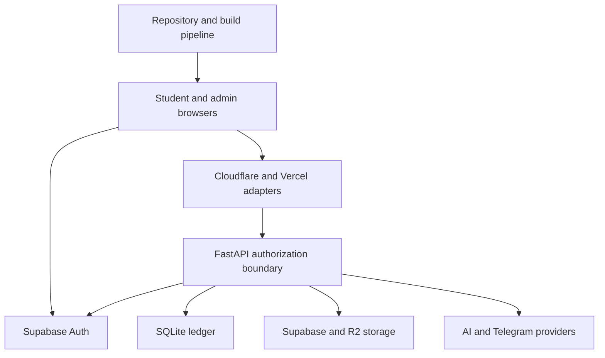

## Executive summary

The main risks are privileged credentials crossing into browsers, untrusted users reaching administrative writes, cross-user data access, and financial integrity. Code mitigations now establish a Supabase-verified backend boundary and transactional ledger. Credential revocation, deployment of database policies, and complete server enforcement of paid entitlements remain essential operational and business-logic work.

## Scope and assumptions

The user confirmed a public internet service with separate student accounts, paid usage, and administrators identified by server-controlled Supabase `app_metadata.role`. Scope includes student/admin browser applications, Vercel and Cloudflare adapters, FastAPI, Supabase, R2, SQLite and provider integrations. Developer scripts/builds are considered separately from runtime. Provider internals, live infrastructure configuration, Git history rewriting and payment-provider settlement verification were not tested.

Open questions: deployed Supabase policies beyond the checked-in schema; proxy-wide request limits; purchase entitlement semantics for videos; credential revocation status; and whether SQLite uses persistent, backed-up storage.

## System model

### Primary components

React clients use public Supabase configuration and bearer sessions. FastAPI validates those sessions, serves student data, gates administrator operations and proxies provider calls. SQLite records financial state; R2 stores artifacts and media metadata. Telegram supplies media bytes. Cloudflare serves students; Vercel remains the admin host.

### Data flows and trust boundaries

- Browser → Supabase: email/password or email OTP over HTTPS. Supabase issues sessions; frontend flags do not grant backend privileges (`src/lib/auth.ts`, `admin-portal/src/AuthGate.tsx`).
- Browser → edge/Vercel → FastAPI: bearer tokens, JSON, prompts and range requests over HTTPS. Exact origin checks, token verification, request-size limits, role checks and process-local rate limits apply (`backend/security.py`, `api/backend.js`).
- FastAPI → Supabase: user validation uses the public key and user token; admin proxy operations use a server-held service key and fixed resource prefixes (`backend/secure_routes.py`).
- FastAPI → SQLite/R2: balances, ledger entries, solutions and code. Transactions protect financial updates; administrative checks protect artifact writes (`backend/wallet_ledger.py`, `backend/main.py`).
- FastAPI → AI/Telegram: prompts, audio and media over provider protocols. AI proxy destinations are fixed. Native media requests use expiring, path-bound HMAC tickets (`backend/secure_routes.py`, `backend/media_tickets.py`).
- Repository → build → browser: public configuration and executable assets. Credential scanning and dependency audits check this boundary; historical exposure still requires revocation (`scripts/check_secrets.py`).

#### Diagram

## Assets and security objectives

Protect service credentials and Telegram sessions from disclosure; preserve wallet/ledger integrity and prevent duplicate rewards; keep interview transcripts and user code private; restrict shared problem artifacts and platform configuration to authorized writers; bound paid compute and bandwidth consumption; and prevent malicious rendered content from stealing browser sessions.

## Attacker model

### Capabilities

An attacker can inspect public bundles and leaked history, create ordinary accounts, modify client code and localStorage, call APIs directly, supply malicious JSON/HTML/SVG, replay requests and race financial mutations. A stolen session has its owner's privileges until expiration/revocation.

### Non-capabilities

An ordinary user cannot legitimately edit server-controlled administrator metadata, read server environment variables, or bypass a correctly deployed database policy. Provider internals and a fully compromised administrator workstation are not assumed under attacker control. Administrators are trusted to manage shared content and accounts.

## Entry points and attack surfaces

| Surface | How reached | Trust boundary | Notes | Evidence |
| --- | --- | --- | --- | --- |
| Login and invitation verification | Browser/auth endpoints | Anonymous to authenticated | Native Supabase OTP; invitation codes are not login sessions | `src/lib/auth.ts`, `backend/security.py` |
| Admin database/artifact writes | API and Supabase proxy | User to privileged server | Server metadata role required | `backend/security.py`, `backend/secure_routes.py` |
| Wallet/topup/bounty | Billing endpoints | Client assertions to ledger | Owner/role checks and immediate transactions | `backend/wallet_ledger.py` |
| AI and media | Provider proxy/media tickets | User to paid resources | Authentication is distinct from purchase enforcement | `backend/secure_routes.py` |
| Diagrams/notes | Raw SVG/HTML rendering | Provider/user content to DOM | DOMPurify sanitization | `tests/sanitization.test.mjs` |
| Source and dependency supply chain | Git/build artifacts | Developer environment to browser | Local sessions and scratch excluded from new snapshots | `scripts/check_secrets.py` |

## Top abuse paths

1. Recover a previously embedded key → call storage/provider APIs directly → bypass application authorization. Remove literals and revoke credentials; history removal alone is insufficient.
2. Call an admin mutation without a session, or forge a role in user metadata → change credit balances/configuration. Backend session validation and application-metadata checks now reject these requests.
3. Supply another account's email/interview ID → read or overwrite private records. Identity checks and owner-scoped history/detail reads mitigate this; deployed database policies must also be restrictive.
4. Race approvals, deductions or bounty claims → duplicate rewards or lost balance updates. Immediate transactions, unique locks and idempotency checks protect the ledger.
5. Obtain a media URL or call a provider directly as an ordinary account → consume resources without the intended purchase flow. Tickets and authentication mitigate anonymous access, but full purchase enforcement remains incomplete.
6. Inject a script-bearing SVG or notes document → execute code in the student origin → steal a session. Sanitization removes executable content at the affected raw sinks.

## Threat model table

| Threat ID | Threat source | Prerequisites | Threat action | Impact | Impacted assets | Existing controls | Gaps | Recommended mitigations | Detection ideas | Likelihood | Impact severity | Priority |
| --- | --- | --- | --- | --- | --- | --- | --- | --- | --- | --- | --- | --- |
| TM-001 | Remote attacker | Access to leaked source/bundle/history | Reuse privileged credentials | Storage or provider compromise | Credentials, data, funds | Source/bundle scan; server-only configuration | Previously exposed credentials may still work | Rotate/revoke; audit provider access | Provider audit logs and unusual usage | high until rotation | high | critical |
| TM-002 | Ordinary account | Valid student session or no session | Invoke administrator writes | Financial/content tampering | Ledger, content, users | `SecurityMiddleware` verifies roles | Live deployment must use new code | Deploy backend/client together; test role boundaries | Admin action and 401/403 metrics | low after deployment | high | high |
| TM-003 | Ordinary account | Knows another user's identifier | Read/write another user's records | PII/code disclosure | Interviews, attempts, progress | Identity checks; owner policies supplied | Live policies not applied here; other live tables unknown | Apply migration and enumerate permissive policies | Cross-user negative probes in staging | medium | high | high |
| TM-004 | Authenticated attacker | Access to financial endpoints | Replay/concurrent balance changes | Lost or duplicated credit | Wallets and ledger | `wallet_ledger.py` transactions/retry keys | Legacy UI estimates and cloud reconciliation | Reconcile balances; retain transactional server authority | Ledger/balance reconciliation alerts | low for tested paths | high | medium |
| TM-005 | Ordinary account | Valid session | Skip UI charge or request media ticket | Unpaid compute/bandwidth | Provider budget, media | Authentication; limits; expiring tickets | Purchase-specific checks incomplete; quotas process-local | Enforce server prices/entitlements; gateway quotas and provider caps | Per-user cost and stream anomalies | high | medium | high |
| TM-006 | Content attacker | Influences diagram/notes input | Deliver executable HTML/SVG | Session theft | Browser session and private data | DOMPurify; malicious-payload tests | Third-party/runtime behavior still needs staging checks | Keep sanitizer patched; monitor new raw sinks | CSP reporting where compatible | low for covered sinks | high | medium |

## Criticality calibration

Critical means broad privileged compromise: leaked service-role/R2 credentials, or universal admin authorization. High includes cross-user transcript/code access, forged financial operations, and materially unbounded paid-resource abuse. Medium includes process-local quota gaps, replay within a valid media-ticket lifetime, or misleading client balance estimates. Low includes unsupported tooling paths, non-sensitive configuration disclosure, and deprecated startup hooks without demonstrated security impact.

## Focus paths for security review

| Path | Why it matters | Related Threat IDs |
| --- | --- | --- |
| `backend/security.py` | Central route classification, identity and origin policy | TM-002, TM-003, TM-005 |
| `backend/secure_routes.py` | Privileged and paid upstream boundaries | TM-001, TM-002, TM-005 |
| `backend/wallet_ledger.py` | Financial consistency and replay protection | TM-004 |
| `supabase/migrations/20261115_security_boundaries.sql` | Database ownership and legacy RPC privileges | TM-002, TM-003 |
| `src/lib/billing.ts` | Remaining client estimates and charge triggers | TM-004, TM-005 |
| `src/lib/apiFetch.ts` | Limits where browser session headers are attached | TM-001, TM-003 |
| `scripts/check_secrets.py` | Checks source and built artifacts without printing keys | TM-001 |

Runtime, developer tooling, each identified boundary, user-confirmed assumptions and unresolved production questions are covered above. This model describes code controls and residual risk; it does not certify the live deployment.
